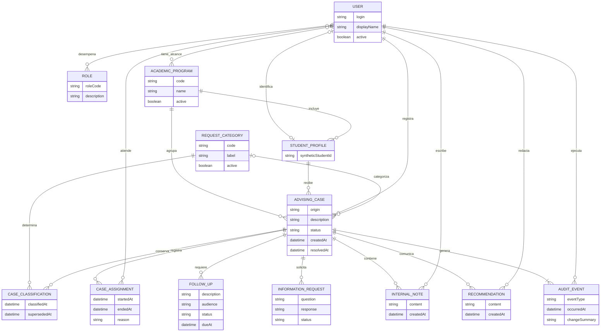
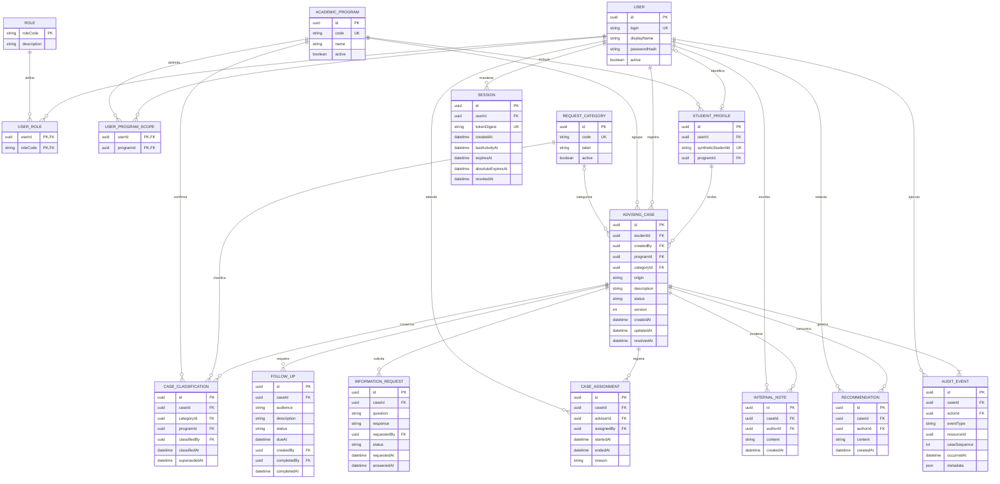

# DH-01 — Modelo de Dominio y Datos

**Architecture Drivers:** AD-01, AD-02, AD-03 y AD-04  
**Decisiones relacionadas:** ADR-001, ADR-002, ADR-003, ADR-004 y ADR-005  
**Tecnología de persistencia propuesta:** PostgreSQL

## 1. Propósito y alcance

Este documento define el modelo de dominio y la estructura lógica de datos del Academic Advising Case Management System (DH-01).

Su propósito es describir las entidades principales del sistema, sus atributos, relaciones, cardinalidades y restricciones de integridad, estableciendo cómo se representarán mediante un modelo relacional.

El diseño responde a las necesidades de registro, clasificación, asignación, seguimiento y resolución de casos de asesoría académica. También contempla la separación entre información confidencial y recomendaciones destinadas al estudiante, junto con la conservación de un historial auditable.

DH-01 no reemplazará al Student Information System (SIS) ni almacenará expedientes académicos oficiales. Para el prototipo se utilizarán usuarios y datos sintéticos.

Se distinguen tres niveles de representación:

- **Modelo conceptual entidad-relación:** describe las entidades académicas, sus atributos y asociaciones desde la perspectiva del dominio.
- **Modelo lógico relacional:** transforma las entidades en tablas, columnas, claves primarias, claves foráneas y restricciones.
- **Persistencia técnica de soporte:** incorpora información necesaria para mecanismos transversales, como las sesiones de autenticación, sin convertirla en parte del dominio académico.

La tabla técnica `SESSION`, definida en el diseño de seguridad, se incorpora al modelo lógico para mantener consistencia con ADR-004. No modifica el ciclo de vida de los casos ni introduce una nueva entidad académica.

## 2. Modelo conceptual entidad-relación

El dominio se organiza alrededor de `AdvisingCase`, que representa una solicitud de asesoría académica.

Cada caso pertenece a un estudiante y conserva su identidad durante la clasificación, asignación, seguimiento y resolución.

El estudiante relacionado con el caso y el usuario que registra la solicitud pueden ser personas diferentes. Esto permite representar solicitudes realizadas por estudiantes y referencias registradas por Program Coordinators.

### 2.1. Entidades del dominio

| Entidad | Descripción | Atributos relevantes |
|---|---|---|
| User | Persona autorizada para utilizar el sistema. | Login, nombre, estado de cuenta. |
| Role | Función institucional de acceso. | Código, descripción. |
| AcademicProgram | Programa académico asociado a estudiantes y casos. | Código, nombre, estado. |
| StudentProfile | Identificación académica mínima del estudiante. | Identificador sintético, programa. |
| RequestCategory | Categoría utilizada para clasificar solicitudes. | Código, descripción, estado. |
| AdvisingCase | Solicitud de asesoría académica. | Descripción, origen, estado, fechas. |
| CaseClassification | Resultado de la clasificación formal. | Categoría, programa, fecha. |
| CaseAssignment | Asignación de responsabilidad a un Academic Adviser. | Inicio, finalización, motivo. |
| FollowUp | Actividad de seguimiento. | Descripción, audiencia, estado, vencimiento. |
| InformationRequest | Solicitud de información adicional. | Pregunta, respuesta, estado. |
| InternalNote | Observación confidencial. | Contenido, autor, fecha. |
| Recommendation | Orientación destinada al estudiante. | Contenido, autor, fecha. |
| AuditEvent | Registro histórico de una operación relevante. | Tipo, actor, fecha, cambio. |

`User` y `Role` mantienen una relación de muchos a muchos. La autorización por programa también se representa como una relación entre `User` y `AcademicProgram`.

Estas asociaciones se transformarán en tablas intermedias dentro del modelo lógico.

Las sesiones de autenticación se consideran persistencia técnica y no aparecen en el modelo conceptual académico.

### 2.2. Diagrama conceptual



**Figura D-DATA-01.** Modelo conceptual entidad-relación de DH-01.

El diagrama identifica las entidades y asociaciones principales sin incorporar claves foráneas propias del modelo relacional.

Un estudiante puede tener múltiples casos. Cada caso puede conservar varias asignaciones históricas, actividades de seguimiento, recomendaciones y eventos de auditoría.

La relación opcional entre `User` y `StudentProfile` permite representar estudiantes referidos por un coordinador que todavía no disponen de una cuenta.

La cardinalidad mínima del historial expresa una invariante de negocio: la creación de un caso y su evento `CASE_CREATED` deben confirmarse conjuntamente.

### 2.3. Reglas conceptuales del dominio

1. Cada caso corresponderá a un estudiante identificado.
2. Una solicitud podrá ser creada por un Student o mediante una referencia autorizada de un Program Coordinator.
3. La asignación inicial requerirá una clasificación formal concluida.
4. Un caso podrá conservar varias asignaciones históricas, pero tendrá como máximo una vigente.
5. Las notas internas y las recomendaciones serán entidades diferentes.
6. Cada caso conservará su historial de eventos relevantes.
7. Las transiciones se controlarán mediante las reglas del ciclo de vida.
8. La resolución requerirá verificar las condiciones de cierre.
9. Las modificaciones estarán sujetas a autorización y control de concurrencia.
10. Los datos técnicos de autenticación no modificarán directamente las reglas del proceso académico.

Las políticas sobre reapertura, cancelación de actividades y permisos excepcionales permanecerán sujetas a validación institucional.

## 3. Modelo lógico relacional

El modelo lógico transforma las entidades conceptuales en estructuras relacionales que podrán implementarse en PostgreSQL.

Se incorporan claves primarias (`PK`), claves foráneas (`FK`), restricciones únicas (`UK`) y atributos necesarios para mantener la información consistente.

Las relaciones de muchos a muchos se representan mediante tablas intermedias. También se incorpora `SESSION` como tabla técnica administrada por CMP-02 — Authentication & Authorization.

### 3.1. Tablas principales

| Tabla | Clave primaria | Principales claves foráneas |
|---|---|---|
| USER | id | — |
| ROLE | roleCode | — |
| USER_ROLE | userId, roleCode | USER, ROLE |
| ACADEMIC_PROGRAM | id | — |
| USER_PROGRAM_SCOPE | userId, programId | USER, ACADEMIC_PROGRAM |
| STUDENT_PROFILE | id | USER, ACADEMIC_PROGRAM |
| REQUEST_CATEGORY | id | — |
| ADVISING_CASE | id | STUDENT_PROFILE, USER, ACADEMIC_PROGRAM, REQUEST_CATEGORY |
| CASE_CLASSIFICATION | id | ADVISING_CASE, REQUEST_CATEGORY, ACADEMIC_PROGRAM, USER |
| CASE_ASSIGNMENT | id | ADVISING_CASE, USER |
| FOLLOW_UP | id | ADVISING_CASE, USER |
| INFORMATION_REQUEST | id | ADVISING_CASE, USER |
| INTERNAL_NOTE | id | ADVISING_CASE, USER |
| RECOMMENDATION | id | ADVISING_CASE, USER |
| AUDIT_EVENT | id | ADVISING_CASE, USER |

**Tabla técnica de soporte:**

| Tabla | Clave primaria | Clave foránea | Responsabilidad |
|---|---|---|---|
| SESSION | id | USER | Persistir sesiones opacas de autenticación. |

Las claves primarias compuestas de `USER_ROLE` y `USER_PROGRAM_SCOPE` impedirán duplicar asociaciones.

`SESSION` podrá contener varios registros correspondientes a un usuario, conforme a la política de sesiones adoptada.

### 3.2. Diagrama lógico relacional



**Figura D-DATA-02.** Modelo lógico relacional propuesto para DH-01, incluida la persistencia técnica de sesiones.

El modelo representa las tablas principales, sus atributos, claves primarias, claves foráneas y relaciones de integridad.

Los campos `createdBy`, `assignedBy`, `classifiedBy`, `requestedBy`, `completedBy` y otros identificadores de actores conservarán referencias válidas a `USER`, aunque algunas líneas se omitan para facilitar la lectura.

Los campos opcionales, como `StudentProfile.userId`, `AdvisingCase.categoryId`, `Session.revokedAt` y determinadas fechas, podrán ser nulos según las reglas del dominio.

### 3.3. Diccionario de atributos principales

**User y StudentProfile**

| Campo | Tipo lógico | Restricción |
|---|---|---|
| User.id | UUID | PK obligatoria. |
| User.login | Texto | Único y obligatorio. |
| User.passwordHash | Texto | Obligatorio para cuentas locales; nunca expuesto por API. |
| User.active | Booleano | Obligatorio. |
| StudentProfile.id | UUID | PK obligatoria. |
| StudentProfile.userId | UUID | FK opcional y única cuando exista. |
| StudentProfile.syntheticStudentId | Texto | Identificador sintético único. |
| StudentProfile.programId | UUID | FK obligatoria. |

`StudentProfile.userId` será opcional para permitir referencias académicas de estudiantes sin cuenta.

El identificador sintético externo no reemplazará la clave primaria UUID del perfil.

**AdvisingCase**

| Campo | Tipo lógico | Restricción |
|---|---|---|
| id | UUID | PK. |
| studentId | UUID | FK obligatoria. |
| createdBy | UUID | FK obligatoria. |
| origin | Enumeración | STUDENT_REQUEST o PROGRAM_REFERRAL. |
| description | Texto | Obligatorio. |
| categoryId | UUID | FK opcional antes de la clasificación. |
| programId | UUID | FK obligatoria. |
| status | Enumeración | Uno de los siete estados. |
| version | Entero | Positivo, inicia en 1. |
| createdAt | Fecha y hora | Asignada por el servidor. |
| updatedAt | Fecha y hora | Última modificación confirmada. |
| resolvedAt | Fecha y hora | Nula hasta la resolución. |

Los estados permitidos son:

- `NEW`
- `UNDER_TRIAGE`
- `ASSIGNED`
- `IN_PROGRESS`
- `WAITING_FOR_INFORMATION`
- `FOLLOW_UP`
- `RESOLVED`

El campo `categoryId` podrá reflejar una categoría inicial propuesta por el usuario, pero no sustituirá la clasificación formal registrada mediante `CaseClassification`.

**CaseClassification**

| Campo | Restricción |
|---|---|
| caseId | FK obligatoria al caso. |
| categoryId | FK obligatoria a una categoría válida. |
| programId | FK obligatoria al programa confirmado. |
| classifiedBy | FK al usuario que clasificó. |
| classifiedAt | Fecha de clasificación. |
| supersededAt | Nula mientras sea vigente. |

La clasificación vigente se identificará mediante `supersededAt IS NULL`.

La reclasificación con historial se considera una extensión futura.

**CaseAssignment**

| Campo | Restricción |
|---|---|
| caseId | FK obligatoria. |
| adviserId | FK al Academic Adviser. |
| assignedBy | FK al actor que asignó. |
| startedAt | Fecha de inicio. |
| endedAt | Nula mientras sea vigente. |
| reason | Motivo de la operación, obligatorio cuando corresponda. |

Se conservará el historial sin sobrescribir asignaciones anteriores.

Un caso `RESOLVED` podrá conservar su última asignación como responsabilidad histórica, sin permitir por ello nuevas operaciones de atención.

**FollowUp**

| Campo | Restricción |
|---|---|
| caseId | FK obligatoria. |
| audience | INTERNAL o STUDENT. |
| description | Texto de actividad. |
| status | PENDING o COMPLETED. |
| dueAt | Fecha límite opcional. |
| createdBy | FK al creador. |
| completedBy | FK opcional. |
| completedAt | Fecha de finalización opcional. |

Un FollowUp `PENDING` representa una actividad no completada.

**Cualquier FollowUp pendiente impedirá resolver el caso**, conforme a las reglas iniciales del ciclo de vida.

La cancelación, reapertura o distinción entre actividades obligatorias y opcionales requerirá una política adicional.

**InformationRequest**

| Campo | Restricción |
|---|---|
| caseId | FK obligatoria. |
| question | Solicitud al estudiante. |
| response | Nula mientras esté abierta. |
| requestedBy | FK al solicitante. |
| status | OPEN o ANSWERED. |
| requestedAt | Fecha de solicitud. |
| answeredAt | Fecha de respuesta aceptada. |

Se propone permitir como máximo una solicitud `OPEN` por caso, pendiente de validación institucional.

Una respuesta aceptada cambiará el registro a `ANSWERED` y permitirá recalcular el estado del caso conforme a las demás condiciones.

**InternalNote y Recommendation**

Ambas entidades tendrán identificador, referencia al caso, autor, contenido y fecha.

Se mantienen separadas para evitar que una consulta destinada al estudiante exponga información confidencial.

`InternalNote` no deberá aparecer en respuestas de estudiantes, aunque el estudiante sea propietario del caso.

**AuditEvent**

| Campo | Restricción |
|---|---|
| id | PK. |
| caseId | FK obligatoria. |
| actorId | FK obligatoria. |
| eventType | Tipo de operación. |
| resourceId | Recurso afectado cuando corresponda. |
| caseSequence | Secuencia única dentro del caso. |
| occurredAt | Fecha y hora. |
| metadata | Información estructurada mínima. |

La combinación `(caseId, caseSequence)` deberá ser única.

`caseSequence` representa el orden de los eventos de un caso, mientras que `AdvisingCase.version` representa la versión de sus modificaciones de negocio.

Una transacción podrá generar varios eventos sin que ambos contadores sean equivalentes.

Los metadatos no deberán duplicar contenido confidencial.

**Session — persistencia técnica de autenticación**

| Campo | Tipo lógico | Restricción |
|---|---|---|
| id | UUID | PK técnica. |
| userId | UUID | FK obligatoria a USER. |
| tokenDigest | Texto | Único y obligatorio. |
| createdAt | Fecha y hora | Creación de sesión. |
| lastActivityAt | Fecha y hora | Última actividad considerada. |
| expiresAt | Fecha y hora | Expiración por inactividad. |
| absoluteExpiresAt | Fecha y hora | Expiración absoluta. |
| revokedAt | Fecha y hora | Nula mientras no esté revocada. |

La tabla `SESSION` almacenará un resumen criptográfico del identificador de sesión, no el token reutilizable en texto claro.

La cookie de sesión no contendrá contraseñas, roles ni información académica.

La sesión será válida únicamente cuando:

- No esté revocada.
- No haya superado su expiración por inactividad.
- No haya superado su expiración absoluta.
- La cuenta asociada permanezca activa.

Los valores iniciales propuestos son **30 minutos de inactividad y 8 horas de duración absoluta**, sujetos a validación institucional.

Los tokens CSRF se vincularán al contexto de sesión mediante el mecanismo definido en [Security Design](security.md).

## 4. Restricciones de integridad y consistencia

### 4.1. Integridad estructural

El diseño utilizará identificadores UUID, claves primarias, claves foráneas y restricciones de PostgreSQL.

Las fechas correspondientes a instantes se almacenarán utilizando `TIMESTAMPTZ` y se manejarán consistentemente en UTC.

| Restricción | Mecanismo |
|---|---|
| Login único | UNIQUE. |
| Identificador sintético único | UNIQUE. |
| Cuenta opcional vinculada a perfil | FK y UNIQUE cuando exista. |
| Relaciones válidas entre entidades | FK. |
| Una asignación vigente por caso | Índice único parcial. |
| Una clasificación vigente por caso | Índice único parcial. |
| Una InformationRequest OPEN por caso | Índice único parcial propuesto. |
| Fechas de asignación coherentes | CHECK. |
| Actividad completada identificable | Validación de estado, actor y fecha. |
| Orden de eventos por caso | UNIQUE sobre caseId y caseSequence. |
| Identificador de sesión protegido | UNIQUE sobre tokenDigest. |
| Expiración de sesiones coherente | CHECK y validaciones del backend. |
| Conservación histórica | Evitar eliminación ordinaria en cascada. |

**Ejemplos de restricciones para clasificaciones y asignaciones:**

```sql
CREATE UNIQUE INDEX uq_case_assignment_active
ON case_assignment (case_id)
WHERE ended_at IS NULL;

CREATE UNIQUE INDEX uq_case_classification_active
ON case_classification (case_id)
WHERE superseded_at IS NULL;
```

**Solicitud de información abierta:**

```sql
CREATE UNIQUE INDEX uq_information_request_open
ON information_request (case_id)
WHERE status = 'OPEN';
```

Esta última restricción depende de la aprobación institucional de la política de una sola solicitud abierta por caso.

**Restricciones de sesiones:**

```sql
CREATE UNIQUE INDEX uq_session_token_digest
ON session (token_digest);

ALTER TABLE session
ADD CONSTRAINT ck_session_absolute_expiry
CHECK (absolute_expires_at > created_at);

ALTER TABLE session
ADD CONSTRAINT ck_session_inactivity_expiry
CHECK (
    expires_at > created_at
    AND expires_at <= absolute_expires_at
);
```

Estas restricciones comprueban la consistencia de los valores almacenados, pero no sustituyen la verificación de expiración, revocación y estado de la cuenta desde CMP-02.

Los ejemplos SQL expresan el diseño propuesto y deberán adaptarse a las convenciones de las migraciones.

### 4.2. Invariantes del negocio

Las condiciones principales serán:

1. Todo caso tendrá un estudiante y un actor de creación identificables.
2. La asignación inicial requerirá clasificación concluida y un asesor habilitado.
3. Los estados `ASSIGNED`, `IN_PROGRESS`, `WAITING_FOR_INFORMATION` y `FOLLOW_UP` requerirán una asignación vigente.
4. Un caso `RESOLVED` conservará su historial y la identidad de su último responsable.
5. La resolución cumplirá las condiciones de cierre.
6. Las notas internas no aparecerán en respuestas destinadas al estudiante.
7. Las modificaciones con auditoría obligatoria se confirmarán junto con sus eventos.
8. No habrá más de una clasificación o asignación vigente por caso.
9. `WAITING_FOR_INFORMATION` requerirá una InformationRequest `OPEN`.
10. `FOLLOW_UP` requerirá al menos un FollowUp `PENDING`.

La resolución de un caso requerirá simultáneamente:

- Estado `IN_PROGRESS`.
- Academic Adviser vigente y autorizado.
- Al menos una `Recommendation`.
- Ningún FollowUp `PENDING`.
- Ninguna InformationRequest `OPEN`.
- Coincidencia entre la versión esperada y la vigente.

Estas reglas se desarrollan en [Lifecycle and Runtime](lifecycle-and-runtime.md) y deberán contrastarse con BR-05.

### 4.3. Transacciones y concurrencia

`AdvisingCase` será el punto común de coordinación para las operaciones que afectan el ciclo de vida.

Las operaciones críticas deberán iniciar una transacción y bloquear la fila del caso antes de modificar estados, asignaciones, seguimientos o condiciones de cierre.

El bloqueo podrá realizarse mediante:

```sql
SELECT id, status, version
FROM advising_case
WHERE id = $1
FOR UPDATE;
```

Después de obtener el bloqueo, el backend deberá releer los datos pertinentes y verificar las autorizaciones, el estado vigente y las condiciones del dominio.

Se propone utilizar `READ COMMITTED` como nivel inicial de aislamiento junto con un protocolo consistente de bloqueo.

La versión del caso permitirá detectar solicitudes desactualizadas y evitar sobrescrituras silenciosas.

Las operaciones relacionadas deberán compartir una única transacción. Por ejemplo, una reasignación confirmará conjuntamente:

- Finalización de la asignación anterior.
- Registro de la nueva asignación.
- Actualización de `AdvisingCase.version`.
- Creación del evento obligatorio de auditoría.

Si una operación falla, se revertirá toda la transacción.

La creación de un caso es una excepción al bloqueo de una fila preexistente: el nuevo caso y su evento `CASE_CREATED` se insertarán en la misma transacción.

### 4.4. Coordinación de auditoría y sesiones

Cada evento tendrá un `caseSequence` único dentro de su caso.

La secuencia se asignará transaccionalmente para impedir duplicados en operaciones concurrentes.

Cuando una transacción produzca varios eventos, por ejemplo `CASE_CLASSIFIED` y `CASE_ASSIGNED`, cada uno recibirá una secuencia distinta.

El número de versión del caso no será equivalente a la cantidad de eventos históricos.

Las operaciones sobre `SESSION` serán responsabilidad de CMP-02, mediante sus propias transacciones.

Crear, renovar o revocar una sesión no modificará `AdvisingCase.version` ni generará automáticamente un evento académico.

Los intentos de autenticación y accesos denegados podrán registrarse como eventos técnicos de seguridad, separados del historial del caso.

## 5. Auditoría y propiedad de la información

### 5.1. Responsabilidades de los componentes

| Información | Componente responsable |
|---|---|
| Usuarios, roles, permisos y sesiones | CMP-02 — Authentication & Authorization |
| Casos y transiciones | CMP-03 — Case Management |
| Clasificaciones y asignaciones | CMP-04 — Triage & Assignment |
| Seguimiento e información adicional | CMP-05 — Follow-up & Resolution |
| Notas y recomendaciones | CMP-06 — Notes & Confidentiality |
| Consultas operacionales | CMP-07 — Reporting & Queries |
| Eventos históricos | CMP-08 — Audit & History |
| Persistencia y transacciones | CMP-09 — Persistence Layer |
| Contexto académico sintético | CMP-10 — SIS Integration Adapter |

Aunque los componentes comparten PostgreSQL, cada uno deberá respetar las responsabilidades e interfaces internas definidas.

`C-WEB` no tendrá acceso directo a PostgreSQL.

La tabla `SESSION` será administrada por CMP-02 mediante CMP-09 y no aparecerá en representaciones de casos o reportes académicos.

### 5.2. Eventos de auditoría

El catálogo inicial incluirá:

| Evento | Operación |
|---|---|
| CASE_CREATED | Creación de solicitud o referencia. |
| TRIAGE_STARTED | Inicio de clasificación. |
| CASE_CLASSIFIED | Clasificación concluida. |
| CASE_ASSIGNED | Asignación inicial. |
| CASE_STARTED | Inicio de atención. |
| CASE_REASSIGNED | Cambio de responsable. |
| INFORMATION_REQUESTED | Solicitud de información. |
| INFORMATION_ANSWERED | Registro de respuesta. |
| FOLLOW_UP_CREATED | Creación de seguimiento. |
| FOLLOW_UP_COMPLETED | Finalización de seguimiento. |
| NOTE_CREATED | Creación de nota interna. |
| RECOMMENDATION_CREATED | Registro de orientación. |
| CASE_RESOLVED | Resolución de caso. |

Los eventos conservarán referencias a actores, casos y recursos relevantes sin incluir información confidencial innecesaria.

Por ejemplo, `NOTE_CREATED` podrá registrar el identificador de la nota y su autor sin copiar el contenido de la observación.

Los eventos de negocio confirmados serán distintos de los logs técnicos y los registros de intentos fallidos.

### 5.3. Orden y conservación

`AuditEvent.caseSequence` permitirá reconstruir el orden de las operaciones confirmadas dentro de un caso.

La asignación de secuencias deberá ser transaccional, evitando duplicados.

Las cuentas desactivadas y los responsables históricos deberán permanecer identificables para conservar la trazabilidad.

No se utilizará eliminación ordinaria en cascada sobre casos, usuarios o registros necesarios para reconstruir el historial.

Las sesiones expiradas podrán eliminarse mediante una política técnica de mantenimiento, sin afectar la auditoría académica.

## 6. Consultas y evolución del esquema

### 6.1. Datos derivados

| Información | Fuente | Regla |
|---|---|---|
| Responsable actual | CaseAssignment | Asignación vigente, sin duplicar un campo editable. |
| Caso abierto | AdvisingCase.status | Estado distinto de RESOLVED. |
| Seguimiento vencido | FollowUp | PENDING y dueAt anterior al momento de consulta. |
| Carga de asesor | Asignaciones y casos | Contar asignaciones vigentes de casos abiertos. |
| Solicitudes pendientes | InformationRequest | Estado OPEN. |
| Actividades pendientes | FollowUp | Estado PENDING. |
| Historial del caso | AuditEvent | Orden por caseSequence. |
| Sesión válida | Session, User y tiempo actual | Sin revocación, sin expiración y con usuario activo. |

Los indicadores calculados no sustituirán las validaciones transaccionales de las operaciones de modificación.

Las sesiones serán consultadas mediante los mecanismos de autenticación, no desde reportes académicos.

### 6.2. Índices y rendimiento

Se evaluarán índices sobre:

- Estudiante.
- Estado del caso.
- Programa académico.
- Categoría.
- Fecha de creación.
- Asignación vigente.
- Fechas límite de seguimiento.
- Solicitudes de información abiertas.
- Identificador y secuencia de auditoría.
- `Session.tokenDigest`.
- `Session.userId`.
- Fechas de expiración de sesiones.

La selección definitiva dependerá de los patrones de consulta y de las verificaciones de QS-04.

Los índices propuestos no constituyen por sí solos evidencia de cumplimiento de rendimiento.

### 6.3. Migraciones y datos sintéticos

El esquema evolucionará mediante migraciones versionadas.

Cada migración deberá documentar los cambios y su compatibilidad con el backend.

Se utilizarán semillas reproducibles que incluyan:

- Usuarios y roles ficticios.
- Programas y categorías.
- Estudiantes sintéticos.
- Casos en diferentes estados.
- Clasificaciones y asignaciones.
- Seguimientos y solicitudes de información.
- Notas y recomendaciones.
- Eventos de auditoría.

La tabla `SESSION` se incorporará mediante una migración compatible con ADR-004.

Se podrán generar sesiones sintéticas para probar expiración, revocación y cuentas desactivadas, evitando reutilizar secretos reales.

Los conjuntos de datos para pruebas funcionales y de seguridad se mantendrán diferenciados de los utilizados para rendimiento.

### 6.4. Extensiones futuras

Se consideran posibles extensiones, sujetas a requisitos adicionales:

- Reapertura de casos.
- Reclasificación con historial.
- Varias solicitudes abiertas de información.
- Seguimientos opcionales o cancelables.
- Delegación excepcional de permisos.
- Políticas de retención y anonimización.
- Administración institucional de cuentas.
- Reglas adicionales de concurrencia y revocación global de sesiones.

Estas posibilidades no forman parte automáticamente de las funcionalidades comprometidas en el diseño inicial.

## 7. Validación y trazabilidad

### 7.1. Riesgos principales

| Riesgo | Consecuencia | Verificación prevista |
|---|---|---|
| Asignaciones vigentes duplicadas | Responsabilidad ambigua. | Restricción única y prueba concurrente. |
| Clasificaciones vigentes duplicadas | Triage inconsistente. | Restricción única y prueba de clasificación. |
| Escrituras concurrentes | Pérdida de cambios. | T-LIFE-02. |
| Notas internas expuestas | Violación de confidencialidad. | T-SEC-01. |
| Auditoría no atómica | Historial incompleto. | Pruebas de auditoría y transacciones. |
| Información confidencial en eventos | Exposición innecesaria. | Revisión de metadatos. |
| Casos resueltos contados como activos | Reportes incorrectos. | Pruebas de consultas. |
| Categoría inicial tratada como clasificación formal | Asignación incorrecta. | T-TRIAGE-01. |
| Eliminación de actores históricos | Pérdida de atribución. | Integridad referencial. |
| Sesiones expiradas aceptadas | Acceso no autorizado. | Pruebas de autenticación. |
| Token de sesión expuesto | Riesgo de reutilización. | Revisión de cookies, almacenamiento y logs. |
| Sesiones de usuarios desactivados | Acceso de cuentas inhabilitadas. | Pruebas de seguridad. |

### 7.2. Relación con requisitos y decisiones

| Elemento | Requisitos y reglas | Decisiones y escenarios |
|---|---|---|
| Modelo de entidades | FR-01, FR-02, FR-07, FR-08 | ADR-002 |
| Clasificación y asignación | FR-03, FR-04, BR-01 a BR-03 | ADR-003, QS-02 |
| Ciclo de vida y cierre | FR-11, BR-05 | ADR-003, QS-02 |
| Confidencialidad | FR-12, FR-14, BR-07, BR-08 | ADR-004, QS-01 |
| Sesiones y autenticación | FR-14, QR-01 | ADR-004, QS-01 |
| Auditoría y transacciones | FR-05, FR-09, FR-10, BR-06 | ADR-005, QS-03 |
| Consultas y persistencia | FR-13, QR-06 | ADR-002, QS-04, QS-07 |

Las pruebas de cada elemento se definirán mediante los identificadores del [Plan de Validación](../validation/test-plan.md).

Los resultados observados se documentarán en [Validation Findings](../validation/findings.md).

### 7.3. Documentos relacionados

- [Vista de Componentes](../views/component-view.md)
- [Vista de Contenedores](../views/container-view.md)
- [Architecture Decision Records](../adr/README.md)
- [Requirements and Drivers](../requirements-and-drivers.md)
- [Quality Scenarios](../quality-scenarios.md)
- [Lifecycle and Runtime](lifecycle-and-runtime.md)
- [API Contracts](interfaces.md)
- [Security Design](security.md)
- [Validation Plan](../validation/test-plan.md)
- [Traceability Matrix](../traceability.md)

## 8. Conclusión

El modelo de dominio de DH-01 se organiza alrededor de `AdvisingCase`, conservando la identidad de los estudiantes, la responsabilidad de atención y la trazabilidad de cada operación.

El modelo conceptual describe las entidades, sus atributos principales y las relaciones del proceso de asesoría académica.

El modelo lógico relacional transforma estas entidades en tablas con claves, relaciones y restricciones, proporcionando una base concreta para PostgreSQL.

Se incorpora `SESSION` como estructura técnica de soporte para las sesiones opacas administradas por C-API, sin modificar el dominio académico.

Las reglas propuestas buscan garantizar consistencia en clasificación, asignaciones, seguimiento, resolución y auditoría, manteniendo la confidencialidad de las notas internas y el control sobre las operaciones concurrentes.

Este documento establece la base de persistencia sobre la que se apoyan el ciclo de vida, los contratos de interfaces y el diseño de seguridad del Academic Advising Case Management System.