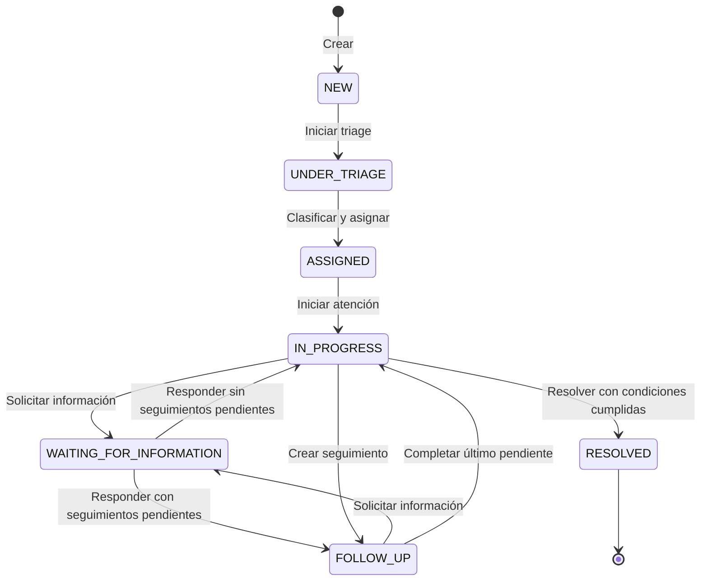
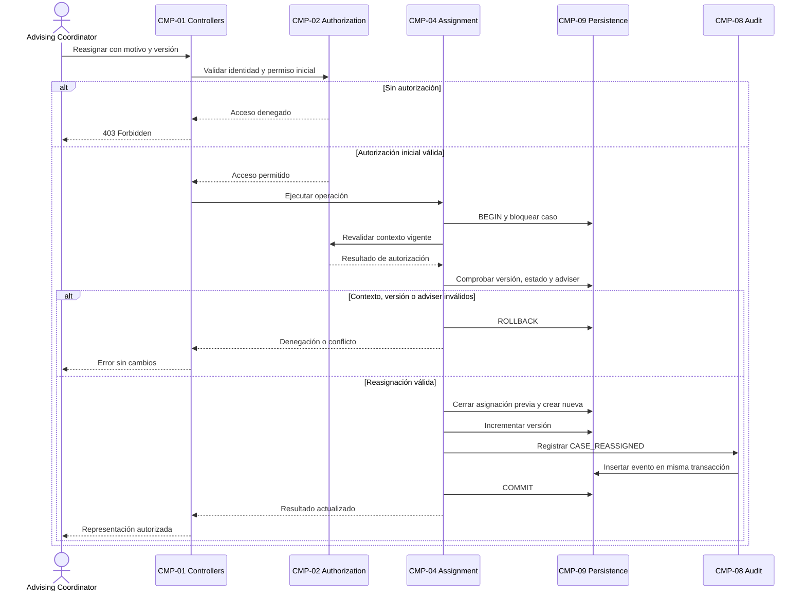
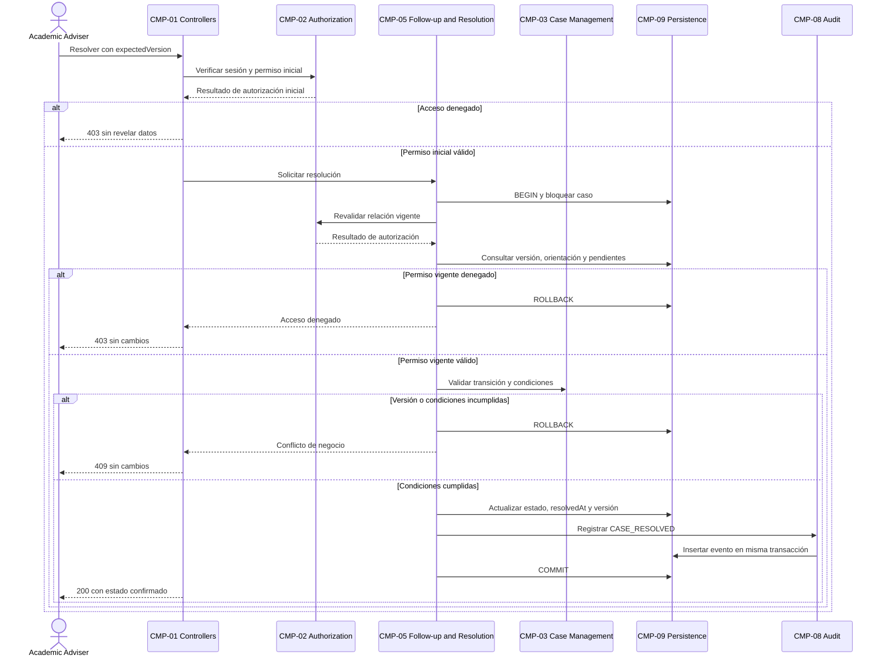

# DH-01 — Ciclo de Vida e Interacciones

**Architecture Drivers:** AD-01, AD-03 y AD-04  
**Decisiones relacionadas:** ADR-003 y ADR-005

## 1. Propósito

Este documento define el comportamiento del ciclo de vida de los casos de asesoría académica de DH-01, las transiciones permitidas y la colaboración entre los componentes del backend.

El modelo contempla siete estados, definidos conforme a ADR-003. Las transiciones representan operaciones de negocio autorizadas: `C-API` no permitirá modificar libremente el campo `status` desde la interfaz.

También se describen los flujos críticos, las reglas transaccionales, el manejo de errores y los escenarios de concurrencia necesarios para mantener la integridad y trazabilidad de los casos.

Las políticas operacionales pendientes, incluyendo retrasos, escalamiento, delegación y reapertura, deberán validarse con Horizon University conforme a BR-09.

## 2. Estados

El ciclo de vida utiliza los siguientes estados:

| Estado | Significado | Condición principal |
|---|---|---|
| `NEW` | Solicitud registrada. | Estudiante y origen identificados. |
| `UNDER_TRIAGE` | Evaluación y clasificación inicial. | Triage iniciado por actor autorizado. |
| `ASSIGNED` | Responsable inicial establecido. | Clasificación concluida y asignación vigente. |
| `IN_PROGRESS` | Atención académica activa. | Academic Adviser vigente atiende el caso. |
| `WAITING_FOR_INFORMATION` | Espera de información adicional. | Existe una solicitud de información abierta. |
| `FOLLOW_UP` | Ejecución de actividades de seguimiento. | Existe al menos un FollowUp pendiente. |
| `RESOLVED` | Atención finalizada. | Resolución aceptada y ausencia de pendientes. |

Los casos conservarán a su responsable durante los estados de espera y seguimiento.

El estado `RESOLVED` conservará la última asignación y el historial, pero no permitirá nuevas acciones ordinarias de atención.

La reapertura, cancelación y escalamiento no forman parte del flujo inicial mientras sus políticas institucionales no estén definidas.

## 3. Transiciones propuestas

Las transiciones permitidas se presentan en la siguiente tabla:

| Origen | Operación | Destino | Actor autorizado | Precondición |
|---|---|---|---|---|
| Sin caso | Crear solicitud o referencia | `NEW` | Student o Program Coordinator | Datos válidos y propiedad o alcance autorizado. |
| `NEW` | Iniciar triage | `UNDER_TRIAGE` | Advising Coordinator o delegado autorizado | Caso existente y versión vigente. |
| `UNDER_TRIAGE` | Clasificar y asignar | `ASSIGNED` | Advising Coordinator o delegado autorizado | Categoría y programa válidos; adviser habilitado. |
| `ASSIGNED` | Iniciar atención | `IN_PROGRESS` | Academic Adviser asignado | Relación vigente comprobada. |
| `IN_PROGRESS` / `FOLLOW_UP` | Solicitar información | `WAITING_FOR_INFORMATION` | Academic Adviser asignado | Pregunta válida y ausencia de solicitud abierta. |
| `WAITING_FOR_INFORMATION` | Responder información | `IN_PROGRESS` o `FOLLOW_UP` | Student asociado | Respuesta válida; destino calculado según seguimientos pendientes. |
| `IN_PROGRESS` | Crear seguimiento | `FOLLOW_UP` | Academic Adviser asignado | Caso abierto y acción válida. |
| `FOLLOW_UP` | Completar último seguimiento pendiente | `IN_PROGRESS` | Academic Adviser asignado | Ningún FollowUp pendiente restante. |
| `IN_PROGRESS` | Resolver | `RESOLVED` | Academic Adviser asignado | Recomendación registrada y ausencia de pendientes. |

Para el flujo inicial se propone permitir como máximo una `InformationRequest` con estado `OPEN` por caso.

Al responder una solicitud de información, el Student no podrá elegir directamente el estado de destino. El servidor determinará si corresponde regresar a `IN_PROGRESS` o pasar a `FOLLOW_UP`.

Crear seguimientos adicionales durante `FOLLOW_UP` o `WAITING_FOR_INFORMATION` conservará el estado actual.

Completar un seguimiento mientras el caso espera información no modificará ese estado: la solicitud permanecerá en espera hasta recibir una respuesta válida.

Cualquier FollowUp `PENDING` impedirá resolver el caso, independientemente de su audiencia.

Las transiciones no contempladas serán rechazadas. Las operaciones que no modifican el estado se describen en la sección 9.

La delegación del triage requerirá un mecanismo explícito de concesión, alcance y revocación de permisos. Mientras no exista una política institucional aprobada, estas operaciones corresponderán al Advising Coordinator autorizado.

### 3.1. Diagrama de estados

**Figura D-LIFE-01.** Diagrama de estados propuesto para el ciclo de vida de DH-01.

El diagrama representa las transiciones que modifican el estado del caso. Las operaciones que conservan el estado, como completar un seguimiento durante `WAITING_FOR_INFORMATION`, se especifican posteriormente.

### 3.2. Reasignación y retrasos

La reasignación modificará el responsable del caso sin cambiar su estado.

Se propone permitirla en:

- `ASSIGNED`
- `IN_PROGRESS`
- `WAITING_FOR_INFORMATION`
- `FOLLOW_UP`

No se permitirá una reasignación ordinaria en `NEW`, `UNDER_TRIAGE` ni `RESOLVED`.

La operación conservará las notas, los seguimientos pendientes, las recomendaciones y el historial de responsabilidades.

**`OVERDUE` será un indicador calculado, no un octavo estado.**

Inicialmente, un FollowUp estará vencido cuando su estado sea `PENDING` y `dueAt` sea anterior al momento de consulta.

Las condiciones para declarar vencido un caso completo y las reglas de escalamiento permanecerán sujetas a definición institucional.

## 4. Reglas transaccionales

Las operaciones que modifican el ciclo de vida deberán preservar las reglas de negocio y la integridad de la información.

| Regla | Aplicación | Referencia |
|---|---|---|
| Clasificación previa | Verificar triage concluido antes de asignar. | BR-01, BR-02 |
| Responsable único | Cerrar la asignación anterior y crear la nueva conjuntamente. | FR-04, BR-03 |
| Resolución sin pendientes | Comprobar FollowUps pendientes e InformationRequests abiertas. | FR-11, BR-05 |
| Historial conservado | Registrar eventos obligatorios junto con los cambios confirmados. | FR-05, FR-10, BR-06 |
| Acceso contextual | Revalidar la relación vigente del usuario antes de modificar datos. | FR-14, BR-08 |

Cada operación de escritura que afecte las invariantes del caso deberá:

1. Iniciar una transacción.
2. Bloquear la fila del caso mediante el mecanismo definido en PostgreSQL.
3. Comprobar la versión esperada.
4. Revalidar la autorización con información vigente.
5. Verificar el estado y las reglas del dominio.
6. Ejecutar las modificaciones permitidas.
7. Registrar los eventos obligatorios de auditoría.
8. Confirmar la transacción si todas las condiciones se cumplen.

Si falla una validación o una escritura obligatoria, la operación deberá revertirse por completo.

El protocolo descrito en [Domain and Data Model](domain-and-data.md) se aplicará también a la creación y finalización de seguimientos, las respuestas de información, las notas y las recomendaciones que incrementen la versión del caso.

Las operaciones de creación inicial constituyen una excepción al bloqueo de una fila preexistente: el caso nuevo y su evento obligatorio se insertarán dentro de una misma transacción.

## 5. Flujos críticos

### 5.1. Creación y asignación

La creación de una solicitud, el inicio de triage y la clasificación con asignación son tres operaciones de negocio independientes.

Cada operación tendrá su propia transacción y sus eventos de auditoría. No se mantendrá una transacción abierta durante todo el proceso de atención.

**Operación 1 — Crear solicitud**

1. CMP-01 recibe la solicitud y valida su estructura.
2. CMP-02 verifica la identidad y la propiedad o el alcance autorizado.
3. CMP-03 crea el caso con estado `NEW`.
4. CMP-08 registra `CASE_CREATED` dentro de la misma transacción.
5. Se confirma la operación y el caso queda disponible para triage.

**Operación 2 — Iniciar triage**

1. CMP-02 verifica la autorización del actor.
2. CMP-03 bloquea el caso y comprueba que esté en `NEW`.
3. Se verifica la versión vigente.
4. El estado cambia a `UNDER_TRIAGE`.
5. CMP-08 registra `TRIAGE_STARTED`.
6. La transacción se confirma.

**Operación 3 — Clasificar y asignar**

1. CMP-04 recibe la categoría, el programa y el Academic Adviser seleccionado.
2. Se comprueban los permisos, la versión y la habilitación del responsable.
3. Se registran `CaseClassification` y `CaseAssignment`.
4. El estado cambia a `ASSIGNED`.
5. CMP-08 registra `CASE_CLASSIFIED` y `CASE_ASSIGNED`.
6. Se confirma la transacción y se devuelve el caso actualizado.

Un fallo no deberá dejar asignaciones incompletas ni eventos que indiquen un éxito inexistente.

Cuando una operación posterior sea rechazada, las operaciones anteriores que ya fueron confirmadas conservarán sus resultados válidos.

### 5.2. Reasignación

**Figura D-LIFE-02.** Secuencia de reasignación de un caso con autorización, control de concurrencia y auditoría transaccional.

La reasignación no modificará el estado del caso, pero sí su responsabilidad vigente y su versión.

El Academic Adviser anterior perderá los permisos derivados de la asignación vigente. Sus acciones anteriores permanecerán en el historial, disponible únicamente para usuarios autorizados.

### 5.3. Resolución y concurrencia

CMP-05 coordinará la resolución con CMP-03, CMP-09 y CMP-08.

Después de bloquear el caso, deberán comprobarse:

- La autorización vigente del Academic Adviser.
- El estado `IN_PROGRESS`.
- La coincidencia de `expectedVersion`.
- La existencia de al menos una `Recommendation`.
- La ausencia de FollowUps `PENDING`.
- La ausencia de InformationRequests `OPEN`.

Cuando las condiciones se cumplan, la transacción actualizará `status` a `RESOLVED`, establecerá `resolvedAt`, incrementará la versión y registrará `CASE_RESOLVED`.

Si una condición falla, la operación se rechazará sin modificar la información persistida.

Las operaciones de creación de seguimiento y resolución deberán utilizar el mismo protocolo de bloqueo.

Si el seguimiento se confirma primero, la resolución se rechazará por pendientes. Si la resolución se confirma primero, la creación del seguimiento se rechazará porque `RESOLVED` no admite nuevas acciones de atención.

### 5.4. Información y dependencia externa

Las consultas destinadas al Student devolverán únicamente información autorizada, como el estado de sus casos, recomendaciones y actividades cuya audiencia sea `STUDENT`.

CMP-06 controlará el acceso a notas internas mediante verificaciones específicas.

CMP-10 consultará `X-SIS` fuera de las transacciones que mantengan bloqueos sobre casos. Las respuestas externas deberán validarse antes de utilizarse.

Cuando una consulta externa sea necesaria para una modificación, el backend deberá volver a comprobar el contexto vigente antes de escribir.

Las operaciones independientes del SIS podrán continuar si el simulador está indisponible.

## 6. Excepciones y recuperación

El diseño contempla los siguientes escenarios:

| Situación | Respuesta esperada |
|---|---|
| Identidad inválida | Rechazar el acceso protegido. |
| Permiso insuficiente | Denegar sin exponer información restringida. |
| Versión desactualizada | Responder conflicto sin sobrescribir cambios. |
| Estado incompatible | Rechazar la transición. |
| Fallo de auditoría obligatoria | Revertir toda la operación. |
| PostgreSQL indisponible | No confirmar una operación no persistida. |
| Respuesta HTTP perdida después del COMMIT | Consultar estado e historial antes de repetir la escritura. |
| Reinicio de C-API | Restablecer servicio conservando registros confirmados. |
| X-SIS indisponible | Manejar error y permitir operaciones independientes. |

Los errores de autenticación, autorización, validación y concurrencia deberán utilizar respuestas HTTP acordes con los contratos definidos.

No se propone inicialmente un worker independiente ni una cola de procesamiento.

La idempotencia automática de escrituras requerirá un contrato adicional antes de habilitar reintentos transparentes.

## 7. Trazabilidad y validación

Los flujos definidos responden a los requisitos, drivers y escenarios de calidad establecidos para DH-01.

| Comportamiento | Requisitos / reglas | Driver / escenario | Pruebas relacionadas |
|---|---|---|---|
| Flujo completo | FR-01, FR-02, FR-06, FR-07, FR-08 | AD-01, AD-04, QS-06 | T-FUNC-01, T-UX-01 |
| Clasificación y asignación | FR-03, FR-04, BR-01, BR-02 | AD-01, QS-02 | T-TRIAGE-01 |
| Resolución | FR-11, BR-05 | AD-01, AD-04, QS-02 | T-LIFE-01 |
| Concurrencia | FR-08, FR-11, BR-05 | AD-01, QS-02 | T-LIFE-02 |
| Reasignación e historial | FR-05, FR-09, FR-10, BR-06 | AD-03, QS-03 | T-AUD-01, T-TXN-01 |
| Consulta según audiencia | FR-12, FR-14, BR-07, BR-08 | AD-02, QS-01 | T-SEC-01 |
| Fallos y reinicios | QR-06, C-05, C-06 | AD-07, QS-07 | T-SIS-01, T-REC-01 |

Las pruebas previstas verificarán tanto operaciones aceptadas como rechazos correctos, concurrencia, persistencia y confidencialidad.

Los procedimientos detallados se encuentran en:

- [Validation Plan](../validation/test-plan.md)
- [API Contracts](interfaces.md)
- [Security Design](security.md)

Los resultados de ejecución deberán documentarse en [Validation Findings](../validation/findings.md).

## 8. Especificación detallada de las operaciones de negocio

### 8.1. Registrar solicitud propia

**Objetivo:** permitir que un Student registre una necesidad de asesoría y obtenga una referencia verificable del caso.

**Precondiciones:** cuenta activa, sesión válida, perfil sintético existente y datos conformes al contrato.

**Flujo principal:**

1. Derivar `studentId` de la identidad autenticada.
2. Validar la descripción y la categoría declarada, cuando se proporcione.
3. Obtener el programa sintético del perfil, sin confiar en un programa impuesto por el cliente.
4. Crear `AdvisingCase` en `NEW`, con `version = 1`.
5. Registrar `CASE_CREATED` en la misma transacción.
6. Confirmar y devolver el identificador, el estado y la fecha de creación.

**Flujos alternativos:**

- La ausencia de categoría no impedirá la creación si se permite clasificación posterior.
- La ausencia de un perfil válido impedirá crear un caso sin estudiante identificado.
- Un fallo de auditoría obligatoria revertirá la creación.

**Postcondición:** existe un caso `NEW`, atribuible al Student, sin asignación definitiva ni triage concluido.

### 8.2. Registrar referencia autorizada

**Objetivo:** permitir que un Program Coordinator registre una referencia en nombre de un estudiante de su ámbito autorizado.

El coordinador será el actor de creación y el estudiante será el destinatario de la atención. Esta diferencia quedará reflejada en el origen y la auditoría.

**Flujo principal:**

1. Verificar el rol y alcance de programa.
2. Comprobar que `studentId` identifica un estudiante sintético autorizado.
3. Validar la información contextual aportada.
4. Crear el caso en `NEW`, con origen `PROGRAM_REFERRAL`.
5. Registrar `CASE_CREATED` con actor y origen correspondientes.
6. Confirmar y devolver una respuesta autorizada.

La operación se rechazará si el estudiante pertenece a un programa fuera del alcance permitido.

La creación de una referencia no concederá al Program Coordinator acceso automático a notas internas futuras.

### 8.3. Iniciar triage

El triage comenzará mediante una operación explícita de `NEW` a `UNDER_TRIAGE`.

No se considerará iniciado únicamente porque un usuario haya consultado el caso.

**Flujo principal:**

1. Comprobar el permiso del Advising Coordinator.
2. Bloquear el caso y comprobar la versión esperada.
3. Verificar el estado `NEW`.
4. Registrar la transición a `UNDER_TRIAGE`.
5. Insertar `TRIAGE_STARTED`.
6. Confirmar la operación.

Un delegado únicamente podrá ejecutar la operación si existe una autorización explícita válida conforme a las políticas aprobadas.

Las solicitudes repetidas basadas en una versión anterior deberán rechazarse sin duplicar eventos.

### 8.4. Clasificar y asignar

Esta operación combinará la clasificación formal del caso y su asignación inicial.

**Validaciones requeridas:**

- Categoría existente y activa.
- Programa académico coherente.
- Academic Adviser activo y habilitado.
- Ausencia de otra asignación vigente.
- Actor autorizado para concluir triage y asignar.
- Versión esperada coincidente.

La operación registrará conjuntamente:

- `CaseClassification`.
- `CaseAssignment`.
- Estado `ASSIGNED`.
- Evento `CASE_CLASSIFIED`.
- Evento `CASE_ASSIGNED`.
- Nueva versión del caso.

Todas las modificaciones pertenecerán a una misma transacción.

Los criterios de especialidad y carga podrán orientar la asignación manual, pero no se propone inicialmente un algoritmo automático ni una capacidad máxima institucional confirmada.

### 8.5. Iniciar atención

El Academic Adviser vigente podrá transformar `ASSIGNED` en `IN_PROGRESS`.

La operación deberá identificar al actor responsable y registrar el evento `CASE_STARTED`.

Si el adviser pierde la asignación entre la consulta del caso y el envío de la operación, la solicitud deberá rechazarse cuando se revalide su autorización.

Mantener una pantalla abierta no prolongará los permisos del usuario.

### 8.6. Solicitar y responder información

Una `InformationRequest` representa una pregunta concreta cuya respuesta es necesaria para continuar la atención.

El flujo inicial admite una sola solicitud `OPEN` por caso.

**Solicitar información:**

1. Verificar autorización del adviser vigente.
2. Comprobar que el caso esté en `IN_PROGRESS` o `FOLLOW_UP`.
3. Confirmar que no exista otra solicitud abierta.
4. Registrar la nueva InformationRequest.
5. Cambiar el caso a `WAITING_FOR_INFORMATION`.
6. Registrar `INFORMATION_REQUESTED`.
7. Confirmar la transacción.

**Responder información:**

1. Verificar que el Student esté asociado al caso.
2. Confirmar que `requestId` pertenezca al caso.
3. Validar que la solicitud esté `OPEN`.
4. Guardar la respuesta.
5. Cambiar la solicitud a `ANSWERED`.
6. Registrar `INFORMATION_ANSWERED`.
7. Calcular y actualizar el estado del caso.
8. Confirmar la transacción.

El destino se determinará así:

| Condición posterior a la respuesta | Estado del caso |
|---|---|
| Existen FollowUps `PENDING` | `FOLLOW_UP` |
| No existen FollowUps `PENDING` | `IN_PROGRESS` |

Una segunda respuesta sobre una solicitud `ANSWERED` será rechazada en el contrato inicial.

Las correcciones posteriores requerirán una operación diferenciada.

### 8.7. Crear y completar seguimiento

Un FollowUp podrá representar una actividad interna o una acción que el estudiante necesita conocer.

La audiencia se establecerá al crear el registro y no se modificará libremente.

**Creación:**

- Desde `IN_PROGRESS`, el caso pasará a `FOLLOW_UP`.
- Desde `FOLLOW_UP`, permanecerá en ese estado.
- Desde `WAITING_FOR_INFORMATION`, conservará el estado de espera.

**Finalización:**

En el flujo inicial, el Academic Adviser vigente será responsable de confirmar la finalización.

Si un estudiante informa que completó una actividad, ello no sustituirá automáticamente la confirmación institucional.

| Estado previo | Resultado al completar |
|---|---|
| `FOLLOW_UP`, con otros pendientes | Conservar `FOLLOW_UP`. |
| `FOLLOW_UP`, sin otros pendientes | Pasar a `IN_PROGRESS`. |
| `WAITING_FOR_INFORMATION` | Conservar `WAITING_FOR_INFORMATION`. |

Un FollowUp `COMPLETED` no regresará a `PENDING` mediante el contrato inicial.

Reabrir o cancelar actividades requerirá una política adicional.

### 8.8. Registrar orientación y notas

Las recomendaciones y las notas internas serán recursos diferentes.

Una `Recommendation` representa orientación destinada al estudiante, mientras que una `InternalNote` conserva observaciones restringidas al personal autorizado.

Ambas operaciones deberán:

1. Verificar identidad y permisos.
2. Validar la relación con el caso.
3. Comprobar el estado vigente.
4. Registrar el recurso correspondiente.
5. Incrementar la versión del caso.
6. Registrar el evento de auditoría obligatorio.
7. Confirmar la transacción.

Crear notas o recomendaciones no modificará por sí mismo el estado del caso.

Una InternalNote no satisfará automáticamente el requisito de orientación para resolver.

La condición inicial de resolución exigirá al menos una Recommendation registrada.

### 8.9. Resolver el caso

La resolución será una operación de negocio controlada, no una modificación libre del campo `status`.

| Verificación | Resultado si no se cumple |
|---|---|
| Academic Adviser vigente y autorizado | Denegación de acceso. |
| Estado `IN_PROGRESS` | Conflicto de transición. |
| Versión esperada vigente | Conflicto de versión. |
| Al menos una Recommendation | Conflicto por orientación ausente. |
| Ningún FollowUp `PENDING` | Conflicto por seguimiento pendiente. |
| Ninguna InformationRequest `OPEN` | Conflicto por información pendiente. |

En el diseño inicial, cualquier FollowUp pendiente impedirá resolver el caso.

La operación confirmada deberá actualizar:

- `status = RESOLVED`.
- `resolvedAt`.
- `version`.
- Evento `CASE_RESOLVED`.

Todos los cambios obligatorios deberán persistirse dentro de una misma transacción.

El evento de resolución conservará actor, fecha, estado anterior, estado nuevo y metadatos pertinentes, sin duplicar información confidencial.

## 9. Matriz de operaciones por estado

La siguiente matriz complementa las transiciones de la sección 3.

La disponibilidad de una operación según el estado no sustituye la autorización basada en rol, asignación y relación con el recurso.

| Operación | NEW | UNDER_TRIAGE | ASSIGNED | IN_PROGRESS | WAITING_FOR_INFORMATION | FOLLOW_UP | RESOLVED |
|---|---|---|---|---|---|---|---|
| Consulta autorizada | Sí | Sí | Sí | Sí | Sí | Sí | Sí |
| Iniciar triage | Sí | No | No | No | No | No | No |
| Clasificar y asignar | No | Sí | No | No | No | No | No |
| Iniciar atención | No | No | Sí | No | No | No | No |
| Reasignar | No | No | Sí | Sí | Sí | Sí | No |
| Solicitar información | No | No | No | Sí | No | Sí | No |
| Responder información | No | No | No | No | Sí | No | No |
| Crear seguimiento | No | No | No | Sí | Sí | Sí | No |
| Completar seguimiento | No | No | No | No | Sí | Sí | No |
| Registrar nota o recomendación | No | No | No | Sí | Sí | Sí | No |
| Resolver | No | No | No | Sí | No | No | No |

Completar seguimiento directamente en `IN_PROGRESS` no estará permitido porque un caso con seguimientos pendientes fuera de la espera de información deberá encontrarse en `FOLLOW_UP`.

Completar una actividad mientras el caso está en `WAITING_FOR_INFORMATION` actualizará el seguimiento, pero no modificará el estado de espera.

Si existen datos contradictorios, la situación deberá tratarse mediante diagnóstico y corrección controlada, no mediante una transición improvisada.

## 10. Secuencia de resolución con rechazo

El siguiente diagrama representa el proceso de resolución, incluyendo los controles de autorización, concurrencia, reglas de negocio y auditoría.

**Figura D-LIFE-03.** Secuencia de resolución con aceptación o rechazo controlado.

La autorización deberá comprobarse al recibir la solicitud y nuevamente después de bloquear el caso.

Una reasignación confirmada durante el proceso podrá invalidar los permisos derivados de la asignación anterior.

El rechazo será el comportamiento correcto cuando evite violar una regla de negocio o de seguridad.

## 11. Escenarios alternativos de concurrencia

### 11.1. Dos reasignaciones simultáneas

Dos coordinadores podrán consultar la misma versión del caso y seleccionar responsables diferentes.

El bloqueo transaccional y `expectedVersion` permitirán confirmar la primera operación válida y rechazar la segunda cuando su versión quede desactualizada.

El sistema no combinará automáticamente decisiones incompatibles.

El segundo actor deberá consultar el responsable vigente antes de volver a intentar la operación.

### 11.2. Reasignación y escritura del adviser anterior

Si una reasignación se confirma antes de que el adviser anterior registre una nota o seguimiento, la nueva operación deberá rechazarse por falta de autorización vigente.

Si la escritura se confirma antes de la reasignación, permanecerá registrada como una acción legítima anterior al cambio de responsabilidad.

La autorización deberá revalidarse después de obtener el bloqueo transaccional del caso.

### 11.3. Dos finalizaciones del mismo seguimiento

Si dos solicitudes intentan completar simultáneamente el mismo FollowUp:

- La primera operación válida podrá marcarlo `COMPLETED`.
- La segunda deberá rechazarse por conflicto de versión o estado.
- No se registrarán dos eventos de finalización confirmados para la misma acción.
- No se sobrescribirá silenciosamente la fecha de finalización.

### 11.4. Respuesta y nueva solicitud de información

Una nueva solicitud de información únicamente podrá registrarse cuando la anterior esté `ANSWERED` y el estado actual permita solicitar información.

Las operaciones utilizarán el bloqueo del caso para evitar que dos solicitudes `OPEN` sean confirmadas simultáneamente.

La restricción relacional propuesta sobre solicitudes abiertas actuará como protección complementaria.

## 12. Errores antes y después de COMMIT

La gestión de errores deberá distinguir entre fallos ocurridos antes de confirmar una transacción y situaciones donde la transacción se confirmó, pero la respuesta no llegó al cliente.

| Momento del fallo | Interpretación | Tratamiento |
|---|---|---|
| Antes de iniciar transacción | No existen cambios de negocio. | Rechazar entrada o autorización. |
| Durante validaciones bajo bloqueo | Operación no aceptada. | ROLLBACK y respuesta controlada. |
| Durante escritura o auditoría | No debe existir confirmación parcial. | ROLLBACK completo. |
| COMMIT con resultado incierto | Puede haberse confirmado la operación. | Consultar estado e historial antes de repetir. |
| Después del COMMIT al enviar HTTP | Operación confirmada y entrega fallida. | Recuperar representación sin revertir ficticiamente. |

Una respuesta HTTP perdida no significa necesariamente que la operación de negocio haya fallado.

Por ello, un reintento automático de escritura podría producir duplicados si no existe un mecanismo de idempotencia.

El contrato inicial exigirá recuperar el estado actualizado antes de repetir operaciones cuyo resultado sea incierto.

## 13. Notificaciones y tareas diferidas

El flujo inicial no presupone notificaciones por correo electrónico, mensajería, notificaciones push ni tareas automáticas de escalamiento.

Los usuarios consultarán las actividades pendientes, los estados y la información operacional mediante las interfaces autorizadas.

Si posteriormente se incorpora un mecanismo de notificaciones, será necesario definir:

- Evento que desencadena la notificación.
- Destinatario autorizado.
- Información que puede incluirse.
- Política de entrega y reintentos.
- Manejo de errores.
- Relación con la transacción principal.
- Condiciones de confidencialidad.

Las comunicaciones externas lentas no deberán ejecutarse mientras una transacción mantenga bloqueada la fila del caso.

Si se requiere procesamiento diferido, deberá evaluarse la incorporación de componentes adicionales y actualizar las vistas y decisiones arquitectónicas correspondientes.

No se incorporará un worker independiente únicamente por la existencia de actividades de seguimiento.

## 14. Criterios para validar el comportamiento

La revisión arquitectónica deberá comprobar la correspondencia entre el modelo de dominio, el diagrama de estados, las operaciones, las interfaces y las decisiones arquitectónicas.

La validación deberá incluir operaciones aceptadas, rechazos, concurrencia, persistencia y auditoría.

| Evidencia necesaria | Qué permite demostrar |
|---|---|
| Estado y versión antes y después | Transición o rechazo consistente. |
| FollowUps e InformationRequests | Ausencia real de pendientes al resolver. |
| Historial de asignaciones | Conservación de responsabilidades anteriores. |
| Eventos de auditoría | Correspondencia entre cambios de negocio e historial. |
| Ejecución concurrente controlada | Competencia real sobre el mismo caso. |
| Respuestas autorizadas | Visibilidad adecuada según rol y recurso. |
| Operaciones revertidas | Ausencia de modificaciones parciales. |
| Reinicio del backend | Persistencia de operaciones confirmadas. |

La validación no deberá depender únicamente de capturas de pantalla.

Las pruebas relacionadas con transiciones, concurrencia, reasignaciones y auditoría deberán conservar evidencia verificable sobre los datos persistidos.

Las pruebas principales incluyen:

- `T-LIFE-01`: reglas de ciclo de vida y resolución.
- `T-LIFE-02`: operaciones concurrentes.
- `T-AUD-01`: conservación del historial.
- Pruebas transaccionales relacionadas con atomicidad.
- `T-SEC-01`: protección de información restringida.

Los procedimientos detallados y las evidencias previstas se documentan en el [Plan de Validación](../validation/test-plan.md).

## 15. Decisiones operacionales pendientes

El diseño establece un flujo inicial acotado, pero algunas políticas deberán confirmarse con Horizon University.

Entre ellas:

- Quién podrá delegar operaciones de triage.
- Cómo se concederán, limitarán y revocarán permisos delegados.
- Qué criterios determinan que una orientación académica es suficiente para resolver.
- Si los estudiantes podrán corregir respuestas ya aceptadas.
- Cómo se cancelarán actividades de seguimiento.
- Bajo qué condiciones podrá reabrirse un caso resuelto.
- Qué circunstancias requerirán escalamiento.
- Cómo se determinará el retraso general de un caso.
- Si existirán seguimientos opcionales que no impidan la resolución.

Mientras no se defina una política diferente, cualquier FollowUp `PENDING` impedirá cerrar el caso.

La introducción de nuevas capacidades deberá reflejarse en el modelo de dominio, las interfaces, las reglas de autorización, los diagramas de comportamiento y las pruebas.

Esta propuesta conserva un ciclo de vida consistente y verificable, alineado con ADR-003 para transiciones y concurrencia, y ADR-005 para trazabilidad y auditoría persistente.