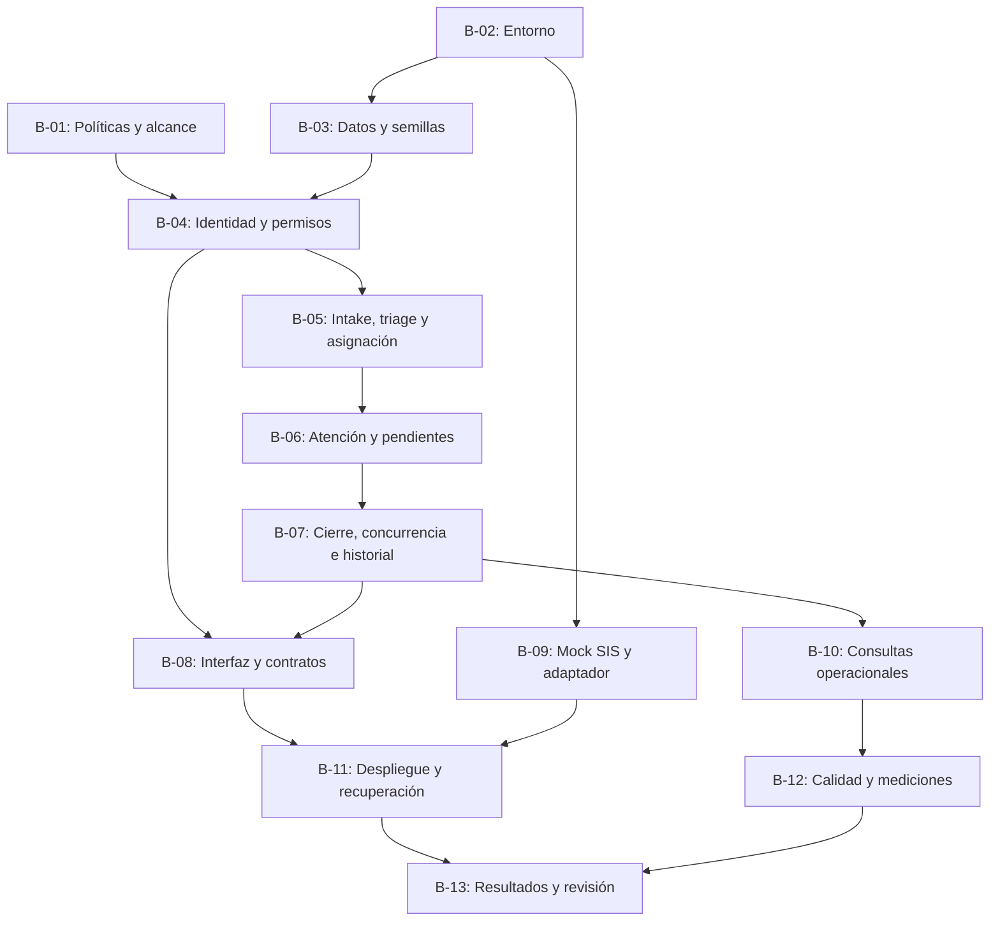

# DH-01 — Estado del Proyecto, Riesgos y Plan de Trabajo

**Proyecto:** Academic Advising Case Management System  
**Documento:** Evaluation 2 — Project Status, Risks and Work Plan  
**Estado general:** Diseño arquitectónico documentado; implementación y validación funcional no realizadas  
**Alcance:** Estado de la Evaluación 2 y planificación de actividades posteriores

## 1. Propósito y estado del proyecto

Este documento presenta el estado de DH-01, los riesgos identificados, las decisiones pendientes y el plan de trabajo propuesto para una posible fase de implementación y validación.

Su objetivo es distinguir entre los entregables documentales de la Evaluación 2 y las actividades técnicas que serían necesarias para construir y verificar el sistema.

La entrega actual comprende requisitos, decisiones arquitectónicas, vistas, modelos, contratos, mecanismos de seguridad, escenarios de calidad, trazabilidad y un plan de validación.

**No se incluye un prototipo funcional ni se presentan pruebas de implementación ejecutadas.**

Por tanto, las actividades de desarrollo y validación descritas en este documento representan planificación futura y no obligaciones técnicas ya completadas.

### 1.1. Criterios de estado

| Estado | Interpretación |
|---|---|
| Documentado | Existe un artefacto que describe el alcance, el comportamiento o el diseño. |
| Propuesto | Existe una decisión seleccionada que todavía puede requerir verificación o aprobación. |
| Pendiente | La actividad aún no se ha realizado o no cuenta con el producto previsto. |
| Validado técnicamente | Existe un resultado comprobado mediante evidencia reproducible. |
| Confirmado institucionalmente | Una autoridad competente aprobó y registró formalmente la política. |

Los ADR-001 a ADR-005 contienen decisiones seleccionadas para la propuesta arquitectónica.

Su documentación no demuestra que dichas decisiones hayan sido implementadas ni implica aprobación institucional de las políticas asociadas.

La revisión documental, la validación técnica y la aceptación institucional corresponden a niveles diferentes de evaluación.

### 1.2. Estado por entregable

| Entregable | Estado de la Evaluación 2 | Trabajo posterior |
|---|---|---|
| Requisitos, restricciones y drivers | Documentados. | Confirmar políticas abiertas y actualizar la trazabilidad cuando corresponda. |
| Escenarios QS-01 a QS-07 | Definidos con criterios propuestos. | Ejecutar pruebas y registrar resultados. |
| ADR-001 a ADR-005 | Decisiones arquitectónicas documentadas. | Comprobar sus consecuencias durante la implementación. |
| Vistas de contexto, contenedores, componentes y despliegue | Documentadas. | Mantenerlas coherentes con cualquier implementación posterior. |
| Dominio, datos, ciclo de vida, interfaces y seguridad | Diseños detallados documentados. | Implementar contratos y validar reglas. |
| Supuestos de despliegue | Documentados. | Confirmar recursos y condiciones reales. |
| Trazabilidad | Matriz documental disponible. | Incorporar referencias a implementación y evidencia cuando existan. |
| Plan de validación | Dieciocho pruebas previstas. | Ejecutar las pruebas correspondientes al alcance implementado. |
| Resultados de validación | Estado documental registrado. | Incorporar resultados verificables cuando se ejecuten pruebas. |
| Prototipo funcional | No incluido en la entrega. | Desarrollo opcional o posterior según el alcance acordado. |
| Evidencias de ejecución | No disponibles. | Generarlas únicamente cuando existan pruebas reales. |

La Evaluación 2 dispone de una propuesta arquitectónica documentada, pero no de una implementación sobre la cual demostrar funcionalidad o atributos de calidad.

No se asigna un porcentaje global de avance porque no existe una estimación de esfuerzo aprobada que permita comparar de forma significativa documentación, desarrollo y validación.

## 2. Registro de riesgos y seguimiento

Los riesgos identifican condiciones que podrían afectar la viabilidad, seguridad, consistencia o evolución del diseño propuesto.

Las valoraciones de probabilidad e impacto son estimaciones cualitativas iniciales. No representan estadísticas obtenidas mediante operación real.

### 2.1. Riesgos principales

| ID | Riesgo | Probabilidad / impacto | Mitigación propuesta | Responsable funcional |
|---|---|---|---|---|
| R-01 | Políticas de estados, permisos y cierre sin confirmación institucional. | Alta / Alto | Validar BR-09 y mantener supuestos explícitos. | Enlace institucional por designar. |
| R-02 | Exposición de notas internas mediante detalles, reportes o historial. | Media / Crítico | Respuestas por audiencia, autorización contextual y T-SEC-01. | Desarrollo y seguridad. |
| R-03 | Resolución concurrente con creación de seguimientos. | Media / Crítico | Bloqueo común, control de versión y T-LIFE-02. | Backend. |
| R-04 | Reasignación sin historial consistente. | Media / Alto | Transacciones compartidas, T-AUD-01 y T-TXN-01. | Backend y datos. |
| R-05 | Recursos insuficientes o consultas costosas. | Media / Medio | Evaluar QS-04 y ajustar índices, consultas y recursos. | Operación y datos. |
| R-06 | Exposición de credenciales, cookies o secretos. | Media / Crítico | Configuración externa, sanitización y pruebas de seguridad. | Seguridad. |
| R-07 | Dependencia innecesaria del SIS simulado. | Media / Medio | Adaptador, timeout y T-SIS-01. | Integración. |
| R-08 | Persistencia o respaldos no verificables. | Media / Alto | T-REC-01 y restauración mediante T-REC-02. | Operación y datos. |
| R-09 | Acoplamiento o dependencias circulares entre componentes. | Media / Alto | Contratos internos y T-MOD-01. | Arquitectura. |
| R-10 | Tiempo insuficiente para una futura implementación semestral. | Alta / Alto | Incrementos, priorización y estimaciones realistas. | Coordinación del equipo. |
| R-11 | Presentar propuestas como funcionalidades o pruebas aprobadas. | Media / Alto | Estados explícitos y resultados vinculados a evidencia. | Documentación y validación. |

Los responsables indicados corresponden a **funciones propuestas**, no a asignaciones individuales confirmadas para una fase de implementación.

Los once riesgos permanecen identificados para seguimiento.

Las mitigaciones descritas son medidas previstas y no se consideran ejecutadas por aparecer documentadas.

### 2.2. Señales de atención

| Riesgo | Señal de atención | Acción prevista |
|---|---|---|
| R-01 | Estados o permisos modificados sin registro de aprobación. | Revisar las decisiones OPEN-01 a OPEN-06. |
| R-02 | Una respuesta destinada al Student contiene información interna. | Revisar autorización y construcción de respuestas. |
| R-03 | Operaciones concurrentes modifican un caso sin bloqueo común. | Evaluar el protocolo transaccional. |
| R-04 | Cambios de responsable y auditoría se confirman por separado. | Revisar la unidad de trabajo. |
| R-05 | Consultas con errores o latencias superiores a los objetivos. | Analizar consultas, índices y recursos. |
| R-06 | Secretos aparecen en archivos, logs o capturas. | Corregir exposición y configuración. |
| R-07 | Una operación independiente falla por indisponibilidad de X-SIS. | Revisar aislamiento y manejo de errores. |
| R-08 | Un reinicio pierde datos o un respaldo no permite restaurar. | Revisar persistencia y procedimientos. |
| R-09 | Cambiar una categoría obliga a modificar autenticación o auditoría. | Revisar límites entre módulos. |
| R-10 | Los incrementos acumulan trabajo sin estimaciones actualizadas. | Revisar prioridades y capacidad. |
| R-11 | Un informe presenta pruebas aprobadas sin resultados verificables. | Corregir el estado y exigir evidencia. |

Estas señales sirven como criterios propuestos de supervisión. No describen incidentes observados en una aplicación ejecutable.

### 2.3. Seguimiento de riesgos

Cuando se realicen revisiones posteriores, cada riesgo deberá registrar:

- Estado: abierto, mitigado o cerrado.
- Probabilidad e impacto actualizados.
- Responsable designado.
- Acciones realizadas y pendientes.
- Evidencias disponibles.
- Decisiones y dependencias relacionadas.

Un riesgo solo se considerará mitigado o cerrado cuando exista una justificación documentada y evidencia suficiente para respaldarla.

## 3. Decisiones abiertas y gestión del alcance

### 3.1. Decisiones pendientes

Las siguientes decisiones deberán revisarse antes o durante una implementación institucional.

| ID | Tema | Propuesta documentada | Validación requerida |
|---|---|---|---|
| OPEN-01 | Estados y transiciones | Siete estados definidos en ADR-003. | Aprobación operacional institucional. |
| OPEN-02 | Permisos y delegaciones | Autorización por rol, relación y ámbito. | Confirmar facultades y concesiones especiales. |
| OPEN-03 | Resolución | Recommendation y ausencia de FollowUps PENDING e InformationRequests OPEN. | Confirmar criterios de cierre y excepciones. |
| OPEN-04 | Retrasos y prioridades | Seguimiento vencido según `dueAt`; prioridad general por definir. | Validar umbrales y categorías institucionales. |
| OPEN-05 | Escalamiento y reapertura | Fuera del flujo inicial. | Definir autoridades, condiciones y consecuencias. |
| OPEN-06 | Retención y corrección | Conservación del historial sin eliminación ordinaria. | Definir plazos, anonimización y procedimientos. |
| OPEN-07 | Infraestructura | Equipo único posible y Docker Compose propuesto. | Confirmar recursos, permisos y conectividad. |
| OPEN-08 | Persistencia y dependencias | PostgreSQL, transacciones y sesiones opacas persistidas. | Confirmar migraciones, bibliotecas y parámetros. |
| OPEN-09 | SIS simulado | Servicio HTTP mock independiente. | Definir fixtures, contratos y manejo de fallos. |

Las políticas institucionales pendientes no se presentarán como decisiones formalmente aprobadas.

Según el diseño seleccionado, el triage inicial y la asignación estarán reservados al Advising Coordinator autorizado.

Las delegaciones especiales no formarán parte del flujo inicial mientras no exista una política de concesión y revocación definida.

### 3.2. Gestión de solicitudes de cambio

Las futuras ampliaciones deberán evaluarse según su necesidad, alcance, impacto arquitectónico y pruebas relacionadas.

| Cambio potencial | Evaluación necesaria |
|---|---|
| Reapertura | Estados, autoridades, historial y pendientes anteriores. |
| Escalamiento | Condiciones, responsables y diferencia frente a reasignación. |
| Archivos adjuntos | Almacenamiento, tamaño, sensibilidad y autorización de descarga. |
| Notificaciones | Destinatarios, contenido, entrega y manejo de errores. |
| Integración institucional | Identidad, contratos, privacidad y datos permitidos. |
| Microservicios | Necesidad demostrada y costo de consistencia distribuida. |
| Delegaciones especiales | Concesión, vigencia, ámbito, revocación y auditoría. |
| Seguimientos opcionales | Condiciones de resolución y revisión de BR-05. |

La identificación de una posible extensión no significa que esta forme parte del alcance aprobado.

Si un cambio se acepta, deberán actualizarse los requisitos, ADR, contratos, diagramas, escenarios y pruebas afectados.

## 4. Backlog priorizado y paquetes de trabajo

El backlog describe las actividades técnicas que permitirían transformar la propuesta arquitectónica en una implementación verificable.

**Las actividades de desarrollo de este apartado corresponden a una fase futura y no forman parte del trabajo declarado como completado en la Evaluación 2.**

### 4.1. Backlog propuesto

| ID | Actividad | Prioridad | Dependencias | Criterio de finalización | Estado |
|---|---|---|---|---|---|
| B-01 | Revisar políticas abiertas y alcance. | Crítica | Interlocutor institucional por designar. | Decisiones o supuestos actualizados. | Pendiente |
| B-02 | Preparar entorno, versiones e instrucciones. | Alta | OPEN-07, OPEN-08. | Instalación reproducible. | Pendiente |
| B-03 | Implementar esquema, migraciones y semillas. | Alta | B-02 y modelo de datos. | T-DATA-01 reproducible. | Pendiente |
| B-04 | Implementar autenticación y autorización. | Crítica | B-03 y matriz de permisos. | T-AUTH-01, T-SEC-01 y T-SEC-02 ejecutables. | Pendiente |
| B-05 | Implementar creación, triage y asignación. | Alta | B-03, B-04. | T-FUNC-01 parcial y T-TRIAGE-01. | Pendiente |
| B-06 | Implementar atención, información, seguimiento y notas. | Alta | B-05. | Operaciones y audiencias verificadas. | Pendiente |
| B-07 | Implementar cierre, concurrencia y auditoría. | Crítica | B-05, B-06. | T-LIFE-01, T-LIFE-02, T-AUD-01 y T-TXN-01. | Pendiente |
| B-08 | Implementar C-WEB y contratos API. | Alta | B-04 a B-07. | Flujo funcional y T-API-01. | Pendiente |
| B-09 | Implementar X-SIS y adaptador. | Media | B-02 y contrato SIS. | T-SIS-01 reproducible. | Pendiente |
| B-10 | Implementar consultas operacionales. | Media | B-03 a B-07. | Consultas autorizadas con datos representativos. | Pendiente |
| B-11 | Validar despliegue y recuperación. | Alta | B-02 a B-09 según alcance. | T-DEP-01, T-REC-01 y T-REC-02. | Pendiente |
| B-12 | Evaluar rendimiento, mantenibilidad y usabilidad. | Media | Flujos y consultas disponibles. | T-PERF-01, T-MOD-01 y T-UX-01. | Pendiente |
| B-13 | Consolidar hallazgos y revisar decisiones. | Alta | Ejecuciones pertinentes de B-04 a B-12. | Evidencia enlazada y riesgos actualizados. | Pendiente |

Los eventos de auditoría obligatorios deberán implementarse desde las primeras operaciones de escritura.

B-07 consolidará las verificaciones de historial y consistencia, pero no deberá posponer la auditoría necesaria para creación y asignación en B-05.

Los responsables individuales del backlog y sus estimaciones permanecerán pendientes hasta que el equipo confirme una fase de desarrollo.

### 4.2. Base técnica — B-02 y B-03

**Objetivo:** preparar un entorno reproducible y una base de datos capaz de conservar información sintética consistente.

**Actividades previstas:**

1. Seleccionar versiones compatibles de las tecnologías.
2. Preparar configuraciones sin incluir secretos en el repositorio.
3. Implementar migraciones para usuarios, programas, casos y entidades relacionadas.
4. Incorporar `SESSION` como tabla técnica de autenticación.
5. Preparar semillas sintéticas reproducibles.
6. Comprobar claves, relaciones, asignaciones y sesiones.
7. Documentar comandos de instalación, ejecución y comprobación de salud.

**Criterio de finalización:** una persona externa puede preparar el entorno siguiendo instrucciones documentadas y ejecutar T-DATA-01 con resultados reproducibles.

**Dependencia:** disponibilidad de recursos y permisos para el entorno de pruebas.

### 4.3. Identidad y acceso — B-04

**Objetivo:** establecer controles de autenticación y autorización contextual antes de habilitar operaciones protegidas.

**Actividades previstas:**

1. Implementar cuentas sintéticas con credenciales almacenadas mediante hashes seguros.
2. Crear sesiones opacas con expiración, revocación y protección CSRF.
3. Persistir `tokenDigest` sin almacenar el token de sesión reutilizable.
4. Centralizar las políticas de acceso por rol, relación y sensibilidad.
5. Preparar casos de acceso permitido y denegado.
6. Verificar la pertenencia de recursos anidados.
7. Comprobar expiración, revocación, cuentas desactivadas y solicitudes sin CSRF.

**Criterio de finalización:** T-AUTH-01, T-SEC-01 y T-SEC-02 ejecutadas para el alcance implementado, con resultados reproducibles y sin exposición crítica conocida pendiente de tratamiento.

**Dependencia:** confirmación de los permisos institucionales y de las posibles concesiones especiales.

### 4.4. Intake y asignación — B-05

**Objetivo:** registrar solicitudes y referencias autorizadas, clasificarlas y asignar un Academic Adviser responsable.

**Actividades previstas:**

1. Diferenciar al estudiante destinatario del actor que registra la solicitud.
2. Implementar los estados `NEW` y `UNDER_TRIAGE`.
3. Validar categoría, programa y elegibilidad del adviser.
4. Persistir clasificación, asignación, estado y auditoría de forma atómica cuando correspondan a una misma operación.
5. Exponer referencia, estado y responsable del caso según autorización.
6. Rechazar operaciones de triage realizadas por actores no autorizados.

**Criterio de finalización:** un caso puede avanzar desde su creación hasta `ASSIGNED` conservando clasificación, responsable e historial verificables.

La creación del caso, el inicio del triage y la clasificación con asignación constituyen operaciones independientes, cada una con su propia transacción y auditoría obligatoria.

### 4.5. Atención — B-06

**Objetivo:** permitir la gestión de orientación, información adicional y seguimiento sin comprometer la confidencialidad.

**Actividades previstas:**

1. Implementar el inicio de atención.
2. Permitir solicitudes de información y respuestas autorizadas.
3. Gestionar FollowUps con audiencia `INTERNAL` y `STUDENT`.
4. Mantener separadas `InternalNote` y `Recommendation`.
5. Construir representaciones de información según actor y recurso.
6. Actualizar la versión del caso en las operaciones de escritura correspondientes.

**Criterio de finalización:** T-FUNC-01 permite recorrer los procesos implementados y T-SEC-01 verifica la separación de información.

### 4.6. Integridad e historial — B-07

**Objetivo:** prevenir resoluciones inconsistentes y conservar el historial de las operaciones aceptadas.

**Actividades previstas:**

1. Aplicar el bloqueo común del caso y el control de versión.
2. Revalidar asignaciones y permisos antes de modificar información.
3. Implementar las condiciones de resolución.
4. Registrar eventos mediante una unidad transaccional compartida.
5. Generar `AuditEvent.caseSequence` de manera consistente dentro de cada caso.
6. Ejecutar pruebas de concurrencia y fallos transaccionales.

**Criterio de finalización:** T-LIFE-01, T-LIFE-02, T-AUD-01 y T-TXN-01 disponen de evidencia suficiente para el alcance implementado.

La auditoría de las operaciones iniciales deberá existir desde sus respectivos incrementos y no comenzar únicamente en B-07.

### 4.7. Interfaz y contratos — B-08

**Objetivo:** permitir realizar los procesos académicos desde el navegador sin transferir al frontend la responsabilidad de autorizar operaciones o aplicar reglas críticas.

**Actividades previstas:**

1. Construir navegación y vistas según el rol.
2. Mostrar estados, responsables y acciones autorizadas.
3. Actualizar la versión del caso después de escrituras confirmadas.
4. Manejar respuestas `401`, `403`, `404` y `409`.
5. Evitar mensajes de éxito anteriores a la confirmación del backend.
6. Aplicar límites de entrada y presentación segura de texto.
7. Enviar la protección CSRF conforme al contrato.

**Criterio de finalización:** el flujo C-WEB → C-API → C-DB es reproducible y las respuestas respetan los contratos documentados.

### 4.8. SIS y consultas — B-09 y B-10

El servicio X-SIS se propone como una dependencia HTTP independiente que devolverá información exclusivamente sintética.

CMP-10 será responsable de validar las respuestas y transformar el formato externo hacia los modelos utilizados por el dominio.

Las consultas operacionales deberán permitir conocer:

- Estados y volumen de casos.
- Categorías y programas.
- Asignaciones y carga de trabajo.
- Seguimientos pendientes y vencidos.
- Resultados limitados al ámbito autorizado.

Los índices y ajustes de rendimiento deberán seleccionarse con base en mediciones cuando exista una implementación.

**Criterio de finalización:** T-SIS-01 demuestra el manejo controlado de errores de integración, y las consultas están disponibles para T-PERF-01.

### 4.9. Operación y evaluación — B-11 a B-13

Estas actividades contemplan recuperación, respaldos, restauración, evaluación de atributos de calidad y consolidación de hallazgos.

El entorno de pruebas deberá permitir reiniciar C-API manteniendo PostgreSQL disponible y efectuar restauraciones sobre una base sintética independiente.

**Criterio de finalización:** el informe de validación identifica versión, entorno, procedimientos, resultados, incidencias y limitaciones, con evidencia suficiente para cada capacidad declarada como validada.

## 5. Incrementos y dependencias de implementación

### 5.1. Secuencia propuesta

Una implementación posterior podría organizarse en cinco incrementos.

| Incremento | Resultado esperado | Puerta de revisión |
|---|---|---|
| I-01 — Base técnica | Entorno, datos, sesiones y políticas centrales. | Restricciones y controles de acceso comprobados. |
| I-02 — Gestión inicial | Creación, referencias, triage y asignación con historial. | Asignación y autorizaciones verificadas. |
| I-03 — Atención consistente | Información, notas, seguimiento y resolución. | Cierre sin pendientes y transacciones consistentes. |
| I-04 — Consulta y operación | Interfaz, reportes, mock SIS y recuperación. | Flujo completo y manejo de fallos. |
| I-05 — Evaluación | Métricas, resultados y revisión de riesgos. | Evidencia reproducible y limitaciones explícitas. |

Los incrementos representan una secuencia técnica de referencia.

No se asignan duraciones ni fechas de implementación porque todavía no se dispone de estimaciones confirmadas ni compromisos de desarrollo.

### 5.2. Dependencias y ruta de implementación

**Figura D-PLAN-01.** Dependencias principales del backlog propuesto.

El diagrama muestra dependencias de producto y validación. No implica que todas las actividades deban realizarse estrictamente una después de otra.

C-WEB podrá desarrollarse inicialmente con contratos simulados, pero su finalización funcional requerirá integrar los servicios correspondientes.

Las políticas institucionales pendientes podrán representarse mediante supuestos explícitos durante el desarrollo, sin declararlas aprobadas.

### 5.3. Estimación y planificación temporal

Antes de asignar fechas será necesario definir:

- Responsables y disponibilidad.
- Herramientas e infraestructura.
- Alcance real de cada incremento.
- Esfuerzo de desarrollo y datos.
- Integraciones.
- Revisión arquitectónica.
- Ejecución y repetición de pruebas.
- Corrección de fallas.
- Documentación y evidencias.

Las actividades amplias podrán dividirse en tareas más pequeñas con resultados verificables.

Toda planificación deberá reservar tiempo para resolver problemas, actualizar contratos y reevaluar cambios.

**No se establecen fechas, duraciones ni velocidades de desarrollo sin información suficiente.**

## 6. Organización y responsabilidades

### 6.1. Funciones necesarias

DH-01 cuenta con un equipo de tres integrantes para la Evaluación 2:

| Integrante | Área principal de trabajo propuesta |
|---|---|
| Nayelhi Álvarez | Requisitos y diseño del sistema. |
| Sergio Pérez | Arquitectura y decisiones técnicas. |
| Pedro Peñate | Validación, trazabilidad y planificación. |

Esta distribución corresponde a la organización propuesta para la documentación y revisión arquitectónica.

No implica que se hayan asignado formalmente las actividades de implementación descritas en el backlog.

En una posible fase de desarrollo, deberán cubrirse las siguientes funciones:

| Función | Responsabilidad | Producto esperado |
|---|---|---|
| Coordinación | Priorizar alcance, riesgos y dependencias. | Backlog actualizado. |
| Arquitectura | Mantener límites, contratos y ADR. | Diseño consistente. |
| Backend | Implementar reglas, permisos y transacciones. | Código y pruebas de integración. |
| Frontend | Implementar flujos y manejo de errores. | C-WEB integrado. |
| Datos | Implementar esquema, migraciones y semillas. | Persistencia reproducible. |
| Operación | Configurar despliegue y recuperación. | Entorno y procedimientos verificables. |
| Validación | Ejecutar pruebas y registrar resultados. | RUN y evidencias. |
| Documentación | Mantener trazabilidad y estados. | Artefactos actualizados. |

En un equipo pequeño, una persona podrá asumir varias funciones.

Las decisiones que requieran aprobación institucional deberán validarse con un interlocutor autorizado.

### 6.2. Revisión cruzada

Los cambios críticos en seguridad, autorización y transacciones deberán revisarse antes de integrarlos en una versión demostrable.

La revisión considerará:

- Requisitos afectados.
- Escenarios de calidad relacionados.
- Contratos y componentes involucrados.
- Coherencia con los ADR.
- Pruebas previstas.
- Riesgos nuevos o modificados.

Cuando una persona implemente y pruebe una misma capacidad, deberán conservarse resultados suficientes para facilitar una revisión posterior.

No se considerará que una validación es independiente únicamente porque se le asigne un nombre diferente.

### 6.3. Asignación de trabajo

Antes de iniciar una actividad de implementación, deberán registrarse:

1. Responsable.
2. Producto esperado.
3. Dependencias.
4. Criterio de finalización.
5. Estimación y disponibilidad, cuando sea posible.
6. Evidencia requerida.

Las asignaciones individuales de desarrollo permanecerán pendientes hasta que el equipo confirme el alcance de una fase posterior.

## 7. Criterios de preparación, seguimiento y aceptación

### 7.1. Actividad preparada

Una actividad estará preparada cuando tenga:

- Propósito definido.
- Alcance comprensible.
- Entradas y dependencias identificadas.
- Criterios de verificación.
- Supuestos y restricciones relevantes.

Una descripción general como «implementar seguridad» no será suficiente sin especificar controles, contratos y pruebas esperadas.

### 7.2. Actividad técnicamente terminada

| Condición | Evidencia requerida |
|---|---|
| Comportamiento implementado | Código identificable y versión correspondiente. |
| Contrato actualizado | Documentación coherente con la implementación. |
| Casos esenciales comprobados | Resultados positivos y negativos pertinentes. |
| Fallas críticas tratadas | Incidencias y correcciones registradas. |
| Entorno reproducible | Instrucciones y configuración suficiente. |
| Trazabilidad mantenida | Relación entre actividad, requisito y prueba. |

Una actividad exclusivamente documental podrá considerarse terminada cuando su contenido esté completo y revisado.

Esto no autoriza a declarar implementada una funcionalidad que solamente haya sido descrita.

### 7.3. Incremento demostrable

Un incremento funcional demostrable deberá permitir ejecutar un proceso completo, incluyendo autorización, persistencia y respuesta observable.

Una pantalla estática podrá apoyar una evaluación de usabilidad, pero no demostrará integración con el backend.

Cuando se evalúen transacciones, concurrencia o auditoría, será necesario comprobar también el estado persistido.

### 7.4. Criterios de aceptación por entrega

| Entregable | Aceptación documental | Aceptación técnica | Aceptación institucional |
|---|---|---|---|
| Modelo de datos | Entidades y restricciones coherentes. | Integridad y transacciones comprobadas. | Políticas de conservación y acceso aprobadas cuando corresponda. |
| Ciclo de vida | Estados, transiciones y excepciones documentados. | Flujos y concurrencia verificados. | Estados y autoridades confirmados. |
| Seguridad | Permisos y mecanismos definidos. | Controles evaluados mediante pruebas. | Facultades y concesiones aprobadas. |
| Interfaces | Entradas, salidas y errores especificados. | Contratos implementados y comprobados. | Visibilidad y permisos confirmados. |
| Validación | Procedimientos y criterios definidos. | Ejecuciones y resultados disponibles. | Aceptación del alcance por los responsables pertinentes. |

Las tres formas de aceptación son diferentes.

La Evaluación 2 se centra en la **aceptación académica de la propuesta documental**, sin implicar que ya se hayan alcanzado los criterios técnicos o institucionales de un producto implementado.

## 8. Configuración, comunicación y control de avance

### 8.1. Gestión de configuración y versiones

La documentación arquitectónica deberá mantenerse consistente cuando cambien decisiones, requisitos o supuestos.

Durante una futura implementación, cada entrega técnica deberá identificar las versiones de código, esquema, migraciones, contratos y datos sintéticos utilizadas.

Las dependencias deberán fijarse utilizando los mecanismos correspondientes a cada tecnología.

La configuración del entorno y los secretos deberán permanecer separados del código y de las evidencias compartidas.

Los diagramas deberán actualizarse cuando cambien la topología, los límites entre componentes o las relaciones externas.

Si una implementación difiere de la propuesta, esa diferencia deberá documentarse y justificarse.

### 8.2. Comunicación y revisión de avances

El avance deberá informarse mediante resultados identificables, diferenciando la documentación del trabajo ejecutable.

| Tipo de avance | Ejemplo de comunicación |
|---|---|
| Documental | Contrato de resolución definido y enlazado. |
| Implementación | Ruta desarrollada e identificada en una revisión de código. |
| Validación | T-LIFE-01 ejecutada con resultado y evidencia. |
| Dependencia institucional | Matriz definitiva de permisos pendiente de aprobación. |
| Incidencia | Conflicto concurrente registrado en una ejecución identificada. |

Los ejemplos de implementación, validación e incidencia son ilustrativos y no representan resultados actuales.

**En la Evaluación 2, el avance declarado corresponde a documentación de arquitectura y diseño.**

No se presentan funcionalidades ejecutables ni métricas de validación como trabajo realizado.

### 8.3. Indicadores de seguimiento

En una fase posterior podrán registrarse:

- Actividades preparadas y terminadas.
- Pruebas ejecutadas y clasificadas por estado.
- Fallas por severidad.
- Riesgos abiertos, mitigados y cerrados.
- Decisiones institucionales pendientes.
- Cambios de arquitectura y contratos.

Los indicadores deberán especificar alcance y denominador.

No se calculará un único porcentaje que mezcle documentación redactada con funcionalidades implementadas.

La cantidad de archivos o líneas tampoco constituye por sí sola una medida de calidad.

### 8.4. Actualización de trazabilidad

Los cambios relevantes deberán reflejarse en la [Matriz de Trazabilidad](traceability.md).

Cuando se modifiquen requisitos, permisos, decisiones arquitectónicas o contratos de API, deberán revisarse las pruebas y documentos asociados.

Las actualizaciones deberán vincularse con una versión identificable para evitar contradicciones entre artefactos.

La documentación mantendrá la separación entre decisiones propuestas, implementaciones verificables y resultados efectivamente observados.

## 9. Cierre del plan y referencias

### 9.1. Criterios de cierre

Para la Evaluación 2, el cierre documental requiere:

1. Requisitos y alcance identificados.
2. Escenarios de calidad y drivers justificados.
3. Decisiones arquitectónicas y alternativas documentadas.
4. Vistas, componentes e interacciones coherentes.
5. Modelo de datos y ciclo de vida definidos.
6. Contratos y mecanismos de seguridad documentados.
7. Supuestos de despliegue identificados.
8. Plan de validación con criterios observables.
9. Riesgos, decisiones abiertas y backlog trazables.
10. Estado real de implementación y validación declarado correctamente.

El cierre técnico de una futura implementación exigirá ejecutar pruebas, demostrar los controles correspondientes y tratar las fallas identificadas.

La aceptación institucional será independiente y requerirá confirmar las políticas pertinentes.

El plan técnico propuesto prioriza identidad, integridad, confidencialidad y trazabilidad antes de incorporar capacidades operacionales adicionales.

El siguiente trabajo, si se acuerda una fase de desarrollo, consistirá en asignar responsabilidades, estimar el backlog y seleccionar un incremento verificable.

### 9.2. Documentos relacionados

- [Architecture and Design](architecture-and-design.md)
- [Requirements and Drivers](requirements-and-drivers.md)
- [Quality Scenarios](quality-scenarios.md)
- [Deployment Assumptions](deployment-assumptions.md)
- [Domain and Data Model](design/domain-and-data.md)
- [Lifecycle and Runtime](design/lifecycle-and-runtime.md)
- [API Contracts](design/interfaces.md)
- [Security Design](design/security.md)
- [Validation Plan](validation/test-plan.md)
- [Validation Findings](validation/findings.md)
- [Traceability Matrix](traceability.md)

Este documento consolida el estado documental de DH-01, los riesgos, las decisiones pendientes y una secuencia técnica propuesta para una eventual implementación.

La Evaluación 2 presenta una **arquitectura documentada y justificable**, sin atribuir al proyecto funcionalidades desarrolladas, pruebas ejecutadas ni aprobaciones institucionales que todavía no existen.