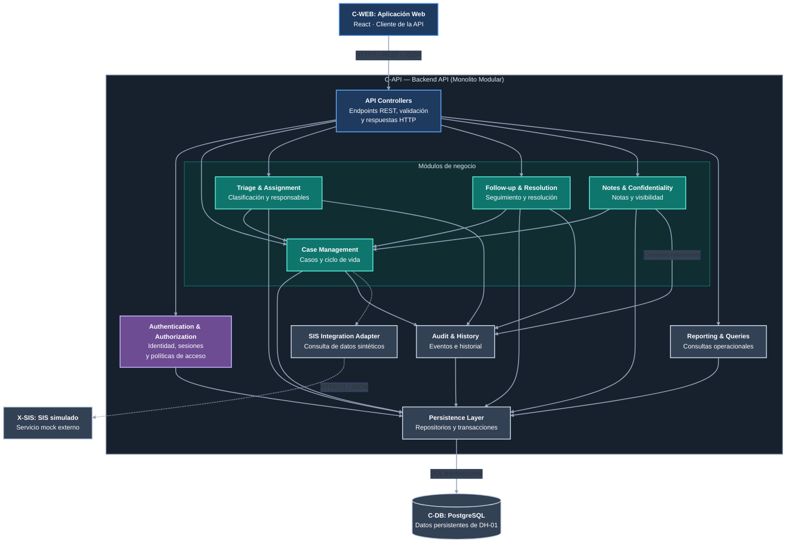

# DH-01 — Vista de Componentes del Backend

**Proyecto:** Academic Advising Case Management System  
**ID de la vista:** V-CMP  
**Estilo de modelado:** C4 Model — Component Level  
**Contenedor analizado:** C-API — Backend API  
**Decisión arquitectónica principal:** ADR-001 — Modular Monolith Architecture  
**Decisiones relacionadas:** ADR-002, ADR-003, ADR-004 y ADR-005  
**Estado:** Diseño propuesto

## 1. Propósito

La vista de componentes describe la organización interna del Backend API (`C-API`) del Academic Advising Case Management System (DH-01).

Su objetivo es identificar las responsabilidades de los principales componentes de software, sus dependencias y las reglas que gobiernan su colaboración.

A diferencia de la vista de contenedores, que representa las unidades ejecutables y los almacenes de datos, esta vista se concentra en la estructura lógica de una aplicación específica: el backend.

El diseño propuesto adopta una arquitectura de monolito modular. Por esta razón, los componentes descritos formarán parte de una misma aplicación desplegable, aunque estarán organizados mediante límites funcionales.

Esta separación busca facilitar el mantenimiento, la comprensión del código, la protección de recursos y la consistencia de las operaciones relacionadas con el ciclo de vida de los casos.

La vista también establece cómo los componentes internos interactuarán con PostgreSQL y con el simulador del Student Information System (SIS), sin atribuir a estos elementos responsabilidades que pertenezcan al dominio de asesoría académica.

## 2. Diagrama de componentes

**Figura V-CMP.** Vista lógica de componentes del Backend API de DH-01.

El diagrama presenta diez componentes propuestos dentro del contenedor `C-API`.

`C-WEB`, `C-DB` y `X-SIS` aparecen como elementos externos al contenedor analizado para proporcionar contexto sobre sus interacciones.

**Convenciones:**

- Azul: interfaz de entrada o aplicación cliente.
- Morado: autenticación y autorización.
- Verde azulado: componentes de negocio.
- Gris azulado: componentes de soporte, persistencia o dependencias.
- Líneas continuas: dependencias o interacciones internas previstas.
- Líneas punteadas: interacción con la integración simulada del SIS.

Las flechas representan dependencias funcionales entre componentes y no necesariamente el orden cronológico de ejecución.

**Nota de seguridad:** `Authentication & Authorization` proporciona controles transversales a las operaciones protegidas. La validación de identidad se realiza al ingresar a la API, mientras que la autorización específica sobre casos, notas y operaciones debe verificarse mediante las políticas correspondientes en la capa de aplicación. No se dibuja una flecha desde cada componente hacia el servicio de autorización para evitar sobrecargar el diagrama.

**Nota de persistencia:** los componentes de negocio acceden a PostgreSQL a través de `Persistence Layer`. Las operaciones que requieren modificaciones relacionadas y auditoría obligatoria deberán coordinarse mediante una misma transacción.

**Nota de auditoría:** la conexión `Notes & Confidentiality → Audit & History` representa el registro de cambios relevantes sobre las notas, como su creación o modificación autorizada. No implica transferir ni duplicar automáticamente el contenido confidencial de las notas en el historial de auditoría.

## 3. Organización general del backend

El backend seguirá un enfoque de separación por responsabilidades.

Los componentes se agrupan conceptualmente en cuatro categorías:

| Categoría | Componentes | Responsabilidad |
|---|---|---|
| Entrada | API Controllers | Recibir solicitudes y producir respuestas. |
| Seguridad | Authentication & Authorization | Identificar usuarios y evaluar permisos. |
| Dominio de negocio | Case Management, Triage & Assignment, Follow-up & Resolution, Notes & Confidentiality | Aplicar las reglas del proceso de asesoría. |
| Soporte e infraestructura | Reporting & Queries, Audit & History, Persistence Layer, SIS Integration Adapter | Proporcionar consultas, trazabilidad, persistencia e integración. |

Estas categorías no representan aplicaciones desplegables separadas.

El backend se ejecutará como un monolito modular, pero cada módulo deberá contar con responsabilidades identificables e interfaces internas claras.

### 3.1. Principios de diseño

La organización de los componentes se fundamentará en los siguientes principios:

- Los controladores HTTP no deberán contener reglas de negocio complejas.
- Las reglas de autorización se verificarán en el servidor.
- Las operaciones del dominio deberán mantener la consistencia del estado del caso.
- La persistencia se accederá mediante interfaces definidas.
- Los registros de auditoría obligatorios deberán conservarse junto con las operaciones que los generan.
- Los componentes de negocio no deberán depender directamente de detalles del SIS simulado.
- Las dependencias entre módulos deberán evitar relaciones circulares.
- Las decisiones funcionales deberán ser comprobables mediante pruebas.

Estos principios permitirán mantener un diseño modular sin introducir la complejidad de servicios distribuidos.

### 3.2. Coordinación de operaciones

Los componentes podrán colaborar para ejecutar una misma operación de negocio.

Por ejemplo, una reasignación requiere la intervención de `Triage & Assignment`, `Case Management`, `Persistence Layer` y `Audit & History`.

Esto no significa que cada componente ejecute una transacción independiente.

La operación de aplicación que coordine la reasignación deberá establecer la unidad transaccional y garantizar que la modificación del responsable y el evento obligatorio de auditoría se confirmen juntos.

Esta coordinación evita registros inconsistentes y mantiene la trazabilidad de las operaciones.

## 4. Componente CMP-01 — API Controllers

**Identificador:** CMP-01  
**Nombre:** API Controllers  
**Ubicación:** C-API  
**Responsabilidad principal:** Exponer las operaciones del backend mediante una interfaz HTTP.

### 4.1. Descripción

Los controladores constituyen el punto de entrada para las solicitudes provenientes de `C-WEB`.

Su función será recibir peticiones, interpretar los parámetros, aplicar validaciones de formato y delegar las operaciones a los componentes correspondientes.

No deberán decidir por sí mismos las transiciones válidas del ciclo de vida ni implementar directamente las reglas de asignación de casos.

### 4.2. Responsabilidades

- Recibir solicitudes HTTP.
- Identificar la operación solicitada.
- Validar parámetros y estructuras de entrada.
- Obtener el contexto de autenticación.
- Invocar los servicios correspondientes.
- Transformar resultados en respuestas JSON.
- Aplicar códigos de estado HTTP consistentes.
- Gestionar errores sin exponer información confidencial.

### 4.3. Ejemplos de operaciones

Se contemplan grupos de endpoints relacionados con:

- Autenticación.
- Solicitudes y casos.
- Asignaciones.
- Seguimientos.
- Notas y recomendaciones.
- Consultas operacionales.

La definición exacta de rutas, parámetros y respuestas se desarrollará en `design/interfaces.md`.

### 4.4. Restricciones

Los controladores no deberán acceder directamente a las tablas de PostgreSQL para ejecutar lógica de negocio.

Su responsabilidad principal será coordinar la entrada y salida de las operaciones, manteniendo separada la lógica del dominio.

Tampoco deberán depender exclusivamente de validaciones realizadas en el navegador.

## 5. Componente CMP-02 — Authentication & Authorization

**Identificador:** CMP-02  
**Nombre:** Authentication & Authorization  
**Ubicación:** C-API  
**Responsabilidad principal:** Verificar identidades y controlar el acceso a los recursos.

### 5.1. Descripción

Este componente implementará la estrategia definida en ADR-004.

La autenticación se realizará mediante usuarios ficticios almacenados y gestionados para el prototipo.

No se contempla una integración real con el proveedor institucional de identidad de Horizon University.

El componente también proporcionará las verificaciones de autorización necesarias para determinar qué operaciones puede ejecutar cada usuario.

### 5.2. Autenticación

La autenticación deberá permitir:

- Validar credenciales de prueba.
- Identificar al usuario autenticado.
- Verificar el estado de su sesión.
- Rechazar credenciales inválidas o expiradas.
- Mantener protegidos los datos de autenticación.

Las contraseñas deberán almacenarse mediante un algoritmo de hash seguro.

La configuración concreta de sesiones o tokens se establecerá en el documento de seguridad.

### 5.3. Autorización

Las decisiones de acceso deberán considerar:

- Identidad autenticada.
- Rol del usuario.
- Relación con el caso.
- Asignación vigente.
- Programa o alcance autorizado.
- Sensibilidad de la información.
- Operación solicitada.

Por ejemplo, un Academic Adviser podrá tener autorización para gestionar sus casos asignados, pero no necesariamente para consultar notas internas de casos ajenos.

### 5.4. Separación de responsabilidades

La autenticación verificará quién es el usuario.

La autorización determinará qué puede hacer ese usuario.

Ambas responsabilidades estarán relacionadas, pero deberán mantenerse diferenciadas para facilitar su evolución.

Las verificaciones de autorización deberán estar disponibles para los módulos de negocio que procesen operaciones protegidas.

No será suficiente comprobar la identidad una sola vez si la operación requiere conocer la relación del usuario con un recurso determinado.

### 5.5. Comportamiento ante accesos no autorizados

Cuando una operación no esté permitida:

- No deberá ejecutarse la modificación solicitada.
- No deberán devolverse campos confidenciales.
- Deberá utilizarse una respuesta de error apropiada.
- Podrá registrarse el evento de seguridad pertinente sin almacenar secretos.

La interfaz web podrá ocultar funcionalidades, pero no sustituirá estas verificaciones.

## 6. Componente CMP-03 — Case Management

**Identificador:** CMP-03  
**Nombre:** Case Management  
**Ubicación:** C-API  
**Responsabilidad principal:** Gestionar los casos y proteger la integridad de su ciclo de vida.

### 6.1. Descripción

Case Management será el componente central del dominio de DH-01.

Administrará la creación y recuperación de casos, así como las operaciones generales necesarias para mantener su información consistente.

También coordinará las reglas de transición entre estados, en colaboración con los demás componentes del dominio.

### 6.2. Responsabilidades

- Crear solicitudes de asesoría.
- Crear casos a partir de referencias autorizadas.
- Consultar información de casos.
- Actualizar datos permitidos.
- Validar operaciones según el estado del caso.
- Coordinar cambios de estado.
- Mantener la relación entre el caso y el estudiante.
- Solicitar el registro de eventos de auditoría cuando corresponda.

### 6.3. Estados del caso

El modelo inicial contempla los siguientes estados:

| Estado | Significado |
|---|---|
| NEW | Caso registrado y pendiente de revisión inicial. |
| UNDER_TRIAGE | Caso en clasificación o evaluación inicial. |
| ASSIGNED | Caso asignado a un Academic Adviser. |
| IN_PROGRESS | Caso en atención activa. |
| WAITING_FOR_INFORMATION | Caso pendiente de información necesaria. |
| FOLLOW_UP | Caso en etapa de seguimiento. |
| RESOLVED | Caso resuelto según los criterios establecidos. |

Las transiciones autorizadas entre estos estados deberán especificarse en `design/lifecycle-and-runtime.md`.

No se asumirá que cualquier estado puede cambiar directamente a otro.

### 6.4. Invariantes del dominio

Las operaciones deberán preservar, como mínimo, las siguientes condiciones:

- Todo caso tendrá un identificador único.
- Todo caso deberá estar asociado a un estudiante identificable en el entorno de prueba.
- Los cambios de estado deberán cumplir las reglas definidas.
- Las asignaciones vigentes deberán ser consistentes con el historial de asignaciones.
- Las operaciones restringidas requerirán autorización.
- Los cambios relevantes deberán conservar trazabilidad.
- No se considerará completada una operación si sus modificaciones obligatorias quedan parcialmente registradas.

Las reglas concretas se detallarán en los documentos de dominio y comportamiento.

### 6.5. Colaboraciones

Case Management interactuará principalmente con:

- Authentication & Authorization, para las verificaciones de acceso.
- Triage & Assignment, para cambios de clasificación y responsabilidad.
- Follow-up & Resolution, para los procesos de atención y resolución.
- Notes & Confidentiality, para vincular información al caso.
- Audit & History, para registrar acciones relevantes.
- Persistence Layer, para almacenar y recuperar datos.
- SIS Integration Adapter, cuando necesite contexto académico sintético.

Estas colaboraciones deberán establecerse mediante contratos internos que eviten dependencias circulares.

## 7. Componente CMP-04 — Triage & Assignment

**Identificador:** CMP-04  
**Nombre:** Triage & Assignment  
**Ubicación:** C-API  
**Responsabilidad principal:** Gestionar la clasificación y responsabilidad de los casos.

### 7.1. Descripción

Este componente administrará los procesos mediante los cuales una solicitud se evalúa inicialmente y se asigna al personal autorizado.

También permitirá la reasignación cuando las reglas del servicio lo permitan.

La clasificación y asignación deberán ser consistentes con el estado del caso y con las responsabilidades de los usuarios.

### 7.2. Responsabilidades

- Iniciar o registrar el proceso de triage.
- Registrar información de clasificación.
- Identificar casos pendientes de asignación.
- Asignar responsables autorizados.
- Procesar reasignaciones.
- Consultar el responsable vigente.
- Mantener la trazabilidad de cambios de responsabilidad.
- Validar que el usuario solicitante tenga permisos para efectuar la operación.

### 7.3. Reasignación

Una reasignación deberá ejecutarse de manera consistente.

El flujo esperado incluirá:

1. Verificar la identidad y autorización del solicitante.
2. Identificar el caso.
3. Comprobar que la operación es válida.
4. Validar el nuevo responsable.
5. Actualizar la asignación vigente.
6. Registrar el evento de reasignación.
7. Confirmar la transacción.

Si falla una operación obligatoria, deberá evitarse que la asignación quede parcialmente modificada.

### 7.4. Relación con auditoría

Toda reasignación relevante deberá permitir identificar:

- Caso afectado.
- Responsable anterior.
- Nuevo responsable.
- Usuario que ejecutó el cambio.
- Fecha y hora del evento.
- Motivo, cuando sea requerido por las reglas institucionales.

Estos registros permitirán reconstruir el historial de responsabilidad de un caso.

### 7.5. Restricciones

La política exacta de delegación, asignación y reasignación deberá respetar los permisos institucionales definidos para los stakeholders.

No se asumirá que cualquier Academic Adviser puede reasignar libremente sus casos.

## 8. Componente CMP-05 — Follow-up & Resolution

**Identificador:** CMP-05  
**Nombre:** Follow-up & Resolution  
**Ubicación:** C-API  
**Responsabilidad principal:** Administrar el seguimiento y la resolución de casos.

### 8.1. Descripción

Este componente gestionará las actividades que se producen durante la atención de una solicitud de asesoría.

Permitirá registrar tareas de seguimiento, recomendaciones y resultados de atención, además de aplicar las condiciones establecidas para resolver un caso.

### 8.2. Responsabilidades

- Crear actividades de seguimiento.
- Consultar actividades asociadas a un caso.
- Registrar el avance de actividades.
- Marcar actividades como completadas cuando corresponda.
- Registrar recomendaciones.
- Controlar condiciones de resolución.
- Coordinar cambios de estado relacionados con seguimiento y cierre.
- Solicitar eventos de auditoría para operaciones relevantes.

### 8.3. Consistencia con el ciclo de vida

La existencia de actividades de seguimiento deberá considerarse al evaluar ciertas transiciones.

Por ejemplo, la resolución de un caso podrá requerir verificar el cumplimiento de condiciones previamente establecidas.

Las reglas definitivas deberán evitar que un caso se declare resuelto mediante una operación que contradiga su situación registrada.

No se asumirá automáticamente que todas las actividades deben completarse antes de resolver un caso; esta política deberá definirse y validarse en el diseño de comportamiento.

### 8.4. Recomendaciones

Las recomendaciones deberán distinguirse según su audiencia.

Algunas podrán comunicarse al estudiante, mientras que otras observaciones permanecerán restringidas al personal autorizado.

La clasificación y visibilidad de la información se coordinarán con Notes & Confidentiality.

## 9. Componente CMP-06 — Notes & Confidentiality

**Identificador:** CMP-06  
**Nombre:** Notes & Confidentiality  
**Ubicación:** C-API  
**Responsabilidad principal:** Gestionar la información del caso según su nivel de visibilidad.

### 9.1. Descripción

DH-01 manejará información que puede contener observaciones internas del personal y comunicaciones destinadas al estudiante.

Por esta razón, es necesario separar los datos según su finalidad y audiencia autorizada.

Este componente administrará los registros asociados a los casos y colaborará con el mecanismo de autorización para proteger su contenido.

### 9.2. Categorías de información

Se proponen al menos tres categorías:

**Información general del caso**

Incluye datos de identificación, clasificación, estado y responsabilidad sujetos a los permisos aplicables.

**Información visible para estudiantes**

Incluye recomendaciones y actualizaciones destinadas expresamente al Student.

**Información interna**

Incluye notas y observaciones restringidas al personal autorizado.

### 9.3. Responsabilidades

- Registrar notas vinculadas a casos.
- Diferenciar notas internas de información visible para estudiantes.
- Consultar registros según el permiso del solicitante.
- Aplicar restricciones de visibilidad.
- Evitar incluir notas internas en respuestas destinadas al Student.
- Registrar mediante Audit & History los cambios relevantes que requieran trazabilidad.
- Evitar la duplicación innecesaria de información confidencial en los eventos de auditoría.

### 9.4. Protección de respuestas

La confidencialidad no deberá depender únicamente de ocultar elementos de la interfaz.

El backend deberá construir respuestas que incluyan exclusivamente los campos autorizados.

Por ejemplo, una respuesta destinada a un Student no deberá incorporar notas internas aunque la interfaz no tenga un componente visual para mostrarlas.

La implementación deberá considerar representaciones o contratos diferenciados cuando sea necesario.

### 9.5. Condiciones de acceso

El permiso para consultar un caso no implicará necesariamente autorización para acceder a todas sus notas.

La evaluación deberá considerar la relación del usuario con el caso y la categoría de información.

Esta distinción responde al escenario QS-01 y a ADR-004.

### 9.6. Relación con Audit & History

Notes & Confidentiality colaborará con Audit & History para registrar las acciones relevantes sobre las notas asociadas a un caso.

Entre los eventos propuestos se encuentran:

- Creación de una nota.
- Modificación autorizada de una nota, cuando esté permitida.
- Cambio de clasificación o visibilidad, cuando esté permitido.
- Otras acciones identificadas como auditables por la política correspondiente.

Por ejemplo, cuando un Academic Adviser registra una nota interna, el sistema deberá permitir conocer quién realizó la acción, a qué caso pertenece y cuándo ocurrió.

El registro de auditoría podrá incluir el identificador de la nota y el tipo de operación, pero **no deberá duplicar automáticamente el texto confidencial de su contenido**.

Esto reduce la exposición de información sensible y evita crear copias adicionales de datos que requieren protección especial.

Las consultas de lectura no tendrán que generar necesariamente eventos de auditoría de negocio. El registro de accesos a información confidencial se definirá según las políticas de seguridad y trazabilidad aplicables.

Cuando la creación o modificación de una nota requiera un registro de auditoría obligatorio, ambos registros deberán persistirse dentro de una misma transacción.

Esta colaboración responde a ADR-005 y al escenario QS-03.

## 10. Componente CMP-07 — Reporting & Queries

**Identificador:** CMP-07  
**Nombre:** Reporting & Queries  
**Ubicación:** C-API  
**Responsabilidad principal:** Proporcionar consultas operacionales y reportes autorizados.

### 10.1. Descripción

Este componente ofrecerá información para supervisar el funcionamiento del servicio de asesoría.

Su finalidad será facilitar la consulta del estado de los casos, la distribución del trabajo y las actividades pendientes, según las necesidades y permisos de los usuarios.

### 10.2. Responsabilidades

- Consultar casos mediante filtros autorizados.
- Proporcionar información sobre casos abiertos y resueltos.
- Identificar actividades pendientes o retrasadas.
- Consultar la distribución de casos por responsable.
- Obtener indicadores operacionales.
- Aplicar paginación y ordenamiento.
- Restringir el alcance de los resultados según el usuario.

### 10.3. Rendimiento

Las consultas deberán diseñarse considerando el crecimiento del volumen de información.

Se evaluará la necesidad de:

- Índices en campos utilizados para filtrado.
- Consultas agregadas.
- Paginación de resultados.
- Límites de respuesta.
- Optimización de consultas frecuentes.

La validación del rendimiento utilizará datos sintéticos y criterios establecidos en QS-04.

### 10.4. Seguridad

Los reportes también estarán sujetos a autorización.

Un usuario no deberá obtener información sobre casos fuera de su ámbito mediante consultas agregadas o filtros manipulados.

Las políticas de acceso deberán aplicarse antes de entregar los resultados.

## 11. Componente CMP-08 — Audit & History

**Identificador:** CMP-08  
**Nombre:** Audit & History  
**Ubicación:** C-API  
**Responsabilidad principal:** Conservar la trazabilidad de las acciones relevantes.

### 11.1. Descripción

El sistema deberá permitir reconstruir eventos importantes relacionados con los casos.

Este componente gestionará el registro de acciones de negocio que deban conservarse para fines de seguimiento, revisión y responsabilidad institucional.

Su objetivo es registrar eventos relevantes sin convertirse en una copia completa del contenido de los casos.

### 11.2. Eventos propuestos

Los eventos relevantes podrán incluir:

- Creación de un caso.
- Cambio de estado.
- Asignación inicial.
- Reasignación.
- Registro de seguimiento.
- Resolución.
- Creación o modificación autorizada de notas relevantes.
- Modificaciones relevantes de información.
- Otras acciones definidas como auditables.

La lista definitiva se establecerá de acuerdo con las reglas de negocio y las políticas institucionales aplicables.

### 11.3. Información de los eventos

Un registro de auditoría podrá contener:

- Identificador del evento.
- Identificador del caso relacionado.
- Tipo de operación.
- Identidad del actor.
- Fecha y hora.
- Identificador del recurso afectado.
- Información mínima necesaria sobre el cambio.
- Motivo, cuando sea pertinente.

No deberán almacenarse contraseñas, tokens de sesión ni secretos dentro de los eventos de auditoría.

Tampoco se deberá duplicar innecesariamente el contenido completo de notas internas o información académica confidencial.

### 11.4. Atomicidad

Cuando el registro de un evento sea indispensable para la validez y trazabilidad de una operación, la actualización del recurso y el evento deberán persistirse en una misma transacción.

Por ejemplo, una reasignación no deberá quedar confirmada sin conservar el evento de cambio de responsable requerido.

De manera similar, cuando una nota deba contar obligatoriamente con trazabilidad de creación, la nota y su evento deberán confirmarse juntos.

Esta estrategia responde a ADR-005.

### 11.5. Protección del historial

Los eventos deberán protegerse contra modificaciones no autorizadas.

Los mecanismos concretos para consulta, retención y corrección administrativa de registros deberán documentarse en el diseño detallado.

La capacidad de soporte técnico no implicará automáticamente autorización para consultar información sensible contenida en el historial.

### 11.6. Diferencia entre auditoría de negocio y registros técnicos

Audit & History se enfocará principalmente en acciones de negocio que deban conservarse como parte de la trazabilidad institucional.

Los registros técnicos de errores, solicitudes y diagnóstico podrán gestionarse mediante mecanismos separados.

La existencia de registros técnicos no sustituirá los eventos de negocio necesarios para reconstruir la evolución de un caso.

Tampoco deberá utilizarse el registro de auditoría para almacenar información sensible innecesaria.

## 12. Componente CMP-09 — Persistence Layer

**Identificador:** CMP-09  
**Nombre:** Persistence Layer  
**Ubicación:** C-API  
**Responsabilidad principal:** Gestionar el acceso persistente a PostgreSQL.

### 12.1. Descripción

La capa de persistencia encapsulará las operaciones de almacenamiento y recuperación de datos.

Permitirá que los componentes de negocio utilicen interfaces de acceso sin depender directamente de detalles específicos de consultas SQL o del controlador de base de datos.

La tecnología de implementación de esta capa se definirá posteriormente.

### 12.2. Responsabilidades

- Recuperar información de usuarios y casos.
- Persistir solicitudes.
- Almacenar notas y recomendaciones.
- Gestionar asignaciones.
- Registrar actividades.
- Guardar eventos de auditoría.
- Ejecutar transacciones.
- Aplicar operaciones de lectura y escritura.
- Propagar errores de persistencia de forma controlada.

### 12.3. Repositorios propuestos

El diseño podrá incorporar repositorios correspondientes a entidades o conjuntos de operaciones relacionadas.

Entre ellos:

- User Repository.
- Case Repository.
- Assignment Repository.
- Follow-up Repository.
- Note Repository.
- Audit Repository.

La separación definitiva dependerá del modelo de dominio.

### 12.4. Coordinación transaccional

Las transacciones deberán coordinarse desde la operación de aplicación que necesita mantener consistencia entre componentes.

Esto permitirá que una reasignación y su evento de auditoría compartan una misma unidad de trabajo.

También permitirá conservar de manera atómica una nota y su evento de creación cuando la auditoría sea obligatoria.

No se deberán confirmar por separado cambios que las reglas de negocio consideren inseparables.

La capa de persistencia deberá proporcionar los mecanismos necesarios para que las operaciones relacionadas utilicen el mismo contexto transaccional.

### 12.5. Control de concurrencia

Las operaciones sobre casos compartidos deberán considerar modificaciones concurrentes.

La estrategia definitiva podrá apoyarse en mecanismos de PostgreSQL y en verificaciones de versión o bloqueo.

El diseño deberá evitar la pérdida silenciosa de cambios y las transiciones inconsistentes.

## 13. Componente CMP-10 — SIS Integration Adapter

**Identificador:** CMP-10  
**Nombre:** SIS Integration Adapter  
**Ubicación:** C-API  
**Responsabilidad principal:** Encapsular la comunicación con el SIS simulado.

### 13.1. Descripción

Este componente representará el límite de integración entre DH-01 y el simulador del Student Information System.

Su función será evitar que los módulos de negocio dependan directamente de las particularidades técnicas del servicio externo.

### 13.2. Responsabilidades

- Construir solicitudes de consulta académica.
- Comunicarse con `X-SIS`.
- Recibir respuestas sintéticas.
- Validar la estructura de las respuestas.
- Transformar los datos al formato interno esperado.
- Manejar errores de comunicación.
- Controlar tiempos de espera.
- Informar la indisponibilidad del servicio cuando corresponda.

### 13.3. Información sintética

El simulador podrá proporcionar información como:

- Identificador ficticio de estudiante.
- Programa académico.
- Estado académico general.
- Otros atributos mínimos necesarios para los casos de uso.

No se accederá a registros académicos oficiales.

### 13.4. Dependencia controlada

La integración deberá utilizarse únicamente cuando la operación lo requiera.

La creación, seguimiento y resolución de casos no deberán quedar innecesariamente acoplados a la disponibilidad del SIS simulado.

Si una consulta externa falla, el sistema deberá aplicar una respuesta controlada y permitir continuar las operaciones independientes de esa información.

### 13.5. Evolución futura

El adaptador permitirá sustituir el mock por otra implementación de integración, siempre que se mantenga el contrato interno esperado.

Cualquier conexión futura con un SIS institucional real requerirá autorización y revisión de seguridad.

## 14. Dependencias y reglas de colaboración

Las relaciones entre componentes deberán preservar una separación clara entre la entrada HTTP, las políticas de seguridad, los servicios de negocio y el almacenamiento.

| Componente origen | Componente destino | Propósito |
|---|---|---|
| API Controllers | Authentication & Authorization | Verificar identidad y acceso inicial. |
| API Controllers | Componentes de negocio | Delegar operaciones de asesoría. |
| Componentes de negocio | Authentication & Authorization | Evaluar permisos específicos sobre recursos protegidos. |
| Case Management | Persistence Layer | Consultar y persistir casos. |
| Case Management | Audit & History | Registrar cambios de estado y otras acciones relevantes. |
| Triage & Assignment | Case Management | Validar información y estado del caso. |
| Triage & Assignment | Persistence Layer | Persistir asignaciones y reasignaciones. |
| Triage & Assignment | Audit & History | Registrar cambios de responsabilidad. |
| Follow-up & Resolution | Case Management | Aplicar condiciones del ciclo de vida. |
| Follow-up & Resolution | Persistence Layer | Persistir actividades, recomendaciones y resultados. |
| Follow-up & Resolution | Audit & History | Registrar acciones relevantes de seguimiento y resolución. |
| Notes & Confidentiality | Case Management | Validar la existencia y contexto del caso. |
| Notes & Confidentiality | Authentication & Authorization | Aplicar restricciones de acceso a información sensible. |
| Notes & Confidentiality | Persistence Layer | Persistir y consultar notas autorizadas. |
| Notes & Confidentiality | Audit & History | Registrar creación o cambios relevantes sin duplicar contenidos confidenciales. |
| Reporting & Queries | Persistence Layer | Consultar información operacional autorizada. |
| Authentication & Authorization | Persistence Layer | Consultar usuarios, roles y datos persistentes de autenticación. |
| Audit & History | Persistence Layer | Persistir eventos de negocio. |
| Case Management | SIS Integration Adapter | Obtener información académica sintética cuando sea necesaria. |
| SIS Integration Adapter | X-SIS | Consultar datos académicos sintéticos. |

### 14.1. Dependencias permitidas

Los componentes de entrada podrán invocar servicios de aplicación.

Los servicios de aplicación podrán utilizar servicios del dominio, repositorios y capacidades transversales mediante interfaces definidas.

Los módulos de negocio deberán interactuar con otros módulos a través de contratos internos, evitando acceder directamente a estructuras privadas de otro módulo.

Las verificaciones de autorización podrán utilizarse desde distintos componentes sin replicar las políticas de acceso en cada uno de ellos.

### 14.2. Dependencias que deben evitarse

Se deberán evitar:

- Accesos directos desde API Controllers a las tablas para ejecutar reglas de negocio.
- Operaciones de autorización exclusivamente dentro de `C-WEB`.
- Referencias circulares entre módulos.
- Dependencias directas del dominio hacia formatos específicos del SIS.
- Escrituras a PostgreSQL desde el navegador.
- Modificaciones de casos sin registrar los eventos de auditoría requeridos.
- Duplicación de reglas de transición entre distintos módulos.
- Copias innecesarias de notas confidenciales dentro del historial de auditoría.
- Transacciones independientes para cambios que deban confirmarse de manera atómica.

### 14.3. Límites de los componentes

Los límites propuestos corresponden a responsabilidades lógicas.

No significa que cada componente deba implementarse como una clase única.

Un módulo podrá contener varios controladores, servicios, entidades, políticas y repositorios, según sus necesidades.

El objetivo es conservar la cohesión funcional y reducir dependencias innecesarias.

### 14.4. Interpretación de las conexiones del diagrama

Las conexiones directas entre componentes indican colaboración o dependencia funcional.

Por ejemplo, `Triage & Assignment → Case Management` significa que las operaciones de clasificación y asignación necesitan consultar o aplicar reglas relacionadas con el estado del caso.

La conexión `Notes & Confidentiality → Audit & History` significa que ciertas modificaciones sobre notas requieren un registro de trazabilidad.

La conexión no significa que Audit & History sea propietario de las notas ni que almacene obligatoriamente sus contenidos.

Las dependencias transversales de autorización se documentan explícitamente en esta sección, aunque no se represente una flecha por cada política en el diagrama.

## 15. Flujos de ejecución relevantes

### 15.1. Creación de una solicitud

El proceso inicia cuando un Student envía una solicitud desde `C-WEB`.

1. API Controllers recibe la petición.
2. Authentication & Authorization verifica la identidad y permisos.
3. Case Management valida los datos y reglas de creación.
4. Se inicia una unidad de trabajo transaccional cuando es necesario.
5. Persistence Layer registra el caso.
6. Audit & History registra el evento correspondiente dentro de la misma transacción cuando sea obligatorio.
7. El backend confirma la operación.
8. API Controllers devuelve una respuesta autorizada a `C-WEB`.

El sistema deberá evitar confirmar una creación si falla una persistencia obligatoria.

### 15.2. Asignación o reasignación

El proceso inicia cuando un usuario autorizado solicita asignar o reasignar un caso.

1. API Controllers recibe la solicitud.
2. Authentication & Authorization valida el permiso.
3. Triage & Assignment consulta los datos necesarios.
4. Case Management verifica las condiciones del caso.
5. Se valida el responsable de destino.
6. Se inicia una transacción.
7. Persistence Layer actualiza la asignación.
8. Audit & History registra el cambio de responsabilidad dentro de la misma transacción.
9. Se confirma la transacción.
10. Se devuelve el resultado.

Un fallo antes de confirmar deberá impedir que se conserve una reasignación incompleta.

### 15.3. Consulta de notas

El proceso inicia cuando un usuario solicita información asociada a un caso.

1. API Controllers recibe la petición.
2. Authentication & Authorization verifica la identidad.
3. Se valida si el usuario puede consultar el caso.
4. Notes & Confidentiality determina qué categorías de información están permitidas.
5. Persistence Layer recupera los registros necesarios.
6. El componente construye una respuesta con los campos autorizados.
7. API Controllers devuelve el resultado.

Un Student no deberá recibir notas internas aunque conozca el identificador del caso.

La consulta de lectura no generará automáticamente un evento de auditoría de negocio, salvo que así lo exija la política de registro de accesos.

### 15.4. Creación de una nota interna

Cuando un Academic Adviser autorizado registra una nota interna:

1. API Controllers recibe la solicitud.
2. Authentication & Authorization verifica su identidad y relación con el caso.
3. Notes & Confidentiality valida el tipo de nota y las reglas aplicables.
4. Se inicia una transacción cuando la operación requiere auditoría obligatoria.
5. Persistence Layer almacena la nota.
6. Audit & History registra el evento `NOTE_CREATED`, con los metadatos necesarios.
7. Se confirma la transacción.
8. El backend devuelve una respuesta autorizada.

El evento de auditoría podrá incluir el identificador de la nota, el caso, el actor y la fecha de creación.

No deberá incluir automáticamente una copia del contenido confidencial de la nota.

Si falla la creación del evento obligatorio, la operación completa deberá revertirse.

### 15.5. Resolución de un caso

Cuando un Academic Adviser autorizado solicita resolver un caso:

1. El backend verifica su identidad y relación con el caso.
2. Follow-up & Resolution recupera el contexto necesario.
3. Case Management verifica las reglas de transición.
4. Se comprueban las condiciones requeridas para la resolución.
5. Se inicia una transacción.
6. Persistence Layer registra los cambios correspondientes.
7. Audit & History registra el evento de resolución.
8. Se confirma la transacción.
9. Se devuelve el nuevo estado.

Las condiciones definitivas de resolución se detallarán en el diseño del ciclo de vida.

### 15.6. Consulta al SIS simulado

Cuando un flujo requiera contexto académico:

1. Case Management solicita información mediante el SIS Integration Adapter.
2. El adaptador construye una solicitud de prueba.
3. `X-SIS` responde con información académica sintética.
4. El adaptador valida y transforma la respuesta.
5. El módulo de negocio utiliza los datos necesarios.
6. El backend devuelve únicamente la información autorizada.

Si el simulador falla, se aplicará el comportamiento de error establecido para esa operación.

## 16. Atributos de calidad y responsabilidades

### 16.1. Seguridad — QS-01

Authentication & Authorization y Notes & Confidentiality colaborarán para restringir el acceso a casos y notas.

Las verificaciones deberán ejecutarse en el backend y los resultados deberán filtrarse según el usuario.

### 16.2. Integridad — QS-02

Case Management, Triage & Assignment, Follow-up & Resolution y Persistence Layer deberán preservar la consistencia del ciclo de vida.

Se utilizarán validaciones de estado, restricciones persistentes y transacciones cuando corresponda.

### 16.3. Auditabilidad — QS-03

Audit & History mantendrá los eventos requeridos para reconstruir las operaciones relevantes.

La persistencia de esos eventos deberá coordinarse con las modificaciones de negocio que representan.

El registro de auditoría deberá limitarse a la información necesaria para la trazabilidad, evitando duplicar innecesariamente información confidencial.

### 16.4. Rendimiento — QS-04

Reporting & Queries y Persistence Layer deberán permitir optimizar las consultas más frecuentes.

La validación utilizará datos sintéticos y mediciones reproducibles.

### 16.5. Mantenibilidad — QS-05

La separación modular permitirá localizar los cambios y limitar su impacto.

Las pruebas deberán comprobar el comportamiento de los componentes y sus contratos internos.

### 16.6. Usabilidad — QS-06

API Controllers deberá proporcionar contratos y respuestas consistentes para apoyar el funcionamiento de `C-WEB`.

La experiencia de usuario será responsabilidad principal de la aplicación web, mientras que el backend garantizará la consistencia de las operaciones.

### 16.7. Recuperación — QS-07

Persistence Layer deberá conservar correctamente los cambios confirmados.

La infraestructura y los procedimientos de recuperación se documentarán por separado.

## 17. Riesgos del diseño de componentes

| Riesgo | Consecuencia | Mitigación propuesta |
|---|---|---|
| Reglas de negocio dentro de los controladores | Duplicación y dificultad de mantenimiento | Delegar operaciones a servicios de dominio o aplicación. |
| Dependencias circulares | Acoplamiento excesivo | Definir interfaces y dirección de dependencias. |
| Autorización aplicada de manera inconsistente | Acceso indebido | Centralizar políticas y realizar pruebas negativas. |
| Notas internas mezcladas con respuestas públicas | Exposición de información sensible | Separar categorías y construir respuestas autorizadas. |
| Auditoría con copias de notas confidenciales | Duplicación y mayor exposición de datos sensibles | Registrar metadatos suficientes sin replicar el contenido completo. |
| Reasignación sin transacción | Historial o responsable inconsistente | Coordinar persistencia y auditoría en una unidad de trabajo. |
| Consultas de reportes sin control de alcance | Divulgación de información | Aplicar filtros y políticas de acceso en el servidor. |
| Dependencia directa del SIS | Fragilidad ante fallos externos | Aislar la comunicación mediante un adaptador. |
| Actualizaciones concurrentes sin protección | Pérdida de cambios | Aplicar control de concurrencia. |

Estos riesgos deberán considerarse durante la implementación y validación del prototipo.

## 18. Verificación de la vista

La vista de componentes deberá revisarse para determinar si la distribución de responsabilidades permite satisfacer los requisitos y atributos de calidad.

### 18.1. Revisión estructural

Se comprobará que:

- Los componentes tengan responsabilidades diferenciadas.
- Las reglas de negocio no dependan de los controladores HTTP.
- El acceso a PostgreSQL esté encapsulado.
- Las políticas de autorización se apliquen a operaciones y recursos.
- Los eventos de auditoría puedan registrarse dentro de las transacciones pertinentes.
- Los eventos de auditoría no dupliquen innecesariamente el contenido de notas confidenciales.
- Las dependencias no formen ciclos innecesarios.
- El SIS simulado permanezca aislado mediante su adaptador.
- La estructura sea compatible con un único backend desplegable.

### 18.2. Pruebas previstas

La validación podrá incluir:

- Pruebas unitarias de reglas de negocio.
- Pruebas de autenticación.
- Pruebas de autorización positiva y negativa.
- Pruebas de transiciones válidas e inválidas.
- Pruebas de asignación y reasignación.
- Pruebas de atomicidad y concurrencia.
- Pruebas de separación de notas.
- Pruebas de persistencia de auditoría.
- Pruebas de creación de notas con registro de eventos.
- Pruebas para comprobar que los eventos no contienen información confidencial innecesaria.
- Pruebas de integración con el simulador del SIS.
- Pruebas de consultas operacionales.

### 18.3. Evidencia

Los resultados deberán documentarse en `validation/`.

Las evidencias podrán incluir registros de pruebas, respuestas de API, resultados de ejecución y capturas de flujos relevantes.

Las verificaciones descritas son objetivos de validación y no implican que los componentes estén implementados o probados.

## 19. Trazabilidad

| Elemento | Relación |
|---|---|
| AD-01 | Integridad de los casos y operaciones. |
| AD-02 | Confidencialidad y acceso restringido. |
| AD-03 | Auditoría e historial. |
| AD-04 | Consistencia del seguimiento y la resolución. |
| AD-05 | Mantenibilidad y organización modular. |
| AD-06 | Consultas y supervisión operacional. |
| AD-07 | Viabilidad técnica del despliegue. |
| ADR-001 | Monolito modular. |
| ADR-002 | PostgreSQL como base de datos relacional. |
| ADR-003 | Reglas centralizadas y operaciones atómicas. |
| ADR-004 | Autenticación interna y autorización por recursos. |
| ADR-005 | Auditoría persistente. |
| QS-01 | Seguridad y confidencialidad. |
| QS-02 | Integridad y concurrencia. |
| QS-03 | Trazabilidad. |
| QS-04 | Rendimiento. |
| QS-05 | Mantenibilidad. |
| QS-06 | Usabilidad. |
| QS-07 | Persistencia y recuperación. |
| V-CTX | Contexto del sistema. |
| V-CON | Vista de contenedores. |
| V-CMP | Vista de componentes del backend. |

### 19.1. Documentos relacionados

- [Vista de Contexto](system-context.md).
- [Vista de Contenedores](container-view.md).
- [Decisiones Arquitectónicas](../adr/README.md).
- [Requisitos y Drivers Arquitectónicos](../requirements-and-drivers.md).
- [Escenarios de Calidad](../quality-scenarios.md).
- [Diseño de Dominio y Datos](../design/domain-and-data.md).
- [Ciclo de Vida y Comportamiento](../design/lifecycle-and-runtime.md).
- [Diseño de Interfaces](../design/interfaces.md).
- [Diseño de Seguridad](../design/security.md).
- [Plan de Pruebas](../validation/test-plan.md).

Los documentos de diseño detallado ampliarán las responsabilidades y contratos identificados en esta vista.

## 20. Conclusión

La vista de componentes establece una organización lógica para el Backend API de DH-01 basada en responsabilidades diferenciadas.

`C-API` estará compuesto por módulos encargados de recibir solicitudes, autenticar usuarios, aplicar políticas de acceso, gestionar casos, clasificar y asignar responsabilidades, administrar seguimientos, controlar notas confidenciales, generar consultas operacionales y conservar la trazabilidad.

La persistencia se concentrará en una capa de acceso a PostgreSQL, mientras que la integración con el SIS simulado se aislará mediante un adaptador.

La relación entre Notes & Confidentiality y Audit & History permitirá registrar los cambios relevantes sobre las notas sin duplicar innecesariamente su contenido confidencial.

Las operaciones que requieran consistencia y trazabilidad deberán utilizar mecanismos transaccionales para confirmar conjuntamente los cambios de negocio y sus eventos obligatorios.

La organización propuesta mantiene el enfoque de monolito modular y evita que los componentes deban desplegarse como servicios independientes.

Esta estructura proporcionará la base para definir el modelo de dominio, las entidades persistentes, las transiciones de estado, los contratos de la API y los mecanismos concretos de seguridad.

La validez del diseño deberá confirmarse mediante revisión arquitectónica y pruebas del prototipo, de acuerdo con los escenarios de calidad y los requisitos establecidos para DH-01.