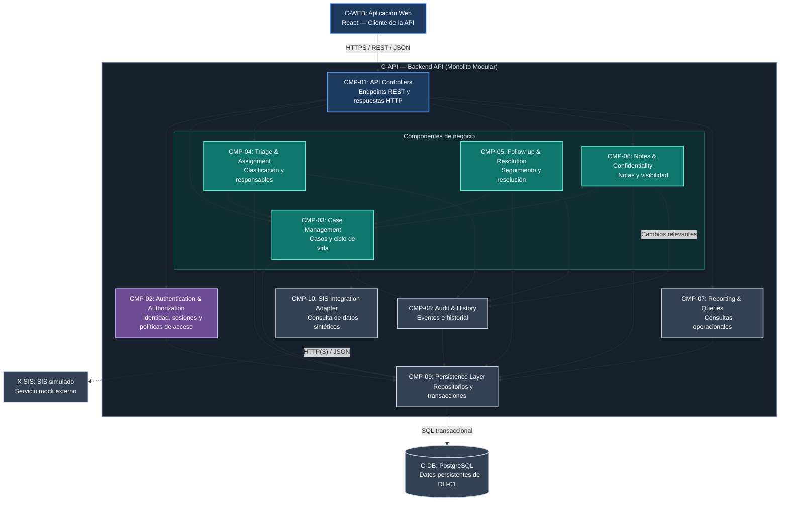

# DH-01 — Vista de Componentes del Backend

**ID de la vista:** V-COMP  
**Modelo:** C4 Model — Component Level  
**Contenedor analizado:** C-API — Backend API  
**Decisión principal:** ADR-001 — Modular Monolith Architecture  
**Decisiones relacionadas:** ADR-002, ADR-003, ADR-004 y ADR-005

## 1. Propósito y organización del backend

Esta vista describe la organización interna del Backend API (`C-API`) del Academic Advising Case Management System (DH-01).

Su objetivo es identificar los principales componentes de software, sus responsabilidades, dependencias y mecanismos de colaboración para gestionar las solicitudes de asesoría académica.

A diferencia de la vista de contenedores, que muestra las unidades de ejecución y los almacenes de datos, esta vista se concentra en la estructura lógica del backend.

La arquitectura seleccionada es un **monolito modular**. Los componentes se organizarán mediante límites funcionales definidos, pero formarán parte de una misma aplicación desplegable desarrollada con Node.js y Express.

La separación de responsabilidades busca facilitar el mantenimiento, la seguridad, la consistencia del ciclo de vida y la trazabilidad de las operaciones.

Los componentes se agrupan conceptualmente de la siguiente manera:

| Categoría | Componentes | Responsabilidad |
|---|---|---|
| Entrada | CMP-01 — API Controllers | Recibir solicitudes y producir respuestas HTTP. |
| Seguridad | CMP-02 — Authentication & Authorization | Identificar usuarios y aplicar políticas de acceso. |
| Dominio | CMP-03, CMP-04, CMP-05 y CMP-06 | Ejecutar las reglas del proceso de asesoría. |
| Consultas y auditoría | CMP-07 y CMP-08 | Proporcionar información operacional y trazabilidad. |
| Infraestructura | CMP-09 y CMP-10 | Gestionar persistencia e integración externa simulada. |

Estas categorías representan una separación lógica. No constituyen aplicaciones desplegables independientes.

## 2. Diagrama de componentes

**Figura V-COMP.** Vista lógica de los componentes del Backend API de DH-01.

El diagrama presenta diez componentes internos de `C-API`. Los elementos `C-WEB`, `C-DB` y `X-SIS` aparecen como dependencias externas al contenedor analizado.

Las flechas representan colaboraciones y dependencias funcionales, no necesariamente el orden cronológico de ejecución.

**Consideraciones del diagrama:**

- La autorización es transversal. Aunque no se dibujen todas las conexiones con CMP-02, cada operación protegida deberá verificar sus permisos.
- Los componentes de negocio accederán a PostgreSQL mediante CMP-09 — Persistence Layer.
- Los cambios de negocio y sus eventos obligatorios de auditoría deberán compartir una misma transacción.
- La colaboración entre Notes & Confidentiality y Audit & History no implica copiar el contenido confidencial de las notas al historial.
- El acceso al SIS simulado se realizará exclusivamente mediante CMP-10 — SIS Integration Adapter.

## 3. Componentes y responsabilidades

### 3.1. CMP-01 — API Controllers

**Responsabilidad principal:** exponer las operaciones del backend mediante una interfaz HTTP.

Este componente constituye el punto de entrada de las solicitudes provenientes de `C-WEB`.

Sus responsabilidades incluyen:

- Recibir solicitudes HTTP.
- Interpretar parámetros y estructuras de entrada.
- Validar formatos y datos básicos.
- Obtener el contexto de autenticación.
- Delegar las operaciones a los servicios correspondientes.
- Transformar los resultados en respuestas JSON.
- Utilizar códigos de estado HTTP consistentes.
- Manejar errores sin revelar información confidencial.

Los controladores expondrán operaciones relacionadas con autenticación, casos, asignaciones, seguimientos, notas, recomendaciones y consultas operacionales.

**Restricción:** no deberán implementar directamente las reglas complejas del dominio ni acceder a las tablas de PostgreSQL para ejecutar lógica de negocio.

Los contratos detallados se encuentran en [API Contracts](../design/interfaces.md).

### 3.2. CMP-02 — Authentication & Authorization

**Responsabilidad principal:** verificar la identidad de los usuarios y controlar el acceso a los recursos del sistema.

Este componente implementará la estrategia seleccionada en ADR-004.

La autenticación utilizará cuentas ficticias y sesiones opacas administradas por el servidor. Las sesiones estarán asociadas a registros persistentes en PostgreSQL y se entregarán al navegador mediante cookies con atributos de seguridad.

Sus responsabilidades incluyen:

- Verificar credenciales mediante hashes seguros.
- Gestionar la creación, expiración y revocación de sesiones.
- Identificar al usuario autenticado.
- Aplicar protección CSRF a las operaciones correspondientes.
- Evaluar los permisos de acuerdo con el rol y el recurso solicitado.
- Rechazar accesos y modificaciones no autorizadas.
- Evitar la exposición de secretos y datos confidenciales.

La autorización considerará:

- Identidad autenticada.
- Rol institucional.
- Relación con el caso.
- Asignación vigente.
- Programa o ámbito autorizado.
- Sensibilidad de la información.
- Operación solicitada.

Por ejemplo, un Academic Adviser podrá gestionar sus casos asignados, pero no tendrá acceso automático a las notas internas de todos los casos de la universidad.

La autenticación verifica quién es el usuario, mientras que la autorización determina qué puede hacer.

Ambas responsabilidades deberán mantenerse diferenciadas.

### 3.3. CMP-03 — Case Management

**Responsabilidad principal:** administrar los casos académicos y proteger la integridad de su ciclo de vida.

Case Management constituye el componente central del dominio de DH-01.

Sus responsabilidades incluyen:

- Crear solicitudes de asesoría.
- Crear casos a partir de referencias autorizadas.
- Consultar y actualizar información permitida.
- Mantener la relación entre casos y estudiantes.
- Aplicar las reglas generales de transición.
- Coordinar cambios de estado.
- Colaborar con los componentes de asignación, seguimiento y auditoría.

El ciclo de vida contempla siete estados:

| Estado | Descripción |
|---|---|
| `NEW` | Caso registrado, pendiente de revisión inicial. |
| `UNDER_TRIAGE` | Caso en proceso de clasificación. |
| `ASSIGNED` | Caso asignado a un Academic Adviser. |
| `IN_PROGRESS` | Caso en atención activa. |
| `WAITING_FOR_INFORMATION` | Caso pendiente de información requerida. |
| `FOLLOW_UP` | Caso en etapa de seguimiento. |
| `RESOLVED` | Caso resuelto conforme a las reglas establecidas. |

Las transiciones deberán respetar las condiciones documentadas en [Lifecycle and Runtime](../design/lifecycle-and-runtime.md).

Las invariantes principales incluyen:

- Cada caso tendrá un identificador único.
- Cada caso estará asociado a un estudiante identificable.
- Las transiciones deberán ser válidas.
- Las asignaciones vigentes serán consistentes con su historial.
- Las operaciones restringidas exigirán autorización.
- Los cambios relevantes conservarán trazabilidad.
- Ninguna operación se confirmará si sus modificaciones obligatorias quedan incompletas.

Case Management colaborará con los demás componentes mediante contratos internos que eviten dependencias circulares.

### 3.4. CMP-04 — Triage & Assignment

**Responsabilidad principal:** gestionar la clasificación, asignación y reasignación de casos.

Este componente administrará el proceso mediante el cual una solicitud es revisada, clasificada y asignada a un responsable autorizado.

Sus responsabilidades incluyen:

- Iniciar el proceso de triage.
- Registrar clasificaciones.
- Identificar solicitudes pendientes de asignación.
- Asignar responsables autorizados.
- Procesar reasignaciones.
- Consultar el responsable vigente.
- Conservar el historial de responsabilidad.
- Verificar los permisos aplicables.

La asignación inicial requerirá una clasificación válida.

Las reasignaciones deberán coordinar el cambio del responsable vigente con el registro histórico correspondiente.

Una operación de reasignación deberá verificar la autorización, comprobar el estado del caso, validar el nuevo responsable y actualizar la información dentro de una transacción.

El evento de auditoría conservará, según corresponda, el responsable anterior, el nuevo responsable, el actor que ejecutó el cambio, la fecha y su motivo.

**Restricción:** ningún Academic Adviser podrá reasignar libremente sus casos por el simple hecho de tener ese rol. La operación dependerá de las políticas institucionales definidas.

### 3.5. CMP-05 — Follow-up & Resolution

**Responsabilidad principal:** administrar las actividades de seguimiento, las recomendaciones y la resolución de casos.

Este componente gestionará las acciones realizadas durante la atención de una solicitud académica.

Sus responsabilidades incluyen:

- Crear y consultar FollowUps.
- Registrar avances de seguimiento.
- Completar actividades autorizadas.
- Registrar recomendaciones.
- Gestionar solicitudes de información adicional.
- Evaluar las condiciones de resolución.
- Coordinar transiciones relacionadas con seguimiento y cierre.
- Solicitar los eventos de auditoría correspondientes.

Conforme a ADR-003, la resolución de un caso requerirá:

1. Que el caso se encuentre en `IN_PROGRESS`.
2. Que la operación sea ejecutada por el Academic Adviser vigente y autorizado.
3. Que exista al menos una `Recommendation`.
4. Que no existan `InformationRequest` con estado `OPEN`.
5. Que todos los registros `FollowUp` estén en estado `COMPLETED`.
6. Que la versión esperada del caso coincida con la vigente.

Estas condiciones deberán comprobarse dentro de una transacción coordinada con el bloqueo del caso.

El componente colaborará con Case Management para validar las transiciones y con Notes & Confidentiality para respetar la visibilidad de recomendaciones y observaciones.

### 3.6. CMP-06 — Notes & Confidentiality

**Responsabilidad principal:** administrar notas e información de los casos según su nivel de visibilidad.

Este componente permitirá separar información general, información destinada al estudiante y registros internos restringidos.

Se distinguen tres categorías:

**Información general del caso:** identificación, clasificación, estado, fechas y responsabilidad, sujetos a los permisos correspondientes.

**Información visible para estudiantes:** recomendaciones, solicitudes de información y actualizaciones expresamente autorizadas.

**Información interna:** notas de asesoría, observaciones administrativas y contenido confidencial reservado al personal autorizado.

Sus responsabilidades incluyen:

- Crear y consultar notas vinculadas a los casos.
- Clasificar la visibilidad de los registros.
- Aplicar restricciones de acceso.
- Construir respuestas con únicamente los campos permitidos.
- Impedir que los estudiantes accedan a notas internas.
- Registrar cambios relevantes mediante Audit & History.
- Evitar la duplicación de contenido confidencial en los eventos de auditoría.

La autorización deberá aplicarse en el backend. Ocultar un campo en la interfaz no será suficiente.

El permiso para consultar un caso no implicará automáticamente autorización para leer todas sus notas o recursos relacionados.

Cuando una nota requiera un evento obligatorio de auditoría, ambos registros deberán persistirse en una misma transacción.

Los eventos podrán incluir el identificador de la nota, el caso, el actor, la fecha y el tipo de operación, sin copiar automáticamente el texto confidencial.

### 3.7. CMP-07 — Reporting & Queries

**Responsabilidad principal:** proporcionar consultas y reportes operacionales autorizados.

Este componente ofrecerá información necesaria para supervisar el servicio de asesoría académica.

Sus responsabilidades incluyen:

- Consultar casos mediante filtros.
- Obtener información sobre casos abiertos y resueltos.
- Identificar actividades pendientes o retrasadas.
- Consultar la distribución de casos por responsable.
- Generar indicadores operacionales.
- Aplicar paginación y ordenamiento.
- Restringir los resultados según los permisos del usuario.

Las consultas deberán diseñarse considerando el crecimiento de los datos y la necesidad de mantener tiempos de respuesta aceptables.

Se contemplan índices, filtros, consultas agregadas, paginación y límites de resultados.

La validación del rendimiento se relaciona con QS-04.

Los reportes también estarán sujetos a autorización. Las consultas agregadas no deberán permitir acceder a información fuera del ámbito institucional del usuario.

### 3.8. CMP-08 — Audit & History

**Responsabilidad principal:** conservar la trazabilidad de las operaciones relevantes del sistema.

Este componente gestionará los eventos de negocio necesarios para reconstruir la evolución de los casos.

Los eventos podrán incluir:

- Creación de casos.
- Cambios de estado.
- Asignaciones y reasignaciones.
- Actividades relevantes de seguimiento.
- Resolución de casos.
- Creación o modificación autorizada de notas.
- Otras operaciones definidas como auditables.

Cada evento conservará la información necesaria para identificar la operación, el caso, el actor, la fecha y los cambios relevantes.

**La auditoría de negocio será diferente del logging técnico.** Los registros de errores o diagnóstico no reemplazarán el historial institucional del caso.

Los eventos no deberán contener contraseñas, tokens de sesión ni copias innecesarias de notas confidenciales.

Cuando un evento sea obligatorio, deberá almacenarse dentro de la misma transacción que confirma el cambio de negocio.

Por ejemplo, una reasignación no podrá confirmarse sin conservar el evento histórico exigido.

El historial estará sujeto a controles de consulta, retención y protección frente a modificaciones no autorizadas, conforme a ADR-005.

### 3.9. CMP-09 — Persistence Layer

**Responsabilidad principal:** encapsular el acceso a PostgreSQL y coordinar la persistencia transaccional.

Esta capa permitirá recuperar y almacenar información mediante interfaces definidas, sin exponer los detalles específicos de la base de datos a los componentes de negocio.

Sus responsabilidades incluyen:

- Consultar usuarios y sesiones.
- Recuperar y almacenar casos.
- Gestionar asignaciones.
- Persistir notas y recomendaciones.
- Registrar actividades de seguimiento.
- Almacenar eventos de auditoría.
- Ejecutar consultas y transacciones.
- Propagar errores de persistencia de forma controlada.

La organización podrá utilizar repositorios como:

- User Repository.
- Case Repository.
- Assignment Repository.
- Follow-up Repository.
- Note Repository.
- Audit Repository.

Las operaciones relacionadas deberán compartir una unidad de trabajo transaccional cuando las reglas de negocio exijan atomicidad.

La estrategia seleccionada contempla bloqueo de la fila del caso, verificación de versión esperada y transacciones PostgreSQL para controlar modificaciones concurrentes.

Esto permitirá evitar pérdidas silenciosas de cambios, asignaciones inconsistentes y transiciones incompatibles.

### 3.10. CMP-10 — SIS Integration Adapter

**Responsabilidad principal:** encapsular la comunicación entre DH-01 y el SIS simulado.

Este componente establecerá el límite de integración con `X-SIS`, evitando que los módulos centrales dependan directamente de sus particularidades técnicas.

Sus responsabilidades incluyen:

- Construir solicitudes de consulta académica.
- Comunicarse mediante HTTP(S) con `X-SIS`.
- Recibir datos sintéticos.
- Validar las estructuras de respuesta.
- Transformar información al modelo interno esperado.
- Manejar errores de comunicación y tiempos de espera.
- Informar la indisponibilidad del servicio.

El simulador podrá proporcionar identificadores ficticios, programas académicos, estados académicos y otros atributos mínimos necesarios para los casos de uso.

No se utilizarán registros académicos oficiales.

Las operaciones que no dependan de información académica externa deberán poder continuar cuando el simulador no esté disponible.

El adaptador también facilitará una futura integración institucional autorizada, siempre que se revisen sus contratos, requisitos de seguridad y responsabilidades.

## 4. Dependencias y reglas de colaboración

Los componentes deberán conservar una separación clara entre entrada HTTP, seguridad, dominio, auditoría, persistencia e integración externa.

Las principales dependencias son:

| Origen | Destino | Propósito |
|---|---|---|
| API Controllers | Authentication & Authorization | Verificar identidad y acceso inicial. |
| API Controllers | Componentes de negocio | Delegar operaciones. |
| Componentes de negocio | Authentication & Authorization | Evaluar permisos específicos de recursos. |
| Case Management | Persistence Layer | Consultar y persistir casos. |
| Case Management | Audit & History | Registrar eventos relevantes. |
| Triage & Assignment | Case Management | Validar estado y contexto del caso. |
| Triage & Assignment | Persistence Layer / Audit & History | Gestionar responsables e historial. |
| Follow-up & Resolution | Case Management | Verificar transiciones y condiciones de cierre. |
| Follow-up & Resolution | Persistence Layer / Audit & History | Persistir seguimientos y registrar eventos. |
| Notes & Confidentiality | Authentication & Authorization | Proteger información sensible. |
| Notes & Confidentiality | Persistence Layer / Audit & History | Persistir notas y auditar cambios relevantes. |
| Reporting & Queries | Persistence Layer | Ejecutar consultas autorizadas. |
| Audit & History | Persistence Layer | Persistir eventos de negocio. |
| Case Management | SIS Integration Adapter | Solicitar contexto académico sintético. |
| SIS Integration Adapter | X-SIS | Consultar el servicio externo simulado. |

**Reglas de diseño:**

- Los controladores no deberán contener reglas complejas de negocio.
- Los componentes colaborarán mediante contratos internos definidos.
- Las autorizaciones se evaluarán en el backend y no exclusivamente en la interfaz.
- Los componentes no accederán directamente a estructuras privadas de otros módulos.
- El acceso a PostgreSQL se realizará mediante Persistence Layer.
- Se evitarán dependencias circulares.
- No se duplicarán reglas del ciclo de vida en diferentes componentes.
- Los cambios relacionados compartirán una transacción cuando sea necesario.
- La comunicación con `X-SIS` permanecerá aislada mediante el adaptador.
- Los eventos de auditoría no duplicarán información confidencial innecesaria.

Los límites de componentes representan responsabilidades lógicas. Un componente podrá contener varios servicios, políticas, clases y repositorios; no es necesariamente una única clase.

Las colaboraciones transversales de autorización deberán aplicarse aunque no se represente una flecha específica en el diagrama.

## 5. Flujos de ejecución relevantes

### 5.1. Creación de una solicitud

Cuando un Student registra una solicitud:

1. API Controllers recibe la petición.
2. Authentication & Authorization verifica su identidad y permisos.
3. Case Management valida las reglas de creación.
4. Persistence Layer registra el caso.
5. Audit & History registra el evento obligatorio dentro de la misma transacción.
6. El backend confirma la operación y devuelve una respuesta autorizada.

Una creación no deberá considerarse confirmada si falla una operación obligatoria de persistencia o auditoría.

### 5.2. Asignación o reasignación

Cuando un usuario autorizado solicita asignar o reasignar un caso:

1. API Controllers recibe la solicitud.
2. Authentication & Authorization valida los permisos.
3. Triage & Assignment consulta el caso y el responsable de destino.
4. Case Management verifica las condiciones del estado actual.
5. La operación inicia una transacción y aplica el control de concurrencia correspondiente.
6. Persistence Layer actualiza la asignación.
7. Audit & History registra el cambio de responsabilidad dentro de la misma transacción.
8. La transacción se confirma y se devuelve el resultado.

Si alguna operación obligatoria falla, se revertirán los cambios para evitar una asignación inconsistente.

### 5.3. Consulta de notas

Cuando un usuario intenta consultar notas asociadas a un caso:

1. API Controllers recibe la petición.
2. Authentication & Authorization verifica identidad, rol y relación con el recurso.
3. Notes & Confidentiality determina las categorías de información permitidas.
4. Persistence Layer recupera los registros autorizados.
5. El backend construye una respuesta que contiene únicamente los campos permitidos.
6. API Controllers devuelve el resultado.

Un Student no podrá recibir notas internas aunque conozca el identificador del caso o de la nota.

### 5.4. Creación de una nota interna

Cuando un Academic Adviser autorizado registra una nota:

1. API Controllers recibe la solicitud.
2. Authentication & Authorization verifica su relación con el caso.
3. Notes & Confidentiality valida el tipo de nota y los permisos.
4. Persistence Layer almacena la nota dentro de una transacción.
5. Audit & History registra el evento `NOTE_CREATED` cuando la auditoría sea obligatoria.
6. La transacción se confirma y el backend devuelve la respuesta.

El evento podrá incluir identificadores, actor, fecha y tipo de operación, sin duplicar automáticamente el contenido confidencial.

Si falla la inserción del evento obligatorio, la creación de la nota deberá revertirse.

### 5.5. Resolución de un caso

Cuando un Academic Adviser solicita resolver un caso:

1. API Controllers recibe la solicitud.
2. Authentication & Authorization verifica identidad y asignación vigente.
3. La operación inicia una transacción y bloquea el caso.
4. Case Management comprueba el estado y la versión esperada.
5. Follow-up & Resolution verifica la existencia de una Recommendation y la ausencia de FollowUps pendientes e InformationRequests abiertos.
6. Persistence Layer actualiza el estado del caso.
7. Audit & History registra el evento de resolución en la misma transacción.
8. Se confirma la operación y se devuelve el estado `RESOLVED`.

Si una condición no se cumple, la resolución se rechaza y no se modifica el estado persistido.

El control transaccional deberá impedir que una operación concurrente produzca un caso resuelto con actividades incompatibles pendientes.

### 5.6. Consulta al SIS simulado

Cuando una operación requiere contexto académico:

1. Case Management solicita la información al SIS Integration Adapter.
2. El adaptador construye la consulta.
3. `X-SIS` responde con datos académicos sintéticos o un error.
4. El adaptador valida y transforma la respuesta.
5. El módulo de negocio utiliza únicamente la información necesaria.
6. El backend devuelve los datos permitidos según la autorización del usuario.

Si el servicio externo no está disponible, el sistema aplicará el manejo de errores definido para la operación y permitirá continuar los procesos independientes de esa consulta.

## 6. Atributos de calidad, riesgos y verificación

### 6.1. Atributos de calidad

| Escenario | Componentes principales | Mecanismo |
|---|---|---|
| QS-01 — Seguridad | CMP-02, CMP-06 | Autorización contextual y separación de datos sensibles. |
| QS-02 — Integridad | CMP-03, CMP-04, CMP-05, CMP-09 | Reglas de transición, transacciones y concurrencia. |
| QS-03 — Auditabilidad | CMP-08, CMP-09 | Historial persistente y registro atómico. |
| QS-04 — Rendimiento | CMP-07, CMP-09 | Índices, filtros, paginación y consultas eficientes. |
| QS-05 — Mantenibilidad | CMP-01 a CMP-10 | Responsabilidades claras y contratos internos. |
| QS-06 — Usabilidad | CMP-01 y C-WEB | Respuestas consistentes y flujos adaptados al rol. |
| QS-07 — Recuperación | CMP-09 y C-DB | Persistencia, respaldos y procedimientos de recuperación. |

La separación modular permitirá localizar cambios y realizar pruebas específicas sin introducir servicios distribuidos innecesarios.

### 6.2. Riesgos arquitectónicos

| Riesgo | Consecuencia | Mitigación |
|---|---|---|
| Reglas de negocio dentro de controladores | Acoplamiento y duplicación | Delegar operaciones a servicios de aplicación. |
| Dependencias circulares | Dificultad de mantenimiento | Definir interfaces y dirección de dependencias. |
| Autorización inconsistente | Acceso indebido | Centralizar políticas y realizar pruebas negativas. |
| Exposición de notas internas | Pérdida de confidencialidad | Construir respuestas autorizadas en el backend. |
| Auditoría con contenido confidencial duplicado | Mayor exposición de datos | Registrar metadatos mínimos necesarios. |
| Operaciones sin transacciones | Datos e historial inconsistentes | Compartir una unidad de trabajo transaccional. |
| Actualizaciones concurrentes | Pérdida de cambios | Utilizar bloqueo y control de versiones. |
| Reportes sin filtros de autorización | Divulgación de información | Aplicar restricciones de alcance a las consultas. |
| Dependencia directa de X-SIS | Fragilidad ante fallos externos | Utilizar SIS Integration Adapter. |

Los riesgos identificados se relacionan con el seguimiento general documentado en `project-status.md`.

### 6.3. Verificación

La revisión de esta vista deberá comprobar que:

- Los diez componentes tengan responsabilidades diferenciadas.
- Los controladores no implementen reglas de negocio complejas.
- Los módulos respeten los límites y contratos internos.
- La autorización se aplique en todas las operaciones protegidas.
- PostgreSQL sea accesible mediante Persistence Layer.
- Los eventos obligatorios compartan la transacción de la operación.
- Los registros de auditoría eviten contenido sensible innecesario.
- El ciclo de vida respete las condiciones de resolución.
- Las operaciones concurrentes no generen inconsistencias.
- X-SIS permanezca aislado mediante su adaptador.

Las pruebas propuestas incluyen autenticación y autorización, transiciones de estado, asignación y reasignación, concurrencia, persistencia transaccional, auditoría, confidencialidad de notas, consultas operacionales e integración simulada.

Los procedimientos y criterios detallados se encuentran en el [Plan de Validación](../validation/test-plan.md). Los resultados observados deberán documentarse en los registros de validación correspondientes.

## 7. Trazabilidad y documentos relacionados

**Architecture Drivers:** AD-01, AD-02, AD-03, AD-04, AD-05, AD-06 y AD-07.

**Escenarios de calidad:** QS-01, QS-02, QS-03, QS-04, QS-05, QS-06 y QS-07.

**Decisiones arquitectónicas:**

- [ADR-001 — Modular Monolith Architecture](../adr/ADR-001.md)
- [ADR-002 — Relational Database and Persistent Data Management](../adr/ADR-002.md)
- [ADR-003 — Controlled Case Lifecycle and Transactional Consistency](../adr/ADR-003.md)
- [ADR-004 — Authentication and Resource-Based Authorization](../adr/ADR-004.md)
- [ADR-005 — Persistent Audit Trail and Case History](../adr/ADR-005.md)

**Vistas complementarias:**

- [System Context View](system-context.md)
- [Container View](container-view.md)
- [Deployment View](deployment-view.md)

**Documentos de diseño y validación:**

- [Requirements and Drivers](../requirements-and-drivers.md)
- [Quality Scenarios](../quality-scenarios.md)
- [Domain and Data Model](../design/domain-and-data.md)
- [Lifecycle and Runtime](../design/lifecycle-and-runtime.md)
- [API Contracts](../design/interfaces.md)
- [Security Design](../design/security.md)
- [Validation Plan](../validation/test-plan.md)
- [Traceability Matrix](../traceability.md)

La vista de componentes establece una estructura lógica para `C-API` basada en responsabilidades diferenciadas y colaboración controlada.

La lógica de negocio permanecerá organizada en módulos internos, la persistencia se concentrará en una capa de acceso a PostgreSQL y la integración académica simulada se aislará mediante un adaptador.

Esta organización mantiene el enfoque de monolito modular definido en ADR-001 y proporciona una base coherente para los modelos de dominio, las interfaces, los mecanismos de seguridad y la validación arquitectónica de DH-01.