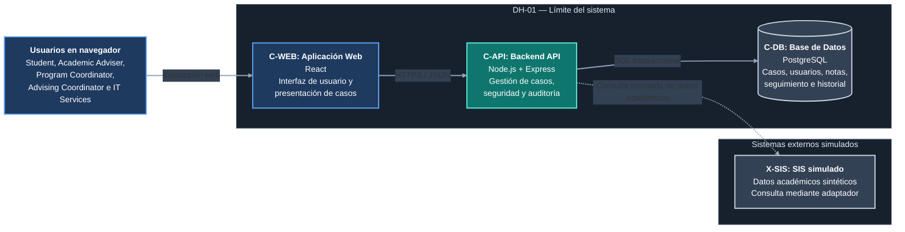

# DH-01 — Vista de Contenedores del Sistema

**Proyecto:** Academic Advising Case Management System  
**ID de la vista:** V-CON  
**Estilo de modelado:** C4 Model — Container Level  
**Decisión arquitectónica principal:** ADR-001 — Modular Monolith Architecture  
**Decisiones relacionadas:** ADR-002, ADR-003, ADR-004 y ADR-005  
**Estado:** Diseño propuesto

## 1. Propósito

La vista de contenedores describe la organización técnica de alto nivel del Academic Advising Case Management System (DH-01).

A diferencia de la vista de contexto, que identifica a los usuarios y sistemas externos, esta vista muestra las principales unidades que conforman la solución, sus responsabilidades y las relaciones de comunicación entre ellas.

En el modelo C4, un contenedor representa una aplicación ejecutable, un servicio o un almacén de datos. No debe confundirse necesariamente con un contenedor Docker.

La arquitectura propuesta busca mantener una implementación comprensible y viable para el alcance del proyecto, sin sacrificar la separación de responsabilidades, la protección de información sensible ni la integridad de las operaciones de negocio.

DH-01 seguirá una arquitectura de monolito modular, compuesta por una aplicación web, un backend centralizado y una base de datos relacional.

La consulta de información académica institucional se representará mediante una integración simulada, sin conexión confirmada con el SIS real de Horizon University.

Esta vista también permite identificar los protocolos previstos, los límites entre unidades desplegables y la ubicación de los mecanismos centrales de autenticación, autorización, persistencia y auditoría.

## 2. Diagrama de contenedores



**Figura V-CON.** Vista de contenedores propuesta para el Academic Advising Case Management System.

El diagrama presenta tres contenedores internos: `C-WEB`, `C-API` y `C-DB`. Estos se encuentran dentro del límite de DH-01 y representan, respectivamente, la interfaz web, el backend y la persistencia de información.

El sistema `X-SIS` se encuentra fuera de ese límite porque representa una dependencia institucional simulada mediante un servicio mock independiente.

**Convenciones del diagrama:**

- Las líneas continuas representan las comunicaciones principales previstas entre usuarios y contenedores.
- La línea punteada representa la integración simulada con el SIS.
- Los recuadros azules identifican actores o aplicaciones de presentación.
- El recuadro verde azulado identifica el backend principal de DH-01.
- Los elementos gris azulados identifican almacenamiento o dependencias externas.

La autenticación se implementará dentro de `C-API`. No se incluye un proveedor institucional de identidad externo, conforme a la decisión establecida en ADR-004.

La interacción con `X-SIS` no implica acceso a registros académicos reales. Su propósito será permitir pruebas controladas con datos sintéticos.

## 3. Descripción general de la arquitectura

La solución estará organizada en tres contenedores internos principales:

1. `C-WEB` — Aplicación Web.
2. `C-API` — Backend API.
3. `C-DB` — Base de Datos PostgreSQL.

Adicionalmente, se contempla una dependencia externa simulada:

- `X-SIS` — Simulador del Student Information System.

Los usuarios interactuarán con la aplicación web, que proporcionará interfaces adaptadas a las responsabilidades de cada rol.

La aplicación web se comunicará con el backend mediante solicitudes HTTPS y respuestas JSON en los entornos desplegados.

El backend será responsable de ejecutar las reglas de negocio, aplicar las verificaciones de seguridad, coordinar las operaciones sobre los casos y conservar la información mediante una base de datos relacional.

Esta distribución permite separar la presentación de la lógica de negocio y de la persistencia, evitando que la interfaz tenga acceso directo a la base de datos.

Los procesos centrales de asesoría académica permanecerán dentro de un único backend organizado en módulos internos.

La comunicación con el simulador del SIS se realizará a través de un adaptador de integración definido dentro de `C-API`, evitando que las reglas centrales de gestión de casos dependan directamente del formato de un sistema institucional externo.

### 3.1. Principio de separación de responsabilidades

Cada contenedor tendrá una responsabilidad principal:

| Identificador | Contenedor | Responsabilidad |
|---|---|---|
| C-WEB | Aplicación Web | Presentar información y permitir la interacción de los usuarios. |
| C-API | Backend API | Ejecutar reglas de negocio, validar permisos y coordinar operaciones. |
| C-DB | Base de Datos | Almacenar datos persistentes y garantizar restricciones de integridad. |
| X-SIS | SIS simulado | Proporcionar datos académicos sintéticos mediante una interfaz de prueba. |

Esta separación es funcional y arquitectónica. No significa que cada módulo interno del backend deba desplegarse como un servicio independiente.

### 3.2. Límites de confianza

La aplicación web se ejecutará en el navegador del usuario y, por tanto, no se considerará un entorno confiable para aplicar las reglas definitivas de seguridad.

El backend deberá validar la identidad, la autorización y los datos recibidos antes de ejecutar operaciones protegidas.

La base de datos permanecerá accesible únicamente para los componentes de servidor autorizados.

Las respuestas del SIS simulado se tratarán como información recibida desde una dependencia externa y deberán validarse antes de utilizarse en operaciones de negocio.

## 4. Contenedor C-WEB — Aplicación Web

**Identificador:** C-WEB  
**Nombre:** Aplicación Web  
**Tecnología propuesta:** React  
**Tipo:** Aplicación cliente ejecutada en navegador  
**Responsabilidad principal:** Presentación e interacción con los usuarios

### 4.1. Descripción

La aplicación web proporcionará la interfaz mediante la cual los diferentes stakeholders interactuarán con DH-01.

Su diseño deberá facilitar las tareas frecuentes de estudiantes, asesores y coordinadores, mostrando la información y las operaciones pertinentes según el contexto del usuario autenticado.

La aplicación web no será responsable de determinar de manera definitiva si una operación está autorizada.

Aunque podrá adaptar sus controles visuales según el rol, todas las operaciones protegidas deberán verificarse en el backend.

### 4.2. Responsabilidades

Las responsabilidades principales de `C-WEB` serán:

- Presentar formularios para solicitudes y referencias.
- Mostrar listas y detalles de casos.
- Permitir registrar recomendaciones y actividades de seguimiento.
- Proporcionar controles para operaciones de asignación y reasignación autorizadas.
- Mostrar información operacional según el rol.
- Gestionar la navegación entre secciones.
- Presentar mensajes de validación y errores.
- Comunicar al backend las acciones solicitadas.
- Representar de forma comprensible los estados del ciclo de vida de los casos.
- Mostrar únicamente la información proporcionada por los contratos de API correspondientes.

### 4.3. Interfaces según el rol

La interfaz deberá contemplar experiencias diferenciadas para los principales stakeholders.

**Student**

Permitirá registrar solicitudes, consultar su estado, responder solicitudes de información y revisar recomendaciones autorizadas.

**Academic Adviser**

Permitirá revisar casos asignados, registrar notas y recomendaciones, administrar actividades de seguimiento y ejecutar operaciones de atención permitidas.

**Program Coordinator**

Permitirá crear referencias autorizadas y consultar información del programa que esté dentro de su alcance.

**Advising Coordinator**

Permitirá supervisar el triage, administrar asignaciones y consultar información operacional según sus permisos.

**IT Services**

Permitirá acceder únicamente a las funciones técnicas o administrativas que sean necesarias y estén autorizadas.

La disponibilidad visual de estas funciones no sustituirá la validación de permisos del servidor.

### 4.4. Consideraciones de seguridad

La aplicación web deberá evitar presentar información restringida a usuarios no autorizados.

Sin embargo, ocultar botones, campos o pantallas no será considerado un control de autorización suficiente.

La validación definitiva de permisos deberá ejecutarse en `C-API`.

La aplicación tampoco tendrá acceso directo a las credenciales de la base de datos.

El manejo de sesiones deberá ajustarse al mecanismo seleccionado en el diseño de seguridad.

Cuando se utilicen cookies de sesión, deberán considerarse medidas como los atributos `HttpOnly`, `Secure` y `SameSite`, así como protección contra CSRF cuando corresponda.

La aplicación no deberá almacenar contraseñas ni secretos institucionales.

### 4.5. Comunicación

`C-WEB` se comunicará con `C-API` mediante una interfaz REST sobre HTTPS, intercambiando principalmente información en formato JSON.

Las operaciones contempladas incluirán:

- Inicio y cierre de sesión.
- Creación de solicitudes.
- Consulta de casos.
- Actualización de información autorizada.
- Registro de seguimiento.
- Asignación y reasignación.
- Consulta de información operacional.

Los endpoints, formatos de mensajes, códigos de respuesta y mecanismos concretos de autenticación se especificarán en `design/interfaces.md` y `design/security.md`.

## 5. Contenedor C-API — Backend API

**Identificador:** C-API  
**Nombre:** Backend API  
**Tecnología propuesta:** Node.js + Express  
**Tipo:** Aplicación de servidor  
**Estilo arquitectónico:** Monolito modular  
**Responsabilidad principal:** Ejecutar las reglas de negocio y proteger los recursos

### 5.1. Descripción

`C-API` constituirá el núcleo funcional de DH-01.

Concentrará las operaciones relacionadas con la autenticación, gestión de casos, clasificación, asignaciones, actividades de seguimiento, resolución, auditoría y consultas operacionales.

Aunque estas responsabilidades se implementarán dentro de una misma aplicación desplegable, se organizarán en módulos para reducir el acoplamiento y mantener límites claros entre las funciones.

La elección de un monolito modular responde a ADR-001 y busca evitar la complejidad operativa de una arquitectura distribuida para el alcance previsto.

### 5.2. Módulos internos propuestos

La descomposición inicial del backend contempla los siguientes módulos lógicos.

**Authentication and Authorization**

Gestionará la autenticación interna de usuarios de prueba, la validación de sesiones y las políticas de autorización basadas en roles y recursos.

**Case Management**

Gestionará la creación, consulta y actualización autorizada de los casos de asesoría.

**Triage and Assignment**

Gestionará la clasificación inicial y las asignaciones o reasignaciones de responsables, conforme a las reglas de negocio.

**Follow-up and Resolution**

Gestionará actividades de seguimiento, recomendaciones y condiciones de resolución de casos.

**Notes and Confidentiality**

Controlará los registros internos y la información destinada al estudiante, aplicando restricciones según el tipo de dato.

**Audit and History**

Registrará acciones relevantes para conservar la trazabilidad de la evolución de los casos.

**Reporting and Operational Queries**

Proporcionará consultas y agregaciones autorizadas para apoyar la supervisión del servicio de asesoría.

**SIS Integration Adapter**

Encapsulará las consultas de información académica sintética cuando un flujo requiera datos del SIS simulado.

Estos módulos representan una separación lógica dentro del mismo proceso de backend y no constituyen contenedores independientes.

Sus dependencias e interfaces internas se desarrollarán en la vista de componentes.

### 5.3. Autenticación interna

La autenticación formará parte de `C-API`.

Se utilizarán cuentas ficticias representativas de los diferentes roles definidos para el sistema.

El backend deberá verificar credenciales, identificar al usuario autenticado y aplicar mecanismos seguros de gestión de sesiones.

No se requiere una conexión con el proveedor institucional de identidad de Horizon University para el prototipo.

Las contraseñas deberán almacenarse mediante algoritmos de hash adecuados, y las operaciones protegidas deberán rechazar solicitudes que no cuenten con autenticación válida.

Esta decisión responde a ADR-004.

### 5.4. Autorización basada en recursos

La autorización combinará el rol institucional con la relación del usuario respecto al caso solicitado.

Por ejemplo, un Academic Adviser no podrá consultar automáticamente todas las notas internas de la universidad por el simple hecho de tener ese rol.

El backend deberá comprobar:

- La identidad del usuario autenticado.
- Su rol institucional.
- La asignación vigente del caso.
- Los permisos asociados con la operación.
- La categoría de información solicitada.
- El alcance institucional permitido.

Estas verificaciones se aplicarán tanto a consultas como a modificaciones.

La decisión responde a ADR-004 y al escenario QS-01.

### 5.5. Gestión del ciclo de vida

El backend centralizará las reglas relacionadas con los estados de los casos.

El modelo de estados definido para DH-01 contempla:

- `NEW`.
- `UNDER_TRIAGE`.
- `ASSIGNED`.
- `IN_PROGRESS`.
- `WAITING_FOR_INFORMATION`.
- `FOLLOW_UP`.
- `RESOLVED`.

Las transiciones permitidas deberán comprobarse antes de actualizar un caso.

No se permitirá que los clientes modifiquen libremente el estado sin que el backend valide las reglas correspondientes.

Las condiciones exactas de transición y los eventos asociados se documentarán en `design/lifecycle-and-runtime.md`.

Esta responsabilidad responde a ADR-003.

### 5.6. Integridad de las operaciones

Las operaciones que modifiquen de manera relacionada diferentes registros deberán mantener la consistencia de los datos.

Por ejemplo, una reasignación de caso podrá requerir:

1. Comprobar que el usuario tiene permiso para reasignar.
2. Verificar que el caso permite la operación.
3. Actualizar el responsable vigente.
4. Registrar el historial correspondiente.
5. Confirmar la operación de manera consistente.

Estas acciones deberán ejecutarse dentro de una transacción cuando la consistencia dependa de que todas se confirmen correctamente.

El backend también deberá considerar controles frente a modificaciones concurrentes, especialmente cuando dos usuarios intenten cambiar el estado o la asignación del mismo caso.

Los mecanismos específicos podrán incluir bloqueo transaccional, control de versiones u otras estrategias compatibles con PostgreSQL.

La selección definitiva se documentará en el diseño del dominio y los flujos de ejecución.

### 5.7. Auditoría

El backend será responsable de registrar los eventos relevantes de negocio, incluyendo:

- Creación de casos.
- Cambios de estado.
- Asignaciones.
- Reasignaciones.
- Registro o modificación de información relevante.
- Resolución de casos.
- Otras acciones definidas por los requisitos de trazabilidad.

Cuando un evento de auditoría sea indispensable para la trazabilidad de una modificación, ambos cambios deberán conservarse de manera atómica.

La información de auditoría deberá protegerse frente a modificaciones no autorizadas.

Esta responsabilidad se relaciona con ADR-005.

### 5.8. Manejo de errores

`C-API` deberá proporcionar respuestas de error consistentes y comprensibles para los clientes.

El diseño deberá distinguir, entre otros:

- Errores de autenticación.
- Errores de autorización.
- Errores de validación.
- Recursos inexistentes.
- Conflictos por estado inválido.
- Conflictos por actualizaciones concurrentes.
- Fallos de persistencia.
- Fallos de integración con el SIS simulado.

Los errores no deberán exponer contraseñas, secretos, consultas sensibles ni detalles internos innecesarios.

Los contratos específicos se documentarán en `design/interfaces.md`.

## 6. Contenedor C-DB — Base de Datos

**Identificador:** C-DB  
**Nombre:** Base de Datos  
**Tecnología propuesta:** PostgreSQL  
**Tipo:** Almacén relacional persistente  
**Responsabilidad principal:** Conservar información consistente y durable

### 6.1. Descripción

`C-DB` almacenará la información necesaria para administrar el ciclo de vida de las solicitudes de asesoría.

PostgreSQL se propone como motor relacional porque el dominio contiene entidades relacionadas y requiere controlar la integridad de las operaciones.

La decisión responde a ADR-002.

### 6.2. Información almacenada

La base de datos deberá contemplar información asociada con:

- Usuarios y roles de prueba.
- Estudiantes y referencias necesarias para los casos.
- Solicitudes de asesoría.
- Estados y clasificación.
- Asignaciones y reasignaciones.
- Notas internas.
- Recomendaciones visibles para estudiantes.
- Actividades de seguimiento.
- Eventos de auditoría e historial.

Las entidades, atributos, claves y relaciones concretas se definirán en `design/domain-and-data.md`.

### 6.3. Integridad y consistencia

El modelo de datos deberá considerar:

- Claves primarias y relaciones entre entidades.
- Restricciones de integridad referencial.
- Identificación del responsable vigente de cada caso.
- Registro histórico de modificaciones relevantes.
- Restricciones necesarias para evitar datos inconsistentes.
- Transacciones para operaciones que afecten varios registros.
- Mecanismos que impidan conflictos o pérdidas de actualizaciones concurrentes.

El diseño deberá evitar que un fallo parcial produzca cambios de estado o asignaciones sin los registros correspondientes.

### 6.4. Acceso a la base de datos

La aplicación web no tendrá acceso directo a PostgreSQL.

`C-API` será el responsable de realizar las consultas y modificaciones mediante una capa de persistencia.

Esta separación permitirá centralizar las reglas de negocio y aplicar controles de acceso antes de ejecutar las operaciones.

La conexión entre `C-API` y `C-DB` utilizará el protocolo correspondiente al controlador de PostgreSQL, con consultas y transacciones SQL.

La protección del canal de conexión dependerá del entorno de despliegue. Cuando la comunicación atraviese redes no confiables, deberá configurarse cifrado de transporte.

Las credenciales de conexión deberán permanecer fuera del código fuente y gestionarse mediante mecanismos adecuados al entorno.

### 6.5. Recuperación y persistencia

La persistencia de los registros confirmados deberá mantenerse ante reinicios del backend.

La recuperación frente a fallos del servidor de base de datos requerirá procedimientos adicionales, como respaldos y restauración, según los supuestos de despliegue.

La utilización de PostgreSQL no garantiza por sí sola la existencia de respaldos, alta disponibilidad o recuperación automática.

Estos aspectos se desarrollarán en `deployment-assumptions.md` y en los escenarios de validación correspondientes.

## 7. Sistema externo simulado X-SIS

**Identificador:** X-SIS  
**Nombre:** Student Information System (SIS) — Simulador  
**Tipo:** Servicio externo de prueba  
**Responsabilidad:** Proporcionar contexto académico sintético

### 7.1. Descripción

El Student Information System es el sistema institucional que administra información académica oficial.

DH-01 no reemplazará esta plataforma ni modificará sus registros.

Debido a que no se dispone de una conexión confirmada con el SIS real de Horizon University, cualquier interacción necesaria para el prototipo utilizará datos sintéticos.

El diagrama representa `X-SIS` como un servicio mock independiente para ilustrar y validar una dependencia externa.

Esta decisión no implica que exista una integración real con la universidad.

### 7.2. Estrategia de simulación

El diseño contempla dos elementos complementarios:

**SIS Integration Adapter**

Será un módulo interno de `C-API`. Su responsabilidad consistirá en encapsular la comunicación con el sistema externo y transformar sus respuestas al formato requerido por DH-01.

**X-SIS — Servicio mock**

Representará el sistema externo y devolverá respuestas de prueba con información académica ficticia.

Para mantener coherencia con la Vista de Contenedores, el prototipo que demuestre esta interacción deberá utilizar un servicio mock separado de `C-API`, aunque pueda ejecutarse en el mismo equipo o entorno de desarrollo.

Por ejemplo, una consulta podrá devolver:

```json
{
  "studentId": "STU-001",
  "program": "Computer Science",
  "academicStatus": "ACTIVE"
}
```

Los datos utilizados no corresponderán a estudiantes reales.

La estructura anterior es ilustrativa y no constituye un contrato definitivo de integración.

### 7.3. Protocolo de comunicación

Se propone que `C-API` consulte `X-SIS` mediante una API HTTP con respuestas JSON.

En entornos desplegados que lo requieran, esta comunicación deberá utilizar HTTPS.

Las rutas, estructuras de respuesta y códigos de error se definirán en `design/interfaces.md`.

La denominación de integración simulada se refiere a la naturaleza del servicio y de los datos, no a la ausencia de una comunicación técnica entre `C-API` y el mock.

### 7.4. Límites de responsabilidad

El SIS simulado proporcionará únicamente la información académica necesaria para los casos de uso que la requieran.

La gestión de solicitudes, estados, asignaciones, seguimiento y resolución permanecerá bajo responsabilidad de DH-01.

El simulador no podrá modificar los datos de los casos ni escribir directamente en `C-DB`.

Si la integración simulada falla, las operaciones que no dependan de información académica externa deberán poder continuar, siempre que se cumplan las reglas de negocio y seguridad aplicables.

### 7.5. Manejo de fallos

El adaptador deberá contemplar situaciones como:

- Servicio no disponible.
- Tiempo de espera agotado.
- Respuesta inválida.
- Estudiante sintético no encontrado.
- Información incompleta.

El backend deberá comunicar estos errores de forma controlada.

No deberá sustituir automáticamente una respuesta fallida por información inventada presentada como válida.

Los detalles del contrato y del manejo de errores se documentarán en `design/interfaces.md`.

## 8. Relaciones entre contenedores

| Origen | Destino | Comunicación | Propósito |
|---|---|---|---|
| Usuarios | C-WEB | Interacción mediante navegador | Utilizar las funcionalidades de DH-01. |
| C-WEB | C-API | HTTPS / REST / JSON | Consultar y modificar recursos autorizados. |
| C-API | C-DB | Protocolo PostgreSQL / SQL transaccional | Persistir y recuperar información de manera consistente. |
| C-API | X-SIS | HTTP(S) / JSON, mediante adaptador | Obtener contexto académico sintético cuando sea necesario. |

### 8.1. Flujo general de una solicitud

Una operación típica seguirá esta secuencia:

1. El usuario interactúa con `C-WEB`.
2. La aplicación envía una solicitud a `C-API`.
3. El backend verifica la autenticación y autorización.
4. El módulo correspondiente valida las reglas de negocio.
5. El backend consulta o modifica la información almacenada en `C-DB`.
6. Si la operación lo requiere, se registra el evento de auditoría.
7. El backend devuelve una respuesta limitada a los datos autorizados.
8. La aplicación web presenta el resultado al usuario.

La consulta a `X-SIS` únicamente ocurrirá en las operaciones que requieran información académica contextual.

### 8.2. Ejemplo de creación de una solicitud

Cuando un Student registra una solicitud:

1. El estudiante completa el formulario en `C-WEB`.
2. `C-WEB` envía la información a `C-API`.
3. `C-API` identifica al usuario y valida los datos recibidos.
4. El módulo Case Management comprueba las reglas de creación.
5. `C-API` registra la solicitud en `C-DB`.
6. Se registra el evento de auditoría correspondiente.
7. El backend devuelve el identificador y el estado inicial del caso.
8. La aplicación muestra la confirmación al estudiante.

La creación no deberá depender de `X-SIS` salvo que una regla funcional validada exija consultar información académica antes de aceptar la solicitud.

### 8.3. Ejemplo de reasignación

Cuando un Advising Coordinator reasigna un caso:

1. El usuario solicita la reasignación desde `C-WEB`.
2. `C-API` verifica sus permisos.
3. Se comprueba que el caso y el nuevo responsable cumplen las condiciones aplicables.
4. El backend inicia una transacción.
5. Se actualiza la asignación vigente.
6. Se registra el evento de reasignación y su historial.
7. Se confirma la transacción.
8. Se devuelve el resultado a la aplicación.

Si alguna operación necesaria falla, la transacción deberá revertirse para evitar un cambio parcial de responsabilidad.

### 8.4. Ejemplo de consulta académica simulada

Cuando una operación requiera contexto académico:

1. `C-API` determina que necesita información adicional.
2. El SIS Integration Adapter prepara la solicitud.
3. El adaptador consulta `X-SIS`.
4. El servicio mock devuelve datos sintéticos o un error controlado.
5. El adaptador valida y transforma la respuesta.
6. El módulo de negocio utiliza únicamente la información autorizada y pertinente.
7. `C-API` devuelve al cliente la información que corresponda según los permisos.

No se consultarán registros académicos oficiales durante este flujo.

## 9. Decisiones de diseño y justificación

### 9.1. Monolito modular frente a microservicios

Se selecciona un backend monolítico modular porque los procesos del sistema comparten entidades y requieren operaciones consistentes.

Separar prematuramente estas funcionalidades en múltiples servicios introduciría mayores necesidades de comunicación, despliegue, observabilidad y gestión de fallos distribuidos.

El diseño modular permite mantener responsabilidades diferenciadas sin asumir esos costos operativos.

No se propone un Background Worker independiente en esta vista, ya que todavía no se ha establecido un requisito que justifique separar procesos asíncronos en otro contenedor.

Si posteriormente se identifica una necesidad de procesamiento diferido, deberá evaluarse su impacto antes de modificar la arquitectura.

**Referencia:** ADR-001.

### 9.2. Base de datos relacional

La gestión de casos requiere mantener relaciones consistentes entre usuarios, solicitudes, asignaciones, actividades e historial.

PostgreSQL ofrece capacidades apropiadas para representar estas relaciones y ejecutar transacciones.

**Referencia:** ADR-002.

### 9.3. Reglas de negocio centralizadas

Las transiciones de estado y operaciones sensibles deberán verificarse dentro de `C-API`.

Esto evita que diferentes interfaces implementen versiones inconsistentes de las mismas reglas.

**Referencia:** ADR-003.

### 9.4. Autenticación interna y autorización contextual

La autenticación interna permite utilizar usuarios ficticios sin depender del sistema de identidad institucional.

La autorización deberá considerar tanto los roles como los recursos específicos.

**Referencia:** ADR-004.

### 9.5. Auditoría persistente

Las acciones relevantes deberán registrarse de forma consistente con las modificaciones que representan.

El almacenamiento de eventos de negocio permanecerá dentro de `C-DB`, coordinado por `C-API`.

**Referencia:** ADR-005.

### 9.6. Aislamiento de integraciones externas

La interacción con `X-SIS` se realizará mediante un adaptador interno.

Esta separación permitirá reemplazar el servicio mock por otra implementación futura sin incorporar directamente las particularidades del SIS a los módulos centrales de negocio.

La sustitución por un servicio institucional real requerirá autorización, revisión de seguridad y validación del contrato de integración.

## 10. Atributos de calidad

### 10.1. Seguridad

La arquitectura separa la interfaz del backend y centraliza las verificaciones de acceso.

Las respuestas deberán evitar exponer notas internas o información fuera del alcance del usuario.

La base de datos no será accesible directamente desde el navegador.

**Escenario relacionado:** QS-01.

### 10.2. Integridad

Las operaciones sobre el ciclo de vida de los casos deberán respetar las transiciones y restricciones definidas.

Las transacciones contribuirán a evitar actualizaciones parciales.

El backend deberá considerar conflictos de concurrencia sobre casos y asignaciones.

**Escenario relacionado:** QS-02.

### 10.3. Auditabilidad

La persistencia de eventos de negocio permitirá reconstruir acciones relevantes y cambios de responsabilidad.

Los registros necesarios para la trazabilidad deberán conservarse de forma consistente con las operaciones correspondientes.

**Escenario relacionado:** QS-03.

### 10.4. Rendimiento

La separación de responsabilidades permitirá identificar consultas críticas y optimizar las operaciones del backend y la base de datos.

El rendimiento deberá medirse mediante escenarios reproducibles con datos sintéticos.

Las consultas operacionales deberán considerar paginación, filtros e índices según el diseño detallado.

**Escenario relacionado:** QS-04.

### 10.5. Mantenibilidad

La estructura modular permitirá modificar funciones específicas sin afectar innecesariamente al resto de la aplicación.

Se deberán establecer contratos claros entre módulos para evitar dependencias circulares y acoplamiento excesivo.

**Escenario relacionado:** QS-05.

### 10.6. Usabilidad

La aplicación web deberá presentar flujos comprensibles para los distintos tipos de usuarios.

La interfaz podrá adaptar la navegación a los roles, sin sustituir las verificaciones de seguridad del backend.

**Escenario relacionado:** QS-06.

### 10.7. Recuperación

La persistencia en PostgreSQL permitirá conservar la información confirmada ante reinicios de la aplicación, siempre que la infraestructura y los procedimientos de recuperación estén configurados correctamente.

La validación deberá diferenciar entre reiniciar el backend y recuperar la base de datos después de un fallo.

**Escenario relacionado:** QS-07.

## 11. Supuestos y restricciones

Esta vista se basa en los siguientes supuestos de diseño:

- React, Node.js, Express y PostgreSQL son tecnologías propuestas para la solución, no servicios institucionales confirmados.
- El backend se desplegará como una única aplicación modular.
- Los usuarios del prototipo tendrán identidades ficticias.
- No se utilizarán registros académicos reales.
- La autenticación se implementará internamente en `C-API`.
- Las operaciones sensibles verificarán autorización en el backend.
- La conexión con el SIS real no forma parte del alcance propuesto.
- `X-SIS` se representará mediante un servicio mock separado para las pruebas que requieran integración.
- El SIS Integration Adapter formará parte de `C-API`, no será un contenedor independiente.
- `C-WEB` no establecerá conexiones directas con `C-DB`.
- No se contempla inicialmente un servicio independiente de procesamiento en segundo plano.
- La infraestructura definitiva y los detalles de despliegue permanecen sujetos a `deployment-assumptions.md`.
- La existencia del diagrama no implica que los contenedores ya estén implementados o que sus integraciones hayan sido verificadas.

### 11.1. Decisiones pendientes de detalle

Aunque los límites generales están definidos, deberán precisarse posteriormente:

- El mecanismo concreto de sesión y su duración.
- La estructura y organización física de los módulos del backend.
- Los contratos definitivos de la API.
- El modelo relacional de datos.
- La estrategia específica de control de concurrencia.
- Los procedimientos de respaldo y recuperación.
- El contrato de integración con `X-SIS`.
- La configuración de despliegue y las restricciones de red.

Estos aspectos se desarrollarán en los documentos de diseño correspondientes.

## 12. Riesgos arquitectónicos

| Riesgo | Impacto potencial | Medida propuesta |
|---|---|---|
| Acoplamiento excesivo entre módulos del backend | Dificultad de mantenimiento | Definir responsabilidades e interfaces internas claras. |
| Consultas sin validación adecuada de permisos | Exposición de información sensible | Centralizar autorización y realizar pruebas negativas. |
| Operaciones de varios registros sin transacciones | Inconsistencia de casos e historial | Utilizar transacciones y restricciones de integridad. |
| Actualizaciones concurrentes sobre un mismo caso | Pérdida de cambios o asignaciones inconsistentes | Definir una estrategia de control de concurrencia. |
| Dependencia excesiva de X-SIS | Fallos en operaciones que deberían funcionar de forma autónoma | Aislar la integración y definir comportamiento ante fallos. |
| Consultas operacionales costosas | Respuestas lentas | Diseñar índices, filtros y paginación; validar cargas sintéticas. |
| Autenticación de prueba implementada de forma insegura | Acceso no autorizado | Aplicar controles seguros de contraseñas y sesiones. |
| Exposición directa de la base de datos | Acceso indebido o alteración de información | Restringir conexiones a componentes autorizados. |
| Ausencia de procedimientos de recuperación | Pérdida de disponibilidad o información | Definir respaldo, restauración y pruebas de recuperación. |

Estos riesgos deberán revisarse durante el diseño detallado y la validación.

La existencia de medidas propuestas no significa que se hayan implementado o probado.

## 13. Verificación de la vista

La vista podrá verificarse mediante una combinación de revisión de diseño y pruebas del prototipo.

### 13.1. Revisión arquitectónica

Se comprobará que:

- Cada contenedor tenga responsabilidades claramente definidas.
- `C-WEB` no acceda directamente a `C-DB`.
- Las reglas de negocio permanezcan dentro de `C-API`.
- La autenticación y autorización no dependan exclusivamente de la interfaz.
- Las operaciones que requieren consistencia se ejecuten mediante mecanismos adecuados.
- El simulador `X-SIS` esté separado de los módulos centrales de negocio.
- La comunicación con `X-SIS` se realice a través de un adaptador.
- Los identificadores del diagrama coincidan con los utilizados en el documento.
- Las relaciones del diagrama coincidan con los contratos y supuestos de despliegue.

### 13.2. Validación mediante prototipo

Cuando los contenedores estén implementados, se podrán comprobar:

- Comunicación entre `C-WEB` y `C-API`.
- Inicio de sesión de usuarios de prueba.
- Acceso permitido y denegado según los roles y recursos.
- Persistencia de casos en `C-DB`.
- Recuperación de información confirmada tras reiniciar el backend.
- Registro de eventos relevantes.
- Reasignaciones atómicas.
- Manejo de solicitudes concurrentes.
- Consulta de datos académicos sintéticos mediante `X-SIS`.
- Manejo controlado de fallos de integración.

### 13.3. Evidencias previstas

Las evidencias podrán incluir:

- Resultados de pruebas automatizadas.
- Solicitudes y respuestas de API.
- Registros de ejecución sin información sensible.
- Capturas de los flujos principales.
- Resultados de pruebas de autorización.
- Comprobaciones de persistencia y consistencia.
- Resultados de escenarios de fallo del SIS simulado.

Las evidencias se organizarán dentro de `validation/evidence/`.

Estos puntos constituyen verificaciones previstas y no resultados de ejecución.

## 14. Trazabilidad

| Elemento | Relación con la vista |
|---|---|
| AD-01 | Integridad de casos y operaciones. |
| AD-02 | Confidencialidad y control de acceso. |
| AD-03 | Auditoría e historial. |
| AD-04 | Consistencia del seguimiento y la resolución. |
| AD-05 | Mantenibilidad y separación modular. |
| AD-06 | Consultas y supervisión operacional. |
| AD-07 | Viabilidad del despliegue. |
| ADR-001 | Arquitectura de monolito modular. |
| ADR-002 | Persistencia relacional mediante PostgreSQL. |
| ADR-003 | Reglas del ciclo de vida y operaciones atómicas. |
| ADR-004 | Autenticación interna y autorización basada en recursos. |
| ADR-005 | Auditoría persistente. |
| V-CTX | Vista de contexto del sistema. |
| QS-01 | Seguridad y acceso restringido a notas. |
| QS-02 | Integridad del ciclo de vida y concurrencia. |
| QS-03 | Auditoría e historial. |
| QS-04 | Rendimiento de consultas operacionales. |
| QS-05 | Mantenibilidad. |
| QS-06 | Usabilidad. |
| QS-07 | Persistencia y recuperación. |

### 14.1. Relación con otros documentos

La vista se complementa con los siguientes documentos:

- [Vista de Contexto](system-context.md).
- [Decisiones Arquitectónicas](../adr/README.md).
- [Requisitos y Drivers Arquitectónicos](../requirements-and-drivers.md).
- [Escenarios de Calidad](../quality-scenarios.md).
- [Diseño de Dominio y Datos](../design/domain-and-data.md).
- [Ciclo de Vida y Comportamiento](../design/lifecycle-and-runtime.md).
- [Diseño de Interfaces](../design/interfaces.md).
- [Diseño de Seguridad](../design/security.md).
- [Supuestos de Despliegue](../deployment-assumptions.md).
- [Plan de Pruebas](../validation/test-plan.md).

Los enlaces a documentos aún no elaborados se resolverán conforme avance la documentación.

## 15. Conclusión

La vista de contenedores propone una arquitectura compuesta por una aplicación web React (`C-WEB`), un Backend API desarrollado con Node.js y Express (`C-API`) y una base de datos relacional PostgreSQL (`C-DB`).

El backend adoptará un monolito modular que centralizará la lógica de negocio, las verificaciones de seguridad, la gestión del ciclo de vida de los casos y la auditoría.

La autenticación interna con usuarios de prueba permitirá validar los mecanismos de acceso sin depender de un proveedor de identidad institucional real.

El SIS permanecerá como una dependencia institucional externa representada mediante un servicio mock (`X-SIS`) y una integración con datos sintéticos.

Los contenedores internos se comunicarán mediante interfaces definidas y mantendrán límites claros de responsabilidad. Las operaciones que requieran consistencia utilizarán mecanismos transaccionales, mientras que las políticas de autorización se aplicarán desde el backend.

Esta estructura constituye la base para definir la organización de los componentes internos de `C-API`, el modelo de dominio, los contratos de interfaz, los mecanismos de seguridad, los supuestos de despliegue y las pruebas de validación.