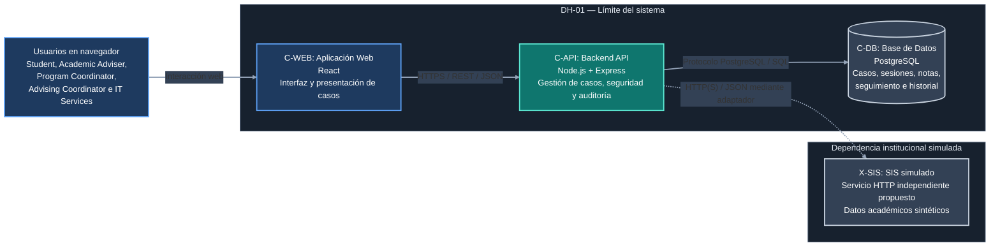

# DH-01 — Vista de Contenedores del Sistema

**ID de la vista:** V-CON  
**Estilo de modelado:** C4 Model — Container Level  
**Decisión arquitectónica principal:** ADR-001 — Modular Monolith Architecture  
**Decisiones relacionadas:** ADR-002, ADR-003, ADR-004 y ADR-005  
**Estado:** Vista arquitectónica propuesta; contenedores no implementados

## 1. Propósito

La vista de contenedores describe la organización técnica de alto nivel del Academic Advising Case Management System (DH-01), identificando las principales unidades de la solución, sus responsabilidades y las relaciones de comunicación previstas.

A diferencia de la vista de contexto, que identifica actores y dependencias institucionales, esta vista representa los contenedores técnicos que permitirían implementar las capacidades del sistema.

En el modelo C4, un contenedor representa una aplicación ejecutable, un servicio o un almacén de datos. No equivale necesariamente a un contenedor Docker.

DH-01 propone una arquitectura de **monolito modular**, compuesta por una aplicación web React, un backend Node.js/Express y una base de datos PostgreSQL.

También se contempla un servicio HTTP simulado que representa la integración con el Student Information System (SIS), utilizando exclusivamente información académica sintética.

Esta organización busca mantener una separación clara entre presentación, lógica de negocio, persistencia e integración externa, con una complejidad operacional compatible con las restricciones del proyecto.

La vista permite identificar:

- Los principales contenedores y sus responsabilidades.
- Las tecnologías seleccionadas.
- Los protocolos y las relaciones de comunicación.
- Los límites de confianza entre unidades.
- La ubicación de la lógica de negocio y la autorización.
- El aislamiento de la persistencia y las dependencias externas.
- Las decisiones arquitectónicas relacionadas.

**Alcance de la Evaluación 2:** los contenedores y sus relaciones forman parte de una propuesta de diseño. No se ha implementado ni desplegado un prototipo funcional.

## 2. Diagrama de contenedores



**Figura V-CON.** Vista de contenedores propuesta para el Academic Advising Case Management System.

El diagrama identifica tres contenedores internos:

- `C-WEB`: aplicación web React.
- `C-API`: backend Node.js/Express organizado como monolito modular.
- `C-DB`: base de datos relacional PostgreSQL.

`X-SIS` se representa fuera del límite de DH-01 porque corresponde a una dependencia institucional simulada mediante un servicio mock independiente.

### Convenciones del diagrama

- Las líneas continuas representan las comunicaciones principales previstas.
- La línea punteada identifica la integración simulada con el SIS.
- Los recuadros azules representan usuarios o presentación.
- El recuadro verde azulado identifica el backend principal.
- Los elementos gris azulados representan persistencia y dependencias externas.

La autenticación se propone dentro de `C-API`, conforme a ADR-004. No se representa un proveedor de identidad institucional externo.

La integración `X-SIS` utiliza datos sintéticos y no implica acceso al SIS real de Horizon University.

**El diagrama representa una arquitectura diseñada, no servicios actualmente desplegados.**

## 3. Descripción general de la arquitectura

La solución estará organizada en tres contenedores internos:

1. `C-WEB` — Aplicación Web.
2. `C-API` — Backend API.
3. `C-DB` — Base de Datos PostgreSQL.

Adicionalmente, se contempla la dependencia externa simulada:

- `X-SIS` — Student Information System Mock.

Los usuarios interactuarán con `C-WEB`, que presentará información y acciones según sus responsabilidades.

La aplicación web se comunicará con `C-API` mediante contratos REST/JSON, utilizando HTTPS en los entornos de despliegue previstos.

El backend será responsable de autenticar usuarios, verificar permisos, ejecutar reglas de negocio, coordinar cambios de estado y conservar información mediante PostgreSQL.

Los procesos principales de asesoría académica permanecerán dentro de una única aplicación backend, organizada en módulos internos.

La comunicación con `X-SIS` estará encapsulada mediante un adaptador de integración dentro de `C-API`.

Esta distribución evita que la interfaz acceda directamente a la base de datos o que el dominio dependa de los formatos específicos del SIS.

### 3.1. Principio de separación de responsabilidades

| Identificador | Contenedor | Responsabilidad |
|---|---|---|
| C-WEB | Aplicación Web | Presentar información y facilitar la interacción. |
| C-API | Backend API | Aplicar reglas de negocio, autorización y coordinación de operaciones. |
| C-DB | Base de Datos | Conservar información persistente y aplicar restricciones de integridad. |
| X-SIS | SIS simulado | Proporcionar contexto académico sintético mediante un contrato HTTP. |

La separación es lógica y arquitectónica.

Los módulos internos de `C-API` no representan servicios independientes y no requieren despliegues individuales.

### 3.2. Límites de confianza

La arquitectura establece distintos límites de confianza:

**Navegador y C-WEB**

El navegador se considera un entorno no confiable para la aplicación definitiva de reglas de seguridad.

Aunque la interfaz podrá ocultar acciones o adaptar la navegación, el backend deberá comprobar todas las operaciones protegidas.

**C-WEB y C-API**

Toda solicitud deberá pasar por autenticación, validación de entradas y autorización contextual.

El cliente no podrá imponer identidades, roles ni estados del caso mediante campos arbitrarios.

**C-API y C-DB**

La base de datos será accesible solamente desde componentes de servidor autorizados.

Las operaciones que afecten registros relacionados deberán utilizar mecanismos transaccionales adecuados.

**C-API y X-SIS**

Las respuestas del simulador se tratarán como datos provenientes de una dependencia externa.

El adaptador verificará los formatos y manejará errores antes de entregar información a los módulos de negocio.

## 4. Contenedor C-WEB — Aplicación Web

**Identificador:** C-WEB  
**Nombre:** Aplicación Web  
**Tecnología propuesta:** React  
**Tipo:** Aplicación cliente ejecutada en navegador  
**Responsabilidad principal:** Presentación e interacción con los usuarios

### 4.1. Descripción

`C-WEB` proporcionará la interfaz mediante la cual los stakeholders interactuarán con DH-01.

Su diseño buscará facilitar las tareas de estudiantes, asesores y coordinadores, presentando estados, responsables y acciones según el contexto de cada actor.

El frontend podrá adaptar las opciones visuales a los permisos recibidos, pero no será responsable de aplicar las decisiones finales de autorización.

Todas las operaciones protegidas deberán verificarse en `C-API`.

### 4.2. Responsabilidades

Las responsabilidades principales de `C-WEB` serán:

- Presentar formularios para solicitudes y referencias autorizadas.
- Mostrar listas y detalles de casos.
- Permitir registrar recomendaciones y actividades de seguimiento.
- Proporcionar controles de clasificación, asignación y reasignación según permisos.
- Mostrar consultas operacionales autorizadas.
- Gestionar navegación y estados de interfaz.
- Presentar mensajes de validación y errores.
- Enviar las acciones al backend.
- Representar los estados del ciclo de vida de forma comprensible.
- Mostrar únicamente los campos proporcionados por los contratos correspondientes.
- Actualizar la información visible después de operaciones confirmadas.

La interfaz no modificará directamente el estado académico de un caso sin utilizar una operación definida en `C-API`.

### 4.3. Interfaces según el rol

**Student**

Permitirá crear solicitudes, consultar su estado, responder solicitudes de información y revisar recomendaciones destinadas al estudiante.

No tendrá acceso a `InternalNote` ni a los metadatos internos protegidos.

**Academic Adviser**

Permitirá revisar los casos bajo asignación vigente, registrar notas internas y recomendaciones, gestionar seguimientos y realizar acciones de atención autorizadas.

El acceso dependerá de la relación actual del adviser con cada caso.

**Program Coordinator**

Permitirá registrar referencias autorizadas y consultar información operacional dentro de su alcance académico.

La creación de una referencia no implica automáticamente permiso para consultar las notas internas del caso.

**Advising Coordinator**

Permitirá administrar el triage, clasificaciones, asignaciones y reasignaciones, así como consultar información operacional dentro de su ámbito de responsabilidad.

En el diseño inicial, las operaciones de triage y asignación corresponden a este rol autorizado.

**IT Services**

Dispondrá exclusivamente de las funciones técnicas o administrativas expresamente autorizadas.

Este rol no recibirá acceso indiscriminado a datos académicos sensibles por su responsabilidad tecnológica.

La disponibilidad de pantallas y controles no sustituirá la autorización del backend.

### 4.4. Consideraciones de seguridad

`C-WEB` deberá aplicar medidas de presentación segura y manejo adecuado de sesiones.

Se propone:

- No almacenar contraseñas ni secretos.
- No utilizar el frontend como fuente definitiva de permisos.
- Evitar mostrar contenido interno no autorizado.
- Presentar errores sin exponer información sensible.
- Mantener las sesiones conforme a los contratos de seguridad.
- Utilizar cookies protegidas y solicitudes autenticadas.
- Enviar el encabezado CSRF requerido en operaciones de escritura.
- Tratar como no confiables los datos ingresados por usuarios.

El diseño de autenticación utiliza cookies `HttpOnly`, `Secure` y `SameSite=Lax`, junto con protección CSRF según el contrato documentado.

La política definitiva de acceso se aplicará en `C-API`.

### 4.5. Comunicación

`C-WEB` se comunicará con `C-API` mediante REST/JSON bajo la base de rutas propuesta `/api/v1`.

Entre las operaciones contempladas se encuentran:

- Inicio y cierre de sesión.
- Registro de solicitudes.
- Consulta de casos.
- Clasificación y asignación autorizadas.
- Solicitudes de información.
- Registro de notas y recomendaciones.
- Seguimientos.
- Reasignaciones.
- Resolución.
- Consultas operacionales.

Las operaciones de escritura utilizarán las condiciones de autorización, control de versión y protección CSRF definidas en los contratos.

Los detalles se documentan en:

- [Diseño de Interfaces](../design/interfaces.md).
- [Diseño de Seguridad](../design/security.md).

## 5. Contenedor C-API — Backend API

**Identificador:** C-API  
**Nombre:** Backend API  
**Tecnología propuesta:** Node.js + Express  
**Tipo:** Aplicación de servidor  
**Estilo arquitectónico:** Monolito modular  
**Responsabilidad principal:** Ejecutar reglas de negocio y proteger recursos

### 5.1. Descripción

`C-API` representa el núcleo funcional de DH-01.

Concentrará las operaciones de autenticación, gestión de casos, clasificación, asignación, atención, seguimiento, resolución, auditoría y consultas operacionales.

Estas capacidades estarán organizadas en módulos internos dentro de una única aplicación backend desplegable.

La organización modular busca reducir el acoplamiento, definir contratos y facilitar la evolución de políticas sin incorporar complejidad distribuida innecesaria.

La decisión corresponde a ADR-001.

### 5.2. Módulos internos propuestos

La descomposición detallada de `C-API` contempla diez componentes lógicos.

| ID | Componente | Responsabilidad |
|---|---|---|
| CMP-01 | API Controllers | Recibir solicitudes HTTP, validar formatos y construir respuestas. |
| CMP-02 | Authentication & Authorization | Autenticar, gestionar sesiones y aplicar autorización contextual. |
| CMP-03 | Case Management | Gestionar casos, estados y operaciones principales. |
| CMP-04 | Triage & Assignment | Clasificar, asignar y reasignar responsables. |
| CMP-05 | Follow-up & Resolution | Gestionar información adicional, seguimientos y resolución. |
| CMP-06 | Notes & Confidentiality | Proteger notas internas y separar recomendaciones. |
| CMP-07 | Reporting & Queries | Proporcionar consultas y métricas operacionales autorizadas. |
| CMP-08 | Audit & History | Registrar eventos y conservar historial. |
| CMP-09 | Persistence Layer | Coordinar repositorios, transacciones y acceso a PostgreSQL. |
| CMP-10 | SIS Integration Adapter | Encapsular la interacción con X-SIS. |

Estos componentes constituyen responsabilidades internas de `C-API`.

No requieren ejecutarse como servicios separados ni constituyen contenedores adicionales de la vista V-CON.

Las interfaces y dependencias internas se detallan en la [Vista de Componentes](component-view.md).

### 5.3. Autenticación interna

La autenticación estará centralizada en `C-API` y utilizará identidades sintéticas correspondientes a los roles definidos.

ADR-004 propone sesiones opacas administradas por el servidor, persistidas mediante la tabla técnica `SESSION` en PostgreSQL.

El backend será responsable de:

- Verificar credenciales almacenadas mediante hashes seguros.
- Crear y revocar sesiones.
- Validar expiración y estado de la cuenta.
- Conservar únicamente el digest del token de sesión.
- Aplicar protección CSRF.
- Impedir operaciones no autenticadas.

Los parámetros técnicos propuestos incluyen sesiones con un límite de 30 minutos de inactividad y ocho horas de duración absoluta.

Estas medidas corresponden a decisiones de diseño y deberán comprobarse durante una implementación futura.

No se requiere conectividad con un proveedor institucional de identidad real para evaluar la propuesta arquitectónica.

### 5.4. Autorización basada en recursos

La autorización combinará:

- Identidad autenticada.
- Rol institucional.
- Relación vigente con el caso.
- Ámbito académico autorizado.
- Operación solicitada.
- Sensibilidad de la información.

Por ejemplo, un Academic Adviser no podrá consultar las notas internas de todos los casos únicamente por poseer ese rol.

Deberá existir una relación autorizada con el recurso solicitado.

Las verificaciones se aplicarán a operaciones de lectura y escritura.

También se comprobará la pertenencia de recursos anidados, como notas, seguimientos y solicitudes de información.

Cuando se produzca una reasignación, los permisos asociados con la asignación anterior deberán reevaluarse.

Estas decisiones responden a ADR-004 y QS-01.

### 5.5. Gestión del ciclo de vida

`C-API` centralizará las transiciones de estado de los casos.

El modelo inicial propone siete estados:

1. `NEW`
2. `UNDER_TRIAGE`
3. `ASSIGNED`
4. `IN_PROGRESS`
5. `WAITING_FOR_INFORMATION`
6. `FOLLOW_UP`
7. `RESOLVED`

Cada operación deberá validar las condiciones necesarias antes de modificar el estado.

No se permitirá que el cliente cambie libremente `AdvisingCase.status` mediante una actualización genérica.

En particular, la resolución requerirá:

- Estado válido para cerrar.
- Responsable autorizado.
- Versión vigente.
- `Recommendation` registrada.
- Ausencia de `FollowUp` en estado `PENDING`.
- Ausencia de `InformationRequest` en estado `OPEN`.

Los estados y las condiciones definitivas todavía requieren la validación institucional indicada en BR-09.

El comportamiento completo está documentado en [Ciclo de Vida e Interacciones](../design/lifecycle-and-runtime.md).

### 5.6. Integridad de las operaciones

Las operaciones relacionadas deberán conservar consistencia entre los registros afectados.

Por ejemplo, una reasignación requiere:

1. Autenticar y autorizar al actor.
2. Comprobar el estado actual del caso.
3. Validar la elegibilidad del nuevo responsable.
4. Aplicar el cambio de asignación.
5. Conservar el historial.
6. Registrar el evento obligatorio de auditoría.
7. Confirmar la operación de forma atómica.

El diseño propone transacciones PostgreSQL, bloqueo común del caso y control de versión mediante `expectedVersion`.

Las operaciones que compitan sobre un mismo caso deberán coordinarse para impedir estados contradictorios.

Si una condición obligatoria falla, la operación deberá revertirse sin cambios parciales.

El mecanismo se encuentra definido en [Dominio y Datos](../design/domain-and-data.md) y [Ciclo de Vida e Interacciones](../design/lifecycle-and-runtime.md).

Su funcionamiento todavía no ha sido verificado mediante pruebas de concurrencia o rollback.

### 5.7. Auditoría

`C-API` deberá registrar los eventos relevantes del proceso académico.

Entre ellos se contemplan:

- Creación de casos.
- Inicio de triage.
- Clasificación.
- Asignación.
- Reasignación.
- Cambios de estado.
- Acciones de seguimiento.
- Solicitudes y recepción de información.
- Resolución.

Los eventos obligatorios deberán almacenarse dentro de la misma transacción que la modificación de negocio correspondiente.

El historial utilizará `AuditEvent.caseSequence` para conservar un orden verificable de eventos dentro del caso.

La auditoría no deberá duplicar innecesariamente contenido confidencial, como textos de notas internas.

Esta responsabilidad corresponde a ADR-005 y QS-03.

### 5.8. Manejo de errores

`C-API` deberá proporcionar respuestas consistentes para situaciones como:

- Falta de autenticación.
- Autorización insuficiente.
- Datos inválidos.
- Recursos inexistentes.
- Transiciones no permitidas.
- Versiones desactualizadas.
- Conflictos de concurrencia.
- Fallos de persistencia.
- Errores de integración con X-SIS.

Las respuestas deberán respetar los contratos definidos y evitar la exposición de información sensible.

Los errores HTTP, sus estructuras y el manejo de conflictos se detallan en [Diseño de Interfaces](../design/interfaces.md).

## 6. Contenedor C-DB — Base de Datos

**Identificador:** C-DB  
**Nombre:** Base de Datos  
**Tecnología propuesta:** PostgreSQL  
**Tipo:** Almacén relacional persistente  
**Responsabilidad principal:** Conservar información consistente y durable

### 6.1. Descripción

`C-DB` representará la persistencia central de DH-01.

PostgreSQL fue seleccionado debido a las relaciones existentes entre usuarios, programas, casos, clasificaciones, asignaciones, seguimientos, recomendaciones y eventos.

La base de datos proporcionará mecanismos para aplicar restricciones de integridad, ejecutar transacciones y consultar información estructurada.

Esta decisión responde a ADR-002.

### 6.2. Información almacenada

Entre las entidades y estructuras documentadas se encuentran:

- `User` y `Role`.
- `UserProgramScope`.
- `StudentProfile`.
- `AcademicProgram`.
- `RequestCategory`.
- `AdvisingCase`.
- `CaseClassification`.
- `CaseAssignment`.
- `FollowUp`.
- `InformationRequest`.
- `InternalNote`.
- `Recommendation`.
- `AuditEvent`.
- `SESSION`, como tabla técnica de autenticación.

El modelo completo, atributos y relaciones están documentados en [Dominio y Datos](../design/domain-and-data.md).

`SESSION` no representa un concepto académico, sino una estructura técnica destinada a administrar sesiones opacas del servidor.

### 6.3. Integridad y consistencia

El diseño contempla:

- Claves primarias y foráneas.
- Restricciones de integridad referencial.
- Una única asignación vigente por caso.
- Conservación de asignaciones anteriores.
- Historial ordenado de eventos.
- Restricciones para evitar datos inconsistentes.
- Transacciones sobre operaciones relacionadas.
- Bloqueos y controles de concurrencia.
- Validación de versiones durante escrituras.

El backend y PostgreSQL deberán colaborar para impedir que un error parcial deje cambios de estado o asignación sin los registros obligatorios correspondientes.

La integridad relacional se evaluará mediante T-DATA-01 y la atomicidad mediante T-TXN-01.

### 6.4. Acceso a la base de datos

`C-WEB` no establecerá conexiones directas con PostgreSQL.

El acceso se realizará mediante `C-API` y su capa de persistencia CMP-09.

La conexión utilizará el protocolo correspondiente a PostgreSQL y operaciones SQL.

Las credenciales deberán gestionarse fuera del código fuente.

El acceso de red se limitará a los componentes de servidor autorizados.

Cuando la comunicación atraviese redes no confiables, deberá protegerse mediante cifrado de transporte.

La configuración específica dependerá de los [Supuestos de Despliegue](../deployment-assumptions.md).

### 6.5. Recuperación y persistencia

Los registros confirmados deberán mantenerse cuando se reinicie `C-API`, siempre que PostgreSQL y su almacenamiento persistente permanezcan disponibles.

La recuperación frente a fallos de la base de datos requerirá mecanismos adicionales.

Por ello, el diseño contempla:

- Almacenamiento persistente.
- Procedimientos de respaldo.
- Restauración controlada.
- Comprobaciones posteriores a la recuperación.
- Identificación de dependencias y condiciones del entorno.

PostgreSQL no garantiza por sí solo alta disponibilidad ni restauración automática.

Estos mecanismos deberán comprobarse mediante T-REC-01 y T-REC-02 durante una eventual implementación.

## 7. Sistema externo simulado X-SIS

**Identificador:** X-SIS  
**Nombre:** Student Information System — Simulador  
**Tipo:** Servicio HTTP externo simulado  
**Responsabilidad:** Proporcionar contexto académico sintético

### 7.1. Descripción

El Student Information System representa la plataforma institucional encargada de administrar información académica oficial.

DH-01 no reemplazará el SIS ni modificará registros académicos institucionales.

Como no existe una integración institucional confirmada, se propone representar esta dependencia mediante un servicio mock independiente.

El objetivo del simulador es permitir que los contratos y mecanismos de integración puedan evaluarse posteriormente sin acceder a datos reales.

**X-SIS es parte del diseño propuesto. No se incluye un servicio mock implementado en la entrega de la Evaluación 2.**

### 7.2. Estrategia de simulación

El diseño distingue dos elementos.

**SIS Integration Adapter — CMP-10**

Será un módulo interno de `C-API`.

Sus responsabilidades incluirán:

- Preparar solicitudes de consulta.
- Validar identificadores sintéticos.
- Comunicarse con X-SIS.
- Verificar respuestas externas.
- Transformar los datos al formato del dominio.
- Manejar fallos controlados.

**X-SIS — Servicio mock**

Será un servicio separado que representará una dependencia externa.

Devolverá respuestas sintéticas y permitirá simular situaciones de disponibilidad, error y demora.

Una respuesta ilustrativa podría ser:

```json
{
  "studentId": "STU-001",
  "program": "Computer Science",
  "academicStatus": "ACTIVE"
}
```

Esta representación contiene datos ficticios.

El ejemplo es ilustrativo y no sustituye el contrato específico documentado en [Diseño de Interfaces](../design/interfaces.md).

La separación entre adaptador y simulador permitirá probar la frontera de integración cuando exista una implementación.

### 7.3. Protocolo de comunicación

`C-API` consultará X-SIS mediante HTTP y respuestas JSON.

En entornos que lo requieran, se utilizará HTTPS.

Las rutas, campos, códigos de respuesta y tiempos de espera se encuentran definidos o propuestos en el documento de interfaces.

El timeout de integración propuesto es de 2.000 ms.

La expresión *integración simulada* se refiere a los datos y a la representación del sistema externo, no a que se omita una comunicación técnica en una futura implementación.

### 7.4. Límites de responsabilidad

X-SIS únicamente proporcionará información académica contextual.

No administrará:

- Estados de casos.
- Asignaciones.
- Seguimientos.
- Notas.
- Recomendaciones.
- Resoluciones.
- Historial de DH-01.

Tampoco escribirá directamente sobre `C-DB`.

Si X-SIS falla, las operaciones que no dependan de información académica externa deberán continuar cuando sus propias reglas lo permitan.

El backend será responsable de distinguir entre fallos de integración y errores de negocio.

### 7.5. Manejo de fallos

El adaptador deberá contemplar:

- Servicio no disponible.
- Tiempo de espera agotado.
- Respuestas inválidas.
- Estudiante sintético no encontrado.
- Información incompleta.
- Errores de comunicación.

Los fallos se comunicarán mediante respuestas controladas.

No se sustituirá automáticamente una respuesta fallida por información inventada presentada como válida.

El manejo de estos escenarios será evaluado mediante T-SIS-01 cuando exista una implementación.

## 8. Relaciones entre contenedores

| Origen | Destino | Comunicación | Propósito |
|---|---|---|---|
| Usuarios | C-WEB | Navegador web. | Utilizar las funciones de DH-01. |
| C-WEB | C-API | HTTPS / REST / JSON. | Consultar y modificar recursos autorizados. |
| C-API | C-DB | Protocolo PostgreSQL / SQL. | Persistir y consultar información. |
| C-API | X-SIS | HTTP(S) / JSON mediante CMP-10. | Consultar contexto académico sintético. |

Las relaciones representan interfaces arquitectónicas propuestas, no conexiones desplegadas actualmente.

### 8.1. Flujo general de una solicitud

Una operación típica seguirá esta secuencia:

1. El usuario interactúa con `C-WEB`.
2. La aplicación envía una solicitud a `C-API`.
3. El backend valida la sesión.
4. Se comprueba la autorización contextual.
5. El componente responsable valida las reglas de negocio.
6. Se consulta o modifica la información necesaria en `C-DB`.
7. Si corresponde, se registra el evento de auditoría en la misma transacción.
8. El backend construye una respuesta limitada a la información autorizada.
9. `C-WEB` presenta el resultado.

Las consultas a `X-SIS` se realizarán únicamente cuando una operación requiera información académica contextual.

### 8.2. Ejemplo de creación de una solicitud

Cuando un Student registra una solicitud:

1. Completa el formulario en `C-WEB`.
2. `C-WEB` envía la información a `C-API`.
3. El backend identifica al estudiante autenticado.
4. Se validan los datos y las condiciones de creación.
5. Case Management prepara el nuevo caso.
6. La capa de persistencia registra `AdvisingCase` y el evento de auditoría dentro de una transacción.
7. Se confirma la operación.
8. El backend devuelve el identificador y el estado inicial `NEW`.
9. La interfaz presenta la confirmación.

La creación no dependerá de X-SIS salvo que una regla funcional confirmada requiera consultar información académica antes de aceptar la solicitud.

### 8.3. Ejemplo de reasignación

Cuando un Advising Coordinator reasigna un caso:

1. Solicita la operación desde `C-WEB`.
2. `C-API` verifica su sesión y autorización.
3. Se comprueba la asignación vigente y la versión esperada.
4. Se valida la elegibilidad del nuevo Academic Adviser.
5. Se bloquea el caso mediante el mecanismo transaccional propuesto.
6. Se actualiza la asignación vigente y se conserva la anterior.
7. Se registra el evento de auditoría correspondiente.
8. Se incrementa la versión del caso según el contrato.
9. Se confirma la transacción.
10. El backend devuelve el resultado autorizado.

Si una condición obligatoria falla, toda la operación deberá revertirse.

### 8.4. Ejemplo de consulta académica simulada

Cuando un flujo requiera contexto académico:

1. `C-API` determina que necesita información externa.
2. CMP-10 prepara la solicitud.
3. El adaptador consulta X-SIS.
4. El simulador devuelve datos sintéticos o una respuesta de error.
5. CMP-10 valida y transforma la información.
6. El componente de negocio utiliza los campos necesarios.
7. El backend devuelve al cliente únicamente la información autorizada.

Este procedimiento no accederá a registros académicos institucionales reales.

## 9. Decisiones de diseño y justificación

### 9.1. Monolito modular frente a microservicios

La propuesta selecciona un monolito modular porque los procesos de DH-01 comparten información y requieren operaciones consistentes sobre casos, asignaciones, seguimientos e historial.

Una arquitectura de microservicios introduciría complejidad adicional de comunicación, despliegue, observabilidad y coordinación de datos.

La separación modular permite organizar responsabilidades sin asumir inicialmente esos costos.

No se incluye un Background Worker independiente porque el alcance actual no establece una necesidad que justifique otro contenedor ejecutable.

Una futura necesidad de procesamiento asíncrono requeriría una nueva evaluación arquitectónica.

**Referencia:** ADR-001.

### 9.2. Base de datos relacional

PostgreSQL se selecciona para representar relaciones entre usuarios, casos, responsables, solicitudes, seguimientos y auditoría.

El modelo relacional y las transacciones permitirán implementar mecanismos de integridad definidos en la propuesta.

**Referencia:** ADR-002.

### 9.3. Reglas de negocio centralizadas

Las transiciones de estado, autorización y condiciones de resolución se verificarán dentro de `C-API`.

Esto evita depender de las validaciones de diferentes interfaces para proteger los invariantes del sistema.

**Referencia:** ADR-003.

### 9.4. Autenticación interna y autorización contextual

La propuesta utiliza autenticación interna con usuarios sintéticos para evitar depender de un proveedor institucional de identidad durante una implementación de prueba.

La autorización considera roles, relaciones y recursos concretos.

**Referencia:** ADR-004.

### 9.5. Auditoría persistente

Las operaciones importantes generarán eventos de auditoría almacenados en PostgreSQL.

Los cambios de negocio y sus eventos obligatorios se confirmarán o revertirán conjuntamente.

**Referencia:** ADR-005.

### 9.6. Aislamiento de integraciones externas

La comunicación con X-SIS se encapsula en CMP-10.

Esta separación permitiría sustituir el servicio simulado por una integración real en una fase posterior, previa autorización institucional y revisión de seguridad.

La sustitución requeriría comprobar el contrato, los datos permitidos y las consecuencias sobre los módulos de negocio.

## 10. Atributos de calidad

### 10.1. Seguridad

La arquitectura separa presentación, reglas de negocio y persistencia.

La autorización contextual se centraliza en `C-API` para impedir accesos indebidos a notas y recursos protegidos.

La base de datos no es accesible directamente desde el navegador.

**Escenario relacionado:** QS-01.

**Validación prevista:** T-SEC-01 y T-SEC-02.

### 10.2. Integridad

Las operaciones deberán respetar estados, condiciones de negocio y control de concurrencia.

Se proponen transacciones PostgreSQL, bloqueo común y validación de versiones para evitar operaciones parciales o contradictorias.

**Escenario relacionado:** QS-02.

**Validación prevista:** T-LIFE-01, T-LIFE-02 y T-TXN-01.

### 10.3. Auditabilidad

La auditoría persistente permitirá reconstruir operaciones relevantes y cambios de responsabilidad.

Los eventos obligatorios se registrarán junto con sus modificaciones de negocio.

**Escenario relacionado:** QS-03.

**Validación prevista:** T-AUD-01 y T-TXN-01.

### 10.4. Rendimiento

La arquitectura contempla consultas estructuradas, filtros, paginación e índices según el modelo de datos.

El rendimiento deberá medirse sobre cargas sintéticas reproducibles.

QS-04 propone evaluar 12.000 casos con 20 solicitudes concurrentes durante cinco minutos, buscando que al menos el 95 % de las respuestas del servidor sean inferiores a 800 ms, sin errores de consulta.

**Escenario relacionado:** QS-04.

**Validación prevista:** T-PERF-01.

### 10.5. Mantenibilidad

Los componentes internos deberán conservar responsabilidades y contratos diferenciados.

Las dependencias entre módulos deberán evitar ciclos y acoplamientos innecesarios.

La modificabilidad se evaluará mediante cambios controlados y pruebas de regresión.

**Escenario relacionado:** QS-05.

**Validación prevista:** T-MOD-01.

### 10.6. Usabilidad

La aplicación web deberá presentar estados, responsables y acciones comprensibles según el rol.

El escenario QS-06 propone comprobar si cuatro de cinco participantes pueden identificar correctamente el estado y la siguiente acción de un caso.

**Escenario relacionado:** QS-06.

**Validación prevista:** T-UX-01.

### 10.7. Recuperación

La persistencia en PostgreSQL permitirá separar la conservación de datos del proceso de ejecución del backend.

QS-07 propone recuperar la capacidad funcional en un máximo de 60 segundos tras un reinicio controlado de `C-API`, manteniendo disponible PostgreSQL.

La restauración de respaldos constituye una verificación adicional.

**Escenario relacionado:** QS-07.

**Validación prevista:** T-REC-01 y T-REC-02.

Los objetivos de esta sección son criterios propuestos, no resultados medidos durante la Evaluación 2.

## 11. Supuestos y restricciones

La vista se fundamenta en los siguientes supuestos:

- React, Node.js, Express y PostgreSQL son tecnologías seleccionadas para la propuesta, no servicios institucionales confirmados.
- `C-API` se plantea como una única aplicación desplegable con módulos internos.
- Las cuentas y los registros de prueba utilizarán datos sintéticos.
- No se accederá al SIS real de Horizon University.
- La autenticación se realizará dentro de `C-API`.
- Las operaciones protegidas exigirán autorización del servidor.
- `C-WEB` no accederá directamente a `C-DB`.
- `X-SIS` será un servicio HTTP simulado independiente cuando se implemente la integración.
- CMP-10 permanecerá dentro de `C-API`.
- No se contempla inicialmente un proceso independiente de procesamiento asíncrono.
- Los recursos y la configuración definitiva dependerán de los supuestos de despliegue.
- Los contenedores representados no han sido implementados ni desplegados en la entrega actual.

Las políticas institucionales pendientes se mantienen identificadas en los requisitos y en el registro de decisiones abiertas.

### 11.1. Decisiones pendientes de detalle o verificación

Los documentos de diseño ya desarrollan los mecanismos principales:

| Aspecto | Definición documental | Estado pendiente |
|---|---|---|
| Sesiones | Cookies opacas, SESSION, tokenDigest y expiración. | Implementación y pruebas. |
| Organización de componentes | CMP-01 a CMP-10 y límites del monolito. | Implementación y revisión de dependencias. |
| Contratos API | Rutas, entradas, respuestas y errores propuestos. | Implementación y pruebas de contrato. |
| Modelo relacional | Entidades, relaciones y restricciones documentadas. | Migraciones y pruebas de integridad. |
| Concurrencia | Bloqueo común y expectedVersion. | Pruebas con PostgreSQL. |
| Respaldos y recuperación | Procedimientos y supuestos propuestos. | Configuración y restauración verificable. |
| Integración SIS | Adaptador, contrato y manejo de fallos. | Implementación del mock y pruebas. |
| Despliegue | Topología, conectividad y configuración propuestas. | Confirmación de recursos y ejecución. |

Por tanto, estos aspectos **no están todos pendientes de diseño**: varios ya cuentan con definiciones técnicas y permanecen pendientes de implementación o verificación.

La aceptación de políticas institucionales corresponde a un proceso separado.

## 12. Riesgos arquitectónicos

| Riesgo | Impacto potencial | Medida propuesta |
|---|---|---|
| Acoplamiento entre módulos. | Dificultad para modificar y mantener el sistema. | Definir responsabilidades y contratos internos. |
| Consultas sin autorización contextual. | Exposición de información sensible. | Centralizar políticas y ejecutar pruebas negativas. |
| Operaciones sin transacciones. | Inconsistencia de casos e historial. | Transacciones y restricciones de integridad. |
| Actualizaciones concurrentes. | Pérdida de cambios o estados contradictorios. | Bloqueo común y control de versiones. |
| Dependencia excesiva de X-SIS. | Fallos en operaciones independientes. | Adaptador y manejo controlado de errores. |
| Consultas operacionales costosas. | Respuestas lentas. | Índices, filtros, paginación y mediciones. |
| Autenticación insegura. | Acceso no autorizado. | Contraseñas protegidas y sesiones seguras. |
| Exposición de PostgreSQL. | Acceso indebido o alteración de datos. | Restricciones de conectividad. |
| Falta de recuperación verificable. | Pérdida de disponibilidad o información. | Respaldos y pruebas de restauración. |

Los riesgos constituyen condiciones potenciales que deberán gestionarse durante una fase posterior.

La definición de medidas no demuestra que hayan sido ejecutadas.

El registro consolidado se encuentra en [Estado del Proyecto](../project-status.md).

## 13. Verificación de la vista

La arquitectura de contenedores podrá revisarse documentalmente y, cuando exista una implementación, evaluarse mediante pruebas técnicas.

Estas dos formas de verificación tienen alcances diferentes.

### 13.1. Revisión arquitectónica

La revisión documental deberá comprobar que:

- Cada contenedor tiene una responsabilidad definida.
- `C-WEB` no accede directamente a `C-DB`.
- Las reglas de negocio permanecen dentro de `C-API`.
- La autenticación y autorización no dependen exclusivamente del navegador.
- Las operaciones consistentes se apoyan en mecanismos transaccionales.
- `X-SIS` aparece separado del límite de DH-01.
- CMP-10 es el único adaptador propuesto para la integración.
- Los identificadores coinciden entre diagramas y documentos.
- Los protocolos coinciden con los contratos y supuestos de despliegue.
- Los componentes internos no se confunden con contenedores desplegables.

La revisión de estos elementos permite evaluar la consistencia del diseño.

No demuestra que exista un sistema ejecutable.

### 13.2. Validación mediante implementación futura

Si posteriormente se implementan los contenedores, podrán evaluarse:

- Comunicación entre `C-WEB` y `C-API`.
- Autenticación y sesiones de usuarios sintéticos.
- Acceso permitido y denegado según rol y relación.
- Persistencia de casos en PostgreSQL.
- Conservación de información al reiniciar el backend.
- Auditoría de operaciones.
- Reasignaciones transaccionales.
- Resolución sin pendientes.
- Operaciones concurrentes.
- Comunicación con X-SIS.
- Respuestas ante fallos del servicio simulado.

Estas verificaciones se encuentran previstas en el plan de validación.

**No se han ejecutado como parte de la entrega documental actual.**

### 13.3. Evidencias previstas

Cuando se realicen pruebas, podrán generarse:

- Resultados de pruebas automatizadas.
- Solicitudes y respuestas HTTP.
- Registros sanitizados de ejecución.
- Capturas de flujos funcionales.
- Comprobaciones de autorización.
- Verificaciones de persistencia.
- Resultados de concurrencia y rollback.
- Pruebas de fallos de X-SIS.
- Mediciones de rendimiento y recuperación.

Las evidencias futuras podrán organizarse en:

`docs/evaluation-2/validation/evidence/`

**Esta ruta es únicamente una ubicación propuesta para resultados futuros. No forma parte de la entrega actual ni debe crearse vacía.**

Los procedimientos y criterios están documentados en:

- [Plan de Validación](../validation/test-plan.md).
- [Resultados de Validación](../validation/findings.md).

La existencia de pruebas previstas no equivale a su ejecución.

## 14. Trazabilidad

La vista de contenedores responde a los drivers, decisiones y escenarios de calidad del proyecto.

| Elemento | Relación con la vista |
|---|---|
| AD-01 | Integridad de casos y operaciones. |
| AD-02 | Confidencialidad y acceso controlado. |
| AD-03 | Auditoría e historial. |
| AD-04 | Consistencia del seguimiento y la resolución. |
| AD-05 | Mantenibilidad y separación modular. |
| AD-06 | Consultas y supervisión operacional. |
| AD-07 | Viabilidad del despliegue. |
| ADR-001 | Arquitectura de monolito modular. |
| ADR-002 | Persistencia mediante PostgreSQL. |
| ADR-003 | Ciclo de vida y operaciones consistentes. |
| ADR-004 | Autenticación y autorización contextual. |
| ADR-005 | Auditoría persistente. |
| V-CTX | Contexto de actores y dependencias externas. |
| V-CMP | Descomposición interna de C-API. |
| V-DEP | Topología y despliegue propuestos. |
| QS-01 | Confidencialidad. |
| QS-02 | Integridad del ciclo de vida. |
| QS-03 | Trazabilidad. |
| QS-04 | Rendimiento. |
| QS-05 | Mantenibilidad. |
| QS-06 | Usabilidad. |
| QS-07 | Recuperación. |

Las relaciones completas entre requisitos, decisiones, componentes y pruebas se encuentran en la [Matriz de Trazabilidad](../traceability.md).

### 14.1. Relación con otros documentos

Esta vista se complementa con:

- [Vista de Contexto](system-context.md).
- [Vista de Componentes](component-view.md).
- [Vista de Despliegue](deployment-view.md).
- [Decisiones Arquitectónicas](../adr/README.md).
- [Requisitos y Drivers Arquitectónicos](../requirements-and-drivers.md).
- [Escenarios de Calidad](../quality-scenarios.md).
- [Diseño de Dominio y Datos](../design/domain-and-data.md).
- [Ciclo de Vida e Interacciones](../design/lifecycle-and-runtime.md).
- [Diseño de Interfaces](../design/interfaces.md).
- [Diseño de Seguridad](../design/security.md).
- [Supuestos de Despliegue](../deployment-assumptions.md).
- [Plan de Validación](../validation/test-plan.md).
- [Resultados de Validación](../validation/findings.md).
- [Estado del Proyecto](../project-status.md).

Estos documentos desarrollan distintos niveles de detalle de una misma propuesta arquitectónica.

Sus identificadores, mecanismos y relaciones deberán mantenerse consistentes durante futuras revisiones.

## 15. Conclusión

La vista de contenedores de DH-01 presenta una arquitectura basada en tres unidades internas: la aplicación web React (`C-WEB`), el backend Node.js/Express (`C-API`) y la base de datos PostgreSQL (`C-DB`).

El backend adopta un **monolito modular** con responsabilidades internas diferenciadas, permitiendo centralizar las reglas del ciclo de vida, la autorización contextual, la gestión de casos y la auditoría.

La autenticación propuesta utiliza sesiones internas con identidades sintéticas, evitando depender de un proveedor institucional real durante una fase de pruebas.

La integración académica se representa mediante `X-SIS`, un servicio mock externo que proporcionaría datos sintéticos a través del adaptador CMP-10.

Las relaciones entre contenedores establecen límites claros: la interfaz no accede directamente a PostgreSQL, el backend concentra las operaciones protegidas y los datos externos se validan antes de utilizarse.

La propuesta también establece mecanismos documentados de integridad, auditoría, seguridad y recuperación, cuya eficacia deberá evaluarse cuando exista una implementación.

**La Evaluación 2 entrega esta vista como parte de un diseño arquitectónico documentado, no como evidencia de contenedores implementados o desplegados.**

La vista V-CON proporciona una base consistente para comprender la estructura técnica de DH-01 y relacionarla con la vista de componentes, el modelo de dominio, los contratos, los supuestos de despliegue y el plan de validación.