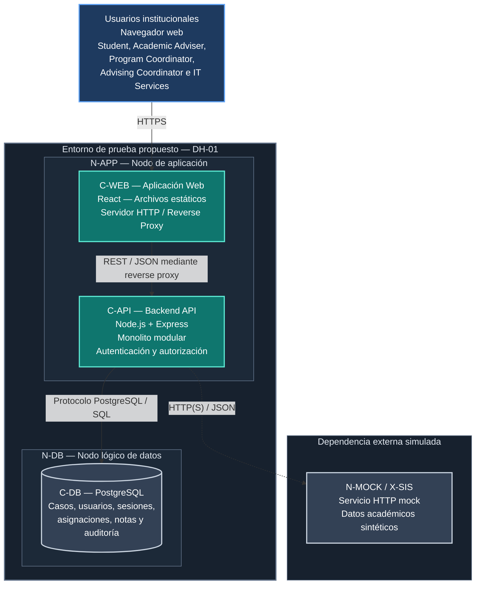

# DH-01 — Vista de Despliegue del Sistema

**ID de la vista:** V-DEP  
**Modelo:** C4 Model — Deployment Level   
**Decisión principal:** ADR-001 — Modular Monolith Architecture  
**Decisiones relacionadas:** ADR-002, ADR-003, ADR-004 y ADR-005  
**Estado:** Vista de despliegue documentada; prototipo HTML interactivo disponible; infraestructura integrada pendiente de implementación y validación

## 1. Propósito y estrategia de despliegue

La vista de despliegue describe cómo se distribuirán los contenedores del Academic Advising Case Management System (DH-01) en un entorno de ejecución.

Su objetivo es identificar los nodos de despliegue, las unidades de software alojadas en ellos, las comunicaciones de red y las responsabilidades técnicas relacionadas con la operación del sistema.

Mientras que la vista de contenedores describe las aplicaciones y almacenes de datos que componen la solución, esta vista muestra dónde se ejecutarán esas unidades y cómo se comunicarán.

La arquitectura propuesta busca facilitar el desarrollo, las pruebas y la demostración del sistema sin introducir dependencias innecesarias de infraestructura institucional.

El despliegue contempla cuatro elementos:

- `C-WEB`: aplicación web React.
- `C-API`: backend Node.js + Express.
- `C-DB`: base de datos PostgreSQL.
- `X-SIS`: servicio HTTP mock del Student Information System.

Se propone una configuración sencilla que pueda ejecutarse en un servidor de prueba o en un equipo de desarrollo.

La arquitectura no requiere inicialmente un clúster, balanceadores de carga, múltiples réplicas del backend ni servicios administrados en la nube.

La separación entre aplicación, datos e integración externa será principalmente lógica. Esto permite alojar diferentes procesos en un mismo equipo durante una futura implementación de prueba, manteniendo sus responsabilidades y controles de acceso.

Se utilizarán usuarios ficticios y datos académicos sintéticos. No se accederá a registros institucionales reales.

**Alcance de la Evaluación 2:** la vista V-DEP representa el despliegue propuesto de la arquitectura integrada. La entrega actual incluye un [prototipo HTML interactivo](../../../prototype/index.html), que se ejecuta directamente en el navegador con datos sintéticos y almacenamiento mediante `localStorage`.

Este prototipo no requiere los nodos `N-APP`, `N-DB` y `N-MOCK`, ni implementa las comunicaciones, sesiones y mecanismos de seguridad representados en el diagrama.

Los contenedores de la arquitectura y su infraestructura permanecen pendientes de implementación y validación.

## 2. Diagrama de despliegue

**Figura V-DEP.** Distribución propuesta de DH-01 en un entorno de prueba y demostración.

El diagrama identifica los nodos lógicos de ejecución y sus comunicaciones.

`N-APP` aloja la aplicación web y el backend. `N-DB` representa el almacenamiento persistente mediante PostgreSQL. `N-MOCK` ejecutaría el servicio simulado del SIS fuera del límite funcional de DH-01.

La separación entre `N-APP` y `N-DB` no exige servidores físicos diferentes. Ambos podrán ejecutarse en un mismo equipo durante una futura implementación integrada, siempre que se mantengan las restricciones de conexión y persistencia.

`N-MOCK` deberá ejecutarse como un proceso o servicio independiente de `C-API`, aunque ambos puedan compartir infraestructura física.

Las líneas continuas muestran las comunicaciones principales y la línea punteada representa la integración externa simulada.

**El diagrama representa una topología propuesta, no servicios actualmente desplegados.** El prototipo HTML disponible funciona de manera independiente y no utiliza los procesos o las conexiones aquí representados.

## 3. Nodos y responsabilidades

### 3.1. N-CLIENT — Navegador del usuario

**Tipo:** Dispositivo cliente  
**Software:** Navegador web moderno  
**Elemento utilizado:** C-WEB, en la arquitectura propuesta

Los usuarios accederán a DH-01 mediante un navegador web, sin necesidad de instalar una aplicación de escritorio.

En la implementación integrada, el navegador cargará los recursos de React, presentará las interfaces correspondientes a cada rol y enviará las solicitudes necesarias al backend.

Sus responsabilidades incluyen:

- Presentar formularios y vistas.
- Capturar información introducida por el usuario.
- Enviar solicitudes a la API.
- Mostrar resultados, estados y errores.
- Mantener el estado de navegación necesario para la experiencia del usuario.

El navegador no será considerado un entorno confiable para aplicar las reglas definitivas de autorización.

No deberá contener credenciales de PostgreSQL ni secretos del backend.

Las comunicaciones públicas en un entorno desplegado utilizarán HTTPS.

El prototipo HTML existente también se ejecuta en el navegador, pero utiliza su propia lógica local y no constituye una implementación integrada de `C-WEB` basada en React.

### 3.2. N-APP — Nodo de aplicación

**Tipo:** Nodo de ejecución de aplicaciones  
**Contenedores alojados:** C-WEB y C-API  
**Tecnologías:** Servidor HTTP, React, Node.js y Express  
**Estado:** Nodo propuesto, no desplegado

Este nodo alojará los elementos necesarios para presentar la interfaz y procesar las solicitudes de los usuarios.

**Aplicación web — C-WEB**

La aplicación React se compilará para producir archivos estáticos que podrán servirse mediante un servidor HTTP o reverse proxy.

La interfaz consumirá los endpoints de `C-API` y no establecerá conexiones directas con PostgreSQL.

**Backend API — C-API**

El backend Node.js + Express se ejecutará como una única aplicación modular.

Contendrá los componentes:

- CMP-01 — API Controllers.
- CMP-02 — Authentication & Authorization.
- CMP-03 — Case Management.
- CMP-04 — Triage & Assignment.
- CMP-05 — Follow-up & Resolution.
- CMP-06 — Notes & Confidentiality.
- CMP-07 — Reporting & Queries.
- CMP-08 — Audit & History.
- CMP-09 — Persistence Layer.
- CMP-10 — SIS Integration Adapter.

El backend ejecutará las reglas de negocio, aplicará las autorizaciones, coordinará las transacciones y registrará los eventos de auditoría correspondientes.

La autenticación utilizará sesiones opacas administradas por el servidor, conforme a ADR-004.

**Servidor HTTP y reverse proxy**

El punto de entrada podrá recibir solicitudes HTTPS, entregar los archivos de React y dirigir las peticiones de API hacia el proceso Node.js.

Cuando ambos servicios compartan un equipo, el tramo entre el proxy y Express podrá utilizar una conexión interna restringida.

Si dicha comunicación atraviesa una red no confiable, deberá protegerse mediante cifrado de transporte.

El puerto interno del backend no necesitará exposición pública directa.

**Supervisión y reinicio**

El proceso Node.js deberá contar con un mecanismo apropiado de inicio y reinicio.

Podrá utilizarse un administrador de procesos o una herramienta equivalente, según el entorno seleccionado.

El reinicio de `C-API` no deberá eliminar información confirmada en PostgreSQL.

**Limitación de la entrega actual:** el prototipo HTML no requiere este nodo de aplicación ni incorpora los componentes CMP-01 a CMP-10 como servicios backend implementados.

### 3.3. N-DB — Nodo lógico de datos

**Tipo:** Nodo lógico de almacenamiento  
**Contenedor alojado:** C-DB  
**Tecnología:** PostgreSQL  
**Estado:** Nodo propuesto, no desplegado

Este nodo será responsable de conservar la información persistente del sistema.

Entre los datos almacenados se encuentran:

- Usuarios, roles y sesiones de prueba.
- Casos académicos y clasificaciones.
- Asignaciones y reasignaciones.
- Seguimientos y solicitudes de información.
- Notas y recomendaciones.
- Eventos de auditoría e historial.

PostgreSQL proporcionará restricciones de integridad y mecanismos transaccionales para apoyar la consistencia de las operaciones.

La separación lógica de `N-DB` permite reconocer sus responsabilidades de almacenamiento, seguridad y recuperación, aunque físicamente se encuentre en el mismo equipo que `N-APP`.

La base de datos no deberá aceptar conexiones públicas innecesarias.

El backend utilizará credenciales con los privilegios requeridos para sus operaciones. Los accesos administrativos deberán gestionarse separadamente cuando corresponda.

Las modificaciones relacionadas, como una reasignación y su evento de auditoría, deberán confirmarse de manera atómica.

La persistencia permitirá conservar los cambios confirmados después de reiniciar el backend, pero no sustituirá una estrategia de respaldo y restauración.

El prototipo HTML utiliza `localStorage` en lugar de PostgreSQL. Este almacenamiento local no permite demostrar las restricciones relacionales, transacciones, respaldos ni mecanismos de recuperación del nodo `N-DB`.

### 3.4. N-MOCK — Simulador del SIS

**Tipo:** Servicio externo simulado  
**Sistema representado:** X-SIS  
**Tecnología:** Servicio HTTP mock  
**Estado:** Servicio propuesto, no implementado

Este nodo proporcionará respuestas académicas sintéticas para los escenarios que requieran información del Student Information System.

El simulador será independiente del proceso principal de `C-API` y no tendrá acceso directo a las tablas de casos de PostgreSQL.

Podrá devolver información como:

- Identificador ficticio del estudiante.
- Programa académico.
- Estado académico general.
- Datos contextuales mínimos necesarios para la asesoría.

La comunicación se realizará mediante el componente SIS Integration Adapter.

El adaptador preparará las solicitudes, validará las respuestas, transformará los datos y manejará errores de comunicación.

El entorno permitirá representar escenarios de respuesta exitosa, estudiante no encontrado, indisponibilidad, tiempo de espera agotado y respuesta inválida.

Las operaciones que no dependan del SIS deberán poder continuar cuando el simulador esté indisponible, siempre que las reglas de negocio lo permitan.

No se considera una conexión real con la infraestructura académica de Horizon University.

El prototipo HTML actual puede representar datos académicos sintéticos, pero no implementa el servicio HTTP independiente `X-SIS` ni su adaptador CMP-10.

## 4. Comunicaciones, configuración y seguridad

### 4.1. Comunicaciones de red

| Origen | Destino | Protocolo | Propósito |
|---|---|---|---|
| Navegador | N-APP / C-WEB | HTTPS | Acceso al sistema y entrega de archivos web. |
| C-WEB | C-API | REST / JSON sobre HTTPS desde el navegador, con enrutamiento interno configurable. | Consultar y modificar recursos autorizados. |
| C-API | C-DB | Protocolo PostgreSQL / SQL. | Consultar y persistir información. |
| C-API | X-SIS | HTTP(S) / JSON. | Consultar información académica sintética. |

La configuración distinguirá cuatro ámbitos:

- **Acceso público:** navegador y punto de entrada HTTPS.
- **Aplicación:** servidor HTTP, reverse proxy y proceso backend.
- **Datos:** PostgreSQL con conectividad restringida.
- **Dependencia simulada:** servicio mock consultado mediante el adaptador.

Esta separación representa límites de responsabilidad y confianza, sin exigir redes físicas independientes para cada ámbito durante una futura implementación de prueba.

Los puertos, dominios, certificados y direcciones concretos se definirán durante la preparación del entorno.

**Estado actual:** estas comunicaciones no están desplegadas. El prototipo HTML no realiza solicitudes REST a `C-API` ni consultas a PostgreSQL o X-SIS.

### 4.2. Configuración y secretos

Los parámetros de configuración deberán mantenerse separados del código fuente.

Entre ellos se incluyen:

- Puerto y entorno de ejecución del backend.
- Dirección y credenciales de PostgreSQL.
- Configuración de autenticación y sesiones.
- Dirección del simulador SIS.
- Tiempos de espera de integración.
- Parámetros de registros técnicos.
- Configuración del servidor HTTP y del reverse proxy.

La aplicación deberá permitir configuraciones diferenciadas para desarrollo, prueba y demostración.

Los secretos no deberán almacenarse en repositorios públicos ni distribuirse a los navegadores.

Las contraseñas de usuarios ficticios deberán almacenarse mediante algoritmos de hash seguros.

Las credenciales del proceso backend deberán respetar el principio de privilegio mínimo.

Estos mecanismos corresponden al diseño de la implementación integrada y no a una configuración de backend actualmente disponible.

### 4.3. Seguridad del despliegue

La arquitectura combinará controles de infraestructura con las políticas de seguridad implementadas en `C-API`.

**Autenticación y autorización**

Las operaciones protegidas requerirán una sesión válida y permisos acordes con el rol, el recurso solicitado y el ámbito institucional autorizado.

Las cookies de sesión deberán utilizar atributos de seguridad apropiados y las operaciones que modifican datos estarán protegidas frente a CSRF.

**Cifrado de comunicaciones**

El acceso desde navegadores utilizará HTTPS en los entornos desplegados.

Las conexiones internas se protegerán según su ubicación y nivel de exposición.

**Protección de PostgreSQL**

La base de datos estará disponible únicamente para los procesos autorizados.

No se expondrá directamente al navegador y utilizará credenciales específicas para las operaciones del backend.

**Protección de información**

El entorno utilizará datos sintéticos y evitará registrar contraseñas, tokens de sesión o contenido confidencial innecesario.

Las notas internas se protegerán mediante autorización contextual.

**Manejo de errores**

Los mensajes enviados al navegador no deberán revelar credenciales, cadenas de conexión, secretos, contenido de otros casos o detalles internos innecesarios.

Los registros técnicos utilizados para diagnóstico se mantendrán diferenciados de los eventos de auditoría de negocio definidos en ADR-005.

Estas medidas deberán implementarse y verificarse en el backend.

El selector de perfiles y los controles visuales del prototipo HTML son simulaciones de comportamiento y no constituyen autenticación, autorización o protección CSRF reales.

## 5. Disponibilidad, recuperación y actualización

### 5.1. Comportamiento ante fallos

**Fallo del backend**

Si el proceso Node.js se detiene, las operaciones dependientes de la API dejarán de estar disponibles temporalmente.

Los datos previamente confirmados deberán permanecer almacenados en PostgreSQL.

**Fallo de PostgreSQL**

Las operaciones que necesiten acceder a la base de datos podrán fallar mientras el servicio esté indisponible.

El backend deberá comunicar los errores sin confirmar falsamente operaciones que no pudieron completarse.

**Fallo del SIS simulado**

La indisponibilidad de `X-SIS` deberá afectar únicamente a las operaciones que dependan de su información.

Las funcionalidades independientes podrán continuar cuando las reglas de negocio lo permitan.

El diseño no presupone alta disponibilidad ni recuperación automática frente a cualquier tipo de fallo.

La configuración propuesta prioriza la viabilidad operacional para el entorno de prueba.

Los escenarios de fallo descritos corresponden a la arquitectura integrada futura y no a componentes desplegados durante la Evaluación 2.

### 5.2. Persistencia, respaldos y restauración

La persistencia cotidiana y la recuperación frente a pérdida de datos son responsabilidades diferentes.

Un reinicio de `C-API` no deberá eliminar los registros confirmados.

Sin embargo, la recuperación frente a fallos de PostgreSQL o pérdida de almacenamiento requerirá procedimientos adicionales de respaldo y restauración.

La estrategia básica deberá definir:

- Información incluida en los respaldos.
- Procedimiento de generación.
- Ubicación y protección de las copias.
- Responsables autorizados.
- Procedimiento de restauración.
- Verificación de integridad de los datos restaurados.

Para demostrar la recuperación será necesario restaurar un respaldo en un entorno controlado y comprobar los registros, relaciones y eventos correspondientes.

El prototipo HTML almacena información local mediante `localStorage`, lo que no sustituye los procedimientos de respaldo y recuperación de PostgreSQL.

### 5.3. Preparación y actualización del entorno

Para ejecutar la solución integrada deberán estar disponibles:

- Entorno compatible con Node.js.
- Aplicación React compilada.
- PostgreSQL configurado.
- Variables de entorno necesarias.
- Esquema de base de datos actualizado.
- Datos ficticios de prueba.
- Servicio mock del SIS para los escenarios que lo requieran.

El inicio de los procesos deberá considerar las dependencias entre servicios.

Las modificaciones del esquema persistente se gestionarán mediante migraciones controladas y documentadas.

Las actualizaciones deberán mantener la compatibilidad entre la aplicación React, los contratos de `C-API`, la estructura de PostgreSQL y el contrato del simulador SIS.

Las instrucciones de ejecución deberán permitir reproducir el entorno, incluyendo dependencias, configuración, comandos de inicio, preparación de datos y comprobaciones básicas.

Las herramientas específicas de automatización y supervisión se seleccionarán según las necesidades reales del proyecto.

**Para ejecutar únicamente el prototipo interactivo de la entrega actual no se necesitan estos servicios.** Basta con abrir `prototype/index.html` en un navegador compatible con JavaScript, siguiendo las indicaciones de [su README](../../../prototype/README.md).

## 6. Riesgos y verificación del despliegue

### 6.1. Riesgos arquitectónicos

| Riesgo | Consecuencia | Mitigación propuesta |
|---|---|---|
| PostgreSQL expuesto públicamente | Acceso no autorizado. | Restringir conexiones y privilegios. |
| Configuración incorrecta de HTTPS | Comunicación insegura. | Verificar cifrado y certificados. |
| Secretos incluidos en el código | Compromiso de credenciales. | Utilizar configuración externa. |
| Reinicios sin persistencia adecuada | Pérdida de información. | Comprobar conservación de datos confirmados. |
| Falta de respaldos | Recuperación limitada. | Definir y comprobar restauraciones. |
| Dependencia excesiva de X-SIS | Interrupción de procesos autónomos. | Aislar integración y manejar fallos. |
| Recursos insuficientes | Lentitud e indisponibilidad. | Evaluar consumo con cargas sintéticas. |
| Migraciones incompatibles | Fallos y pérdida de consistencia. | Utilizar migraciones controladas. |
| Permisos técnicos excesivos | Acceso indebido. | Aplicar privilegios mínimos. |
| Configuración interna expuesta al cliente | Divulgación de secretos. | Separar configuración pública y privada. |
| Entorno no reproducible | Dificultad de demostración. | Documentar procedimientos y dependencias. |
| Confusión entre prototipo e infraestructura implementada | Declaraciones de capacidades técnicas no verificadas. | Mantener diferenciados el HTML local y la arquitectura propuesta. |

Estos riesgos se vinculan con el seguimiento general documentado en [Project Status](../project-status.md).

Las mitigaciones descritas son acciones propuestas y no controles cuya eficacia se haya demostrado.

### 6.2. Verificación funcional

La validación del despliegue integrado deberá comprobar que:

- El navegador puede cargar `C-WEB`.
- `C-WEB` puede comunicarse con `C-API`.
- `C-API` puede conectarse correctamente con PostgreSQL.
- Los usuarios ficticios pueden autenticarse.
- La autorización se aplica en el backend.
- Los casos pueden almacenarse y recuperarse.
- El backend puede consultar `X-SIS` mediante el adaptador.

Estas verificaciones requieren la implementación de los contenedores y no pueden darse por aprobadas debido al funcionamiento del prototipo HTML.

### 6.3. Verificación de seguridad

Se comprobará que:

- PostgreSQL no esté expuesto directamente al navegador.
- Las operaciones protegidas rechacen sesiones inválidas.
- Los usuarios no accedan a información fuera de sus permisos.
- Las notas internas no se entreguen a estudiantes.
- Los secretos permanezcan fuera de los archivos distribuidos al cliente.
- Las cookies y los controles CSRF cumplan el diseño de seguridad.
- Los registros técnicos no incluyan credenciales sensibles.
- Las conexiones públicas utilicen HTTPS en el entorno desplegado.

Las pruebas deberán incluir solicitudes válidas e inválidas para comprobar tanto la protección de recursos como la ejecución de operaciones autorizadas.

### 6.4. Verificación de fallos y recuperación

Se comprobará que:

- Los datos confirmados sobrevivan al reinicio del backend.
- Las operaciones fallidas no se informen como exitosas.
- La indisponibilidad de `X-SIS` produzca una respuesta controlada.
- Las operaciones independientes del simulador puedan continuar.
- Los errores de PostgreSQL no expongan información interna.
- Los cambios de negocio y su auditoría obligatoria mantengan consistencia.
- Un respaldo pueda restaurarse y conservar los registros esperados.

La comprobación de restauración utilizará un conjunto conocido de datos sintéticos, un respaldo verificable y una revisión de las relaciones y eventos almacenados.

### 6.5. Evidencias de validación

Las evidencias previstas podrán incluir:

- Capturas del sistema integrado ejecutándose.
- Registros de inicio de servicios.
- Resultados de pruebas de API.
- Comprobaciones de autorización.
- Resultados de persistencia y reinicio.
- Evidencias de fallos simulados.
- Resultados de respaldo y restauración.

Los procedimientos y criterios detallados se encuentran en el [Plan de Validación](../validation/test-plan.md), mientras que los resultados de ejecución se documentarán en [Validation Findings](../validation/findings.md).

**Estado actual:** las 18 pruebas técnicas del catálogo permanecen en `NOT EXECUTED`.

El prototipo HTML constituye un recurso de demostración disponible, pero no evidencia de despliegue o validación técnica de la arquitectura representada en esta vista.

## 7. Trazabilidad y documentos relacionados

La propuesta de despliegue mantiene relación con los siguientes elementos arquitectónicos:

| Elemento | Relación |
|---|---|
| AD-01 | Integridad y persistencia de operaciones. |
| AD-02 | Protección del acceso y de la información. |
| AD-03 | Conservación de eventos de auditoría. |
| AD-04 | Consistencia del seguimiento y la resolución. |
| AD-05 | Separación modular y mantenibilidad. |
| AD-06 | Consultas y supervisión operacional. |
| AD-07 | Viabilidad y recuperación del entorno. |
| QS-01 | Seguridad y confidencialidad. |
| QS-02 | Integridad y concurrencia. |
| QS-03 | Auditabilidad. |
| QS-04 | Rendimiento. |
| QS-05 | Mantenibilidad. |
| QS-06 | Usabilidad. |
| QS-07 | Persistencia y recuperación. |

**Decisiones arquitectónicas relacionadas:**

- [ADR-001 — Modular Monolith Architecture](../adr/ADR-001.md)
- [ADR-002 — Relational Database and Persistent Data Management](../adr/ADR-002.md)
- [ADR-003 — Controlled Case Lifecycle and Transactional Consistency](../adr/ADR-003.md)
- [ADR-004 — Authentication and Resource-Based Authorization](../adr/ADR-004.md)
- [ADR-005 — Persistent Audit Trail and Case History](../adr/ADR-005.md)

**Vistas complementarias:**

- [System Context View](system-context.md)
- [Container View](container-view.md)
- [Component View](component-view.md)

**Documentos relacionados:**

- [Requirements and Drivers](../requirements-and-drivers.md)
- [Quality Scenarios](../quality-scenarios.md)
- [Deployment Assumptions](../deployment-assumptions.md)
- [Security Design](../design/security.md)
- [API Contracts](../design/interfaces.md)
- [Validation Plan](../validation/test-plan.md)
- [Validation Findings](../validation/findings.md)
- [Traceability Matrix](../traceability.md)
- [Project Status](../project-status.md)
- [Prototipo interactivo y limitaciones](../../../prototype/README.md)

La vista de despliegue establece una distribución técnica compatible con la arquitectura de monolito modular seleccionada para DH-01.

El nodo `N-APP` alojará la aplicación web y el backend, mientras que `N-DB` conservará la información persistente mediante PostgreSQL. El servicio `N-MOCK / X-SIS` representará una dependencia académica externa con datos sintéticos.

La separación lógica de responsabilidades permite plantear la solución sobre una infraestructura sencilla, sin impedir su evolución futura hacia nodos físicos independientes.

El diseño prioriza seguridad, integridad, reproducibilidad y capacidad de recuperación, manteniendo consistencia con las decisiones arquitectónicas, los escenarios de calidad y los mecanismos de validación definidos para DH-01.

**La Evaluación 2 incluye esta vista como diseño de despliegue y un prototipo HTML interactivo independiente. No se han implementado los nodos ni ejecutado las pruebas técnicas necesarias para demostrar que la arquitectura funciona bajo las condiciones propuestas.**