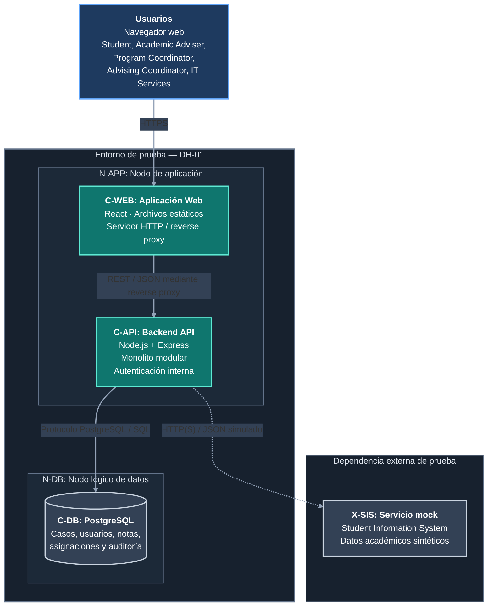

# DH-01 — Vista de Despliegue del Sistema

**Proyecto:** Academic Advising Case Management System  
**ID de la vista:** V-DEP  
**Estilo de modelado:** C4 Model — Deployment Level  
**Entorno representado:** Entorno de prueba y demostración propuesto  
**Decisión arquitectónica principal:** ADR-001 — Modular Monolith Architecture  
**Decisiones relacionadas:** ADR-002, ADR-003, ADR-004 y ADR-005  
**Estado:** Diseño propuesto, pendiente de implementación y validación

## 1. Propósito

La vista de despliegue describe cómo se distribuirán los contenedores del Academic Advising Case Management System (DH-01) en un entorno de ejecución.

Su objetivo es identificar los nodos de despliegue, las unidades de software alojadas en ellos, las conexiones de red y las responsabilidades técnicas relacionadas con la operación de la solución.

Mientras la vista de contenedores presenta la organización de las aplicaciones y almacenes de datos, la vista de despliegue muestra dónde se ejecutarán esas unidades y cómo podrán comunicarse.

La arquitectura propuesta busca facilitar el desarrollo, la demostración y la validación del sistema sin introducir dependencias innecesarias de infraestructura institucional.

El despliegue deberá permitir ejecutar:

- La aplicación web React (`C-WEB`).
- El backend Node.js + Express (`C-API`).
- La base de datos PostgreSQL (`C-DB`).
- El servicio mock del Student Information System (`X-SIS`).

El sistema no utilizará registros académicos reales. Las identidades y los datos empleados durante las pruebas serán ficticios.

Esta vista representa una propuesta de despliegue y no constituye evidencia de infraestructura ya implementada.

## 2. Diagrama de despliegue

**Figura V-DEP.** Vista de despliegue propuesta para el entorno de prueba del Academic Advising Case Management System.

El diagrama identifica los nodos lógicos de ejecución, los contenedores desplegados y las comunicaciones previstas para DH-01.

El entorno se organiza mediante dos responsabilidades principales:

- **N-APP — Nodo de aplicación:** aloja la aplicación React (`C-WEB`) y el backend Node.js + Express (`C-API`).
- **N-DB — Nodo lógico de datos:** aloja PostgreSQL (`C-DB`) y conserva la información persistente del sistema.

Ambos nodos pertenecen al entorno de DH-01. Su separación es lógica y no exige utilizar servidores físicos diferentes. Para el prototipo podrán ejecutarse en un mismo equipo, siempre que se mantengan los controles de acceso y persistencia correspondientes.

El servicio `X-SIS` se representa fuera de los límites de DH-01 porque constituye una dependencia externa simulada que proporcionará datos académicos sintéticos.

### 2.1. Convenciones

- Azul: usuarios y dispositivos cliente.
- Verde azulado: aplicaciones ejecutables de DH-01.
- Gris azulado: almacenamiento persistente e integración externa de prueba.
- Líneas continuas: comunicaciones previstas entre aplicaciones y almacenamiento.
- Línea punteada: comunicación con el SIS simulado.

### 2.2. Interpretación de las comunicaciones

**Navegador → C-WEB**

Los usuarios accederán mediante HTTPS. El servidor web entregará los archivos estáticos de React.

**C-WEB → C-API**

La aplicación realizará solicitudes REST e intercambiará datos JSON con el backend.

En el despliegue propuesto, el reverse proxy podrá recibir las solicitudes HTTPS y dirigirlas al proceso Node.js mediante una conexión interna. El protocolo y el cifrado de ese tramo dependerán de la configuración física de los servicios.

La conexión dibujada representa la comunicación lógica entre la aplicación web y la API.

**C-API → C-DB**

El backend utilizará el protocolo de PostgreSQL para ejecutar consultas y transacciones SQL.

Si ambos procesos se ejecutan en el mismo equipo, podrá utilizarse una conexión local restringida. Si la base de datos se ubica en otro servidor, será necesario configurar controles de red y cifrado apropiados.

**C-API → X-SIS**

El backend consultará el simulador mediante el SIS Integration Adapter.

Esta integración utilizará respuestas de prueba con información académica ficticia. No representa una conexión real con los sistemas de Horizon University.

### 2.3. Alcance del despliegue

El diagrama representa una configuración técnica propuesta para desarrollo, pruebas y demostración.

No implica que la infraestructura ya se encuentre implementada ni que se hayan comprobado los mecanismos de seguridad, disponibilidad o recuperación.

La distribución física, las herramientas de ejecución, los recursos de hardware y los procedimientos de respaldo se definirán en `deployment-assumptions.md`.

La configuración propuesta busca mantener una infraestructura sencilla y viable para el alcance del prototipo, sin incorporar servicios distribuidos que no estén justificados por los requisitos del sistema.

## 3. Descripción general del entorno

El entorno propuesto tiene como finalidad ejecutar una versión funcional de DH-01 y permitir la validación de los principales escenarios arquitectónicos.

Se propone una configuración sencilla que pueda ejecutarse en un servidor de prueba o en un equipo de desarrollo suficientemente preparado.

La arquitectura no requerirá inicialmente un clúster, balanceadores de carga, múltiples réplicas del backend ni servicios administrados en la nube.

La solución estará compuesta por:

| Identificador | Elemento | Función |
|---|---|---|
| N-CLIENT | Navegador del usuario | Acceder a la interfaz web. |
| N-APP | Nodo de aplicación | Servir React y ejecutar Node.js + Express. |
| N-DB | Nodo lógico de datos | Ejecutar PostgreSQL y conservar información. |
| N-MOCK | Entorno externo de prueba | Ejecutar el simulador del SIS. |

`N-DB` podrá implementarse en el mismo servidor que `N-APP` durante la demostración.

`N-MOCK` será una dependencia separada desde el punto de vista funcional y se ejecutará como un proceso o servicio de prueba independiente de `C-API`. Esto no exige un equipo físico diferente.

La distribución física definitiva dependerá de la infraestructura realmente disponible.

### 3.1. Estrategia de despliegue seleccionada

Para el prototipo se propone una configuración de aplicación y datos que pueda ejecutarse en un único equipo, manteniendo separados los procesos y sus responsabilidades.

Esta alternativa reduce la complejidad operacional y permite validar el comportamiento del sistema sin asumir servicios institucionales existentes.

En un entorno futuro con mayores necesidades de disponibilidad, los nodos lógicos podrían distribuirse en infraestructura independiente.

Dicha evolución requeriría una nueva evaluación de capacidad, seguridad y recuperación.

## 4. Nodo N-CLIENT — Navegador del usuario

**Identificador:** N-CLIENT  
**Tipo:** Dispositivo cliente  
**Software:** Navegador web moderno  
**Elemento utilizado:** C-WEB

### 4.1. Descripción

Los usuarios accederán a DH-01 mediante un navegador web.

No será necesario instalar una aplicación de escritorio específica para utilizar las funcionalidades principales.

El navegador cargará los recursos de la aplicación React y permitirá interactuar con la interfaz correspondiente a cada rol.

Los stakeholders considerados son Student, Academic Adviser, Program Coordinator, Advising Coordinator e IT Services.

### 4.2. Responsabilidades

- Presentar la interfaz web.
- Capturar los datos introducidos por el usuario.
- Enviar solicitudes al backend.
- Mostrar las respuestas recibidas.
- Mantener el estado de navegación y de sesión necesario para la experiencia del usuario.

### 4.3. Seguridad

El navegador no será considerado un entorno confiable para aplicar reglas definitivas de autorización.

Las verificaciones de acceso deberán ejecutarse en `C-API`.

La aplicación no deberá contener credenciales de PostgreSQL ni secretos utilizados por el servidor.

En un entorno accesible mediante red, la comunicación entre el navegador y la aplicación deberá utilizar HTTPS.

## 5. Nodo N-APP — Servidor de aplicación

**Identificador:** N-APP  
**Tipo:** Nodo de ejecución de aplicaciones  
**Contenedores alojados:** C-WEB y C-API  
**Tecnologías propuestas:** Servidor HTTP, React, Node.js y Express

### 5.1. Descripción

El nodo de aplicación alojará los elementos ejecutables necesarios para atender las solicitudes de los usuarios.

Se propone que la aplicación React se entregue como un conjunto de archivos estáticos generados mediante su proceso de compilación.

El backend Node.js + Express se ejecutará como un proceso de servidor independiente dentro del mismo nodo lógico.

Esta configuración permite desplegar la aplicación sin requerir una infraestructura distribuida.

### 5.2. Aplicación Web — C-WEB

La aplicación web será compilada para producir archivos estáticos.

Estos recursos podrán servirse mediante un servidor HTTP o reverse proxy.

Su responsabilidad será entregar al navegador los archivos necesarios para ejecutar la interfaz.

La aplicación React consumirá los endpoints del Backend API para consultar y modificar información.

No se permitirá una conexión directa desde React hacia PostgreSQL.

### 5.3. Backend API — C-API

El backend se ejecutará mediante Node.js y Express.

Dentro de este proceso estarán los componentes definidos en la Vista de Componentes:

- API Controllers.
- Authentication & Authorization.
- Case Management.
- Triage & Assignment.
- Follow-up & Resolution.
- Notes & Confidentiality.
- Reporting & Queries.
- Audit & History.
- Persistence Layer.
- SIS Integration Adapter.

Estos componentes compartirán un mismo proceso de aplicación, aunque mantendrán responsabilidades lógicas diferenciadas.

El backend será responsable de ejecutar las verificaciones de autorización, aplicar las reglas del ciclo de vida de los casos, coordinar operaciones transaccionales y registrar los eventos de auditoría necesarios.

### 5.4. Comunicación entre C-WEB y C-API

La comunicación funcional utilizará solicitudes HTTP con una interfaz REST y mensajes JSON.

En el despliegue propuesto se utilizará HTTPS para el acceso desde los navegadores.

Un reverse proxy podrá recibir las solicitudes públicas y dirigir las llamadas a la API hacia el proceso Node.js.

En una configuración donde el reverse proxy y Express se ejecuten en el mismo equipo, podrá utilizarse una conexión interna restringida para ese tramo.

Si la comunicación entre ambos procesos atraviesa una red no confiable, deberá protegerse mediante cifrado de transporte.

Esta configuración permitirá evitar la exposición directa del puerto interno del backend.

La elección del servidor HTTP y del mecanismo de supervisión de procesos se detallará en `deployment-assumptions.md`.

### 5.5. Configuración

El backend necesitará configuración para:

- Puerto de ejecución.
- Credenciales de conexión a PostgreSQL.
- Configuración de autenticación y sesiones.
- Dirección del servicio mock del SIS.
- Entorno de ejecución.
- Parámetros de registro de errores.
- Valores de tiempo de espera para integraciones.

Las credenciales y otros secretos no deberán almacenarse directamente en el código fuente.

### 5.6. Reinicio y supervisión

El proceso de Node.js deberá contar con un mecanismo de inicio y reinicio adecuado al entorno.

Podrá utilizarse un administrador de procesos o una herramienta equivalente.

El mecanismo concreto se seleccionará durante la preparación del despliegue.

El reinicio del proceso no deberá eliminar la información previamente confirmada en PostgreSQL.

## 6. Nodo N-DB — Almacenamiento persistente

**Identificador:** N-DB  
**Tipo:** Nodo lógico de datos  
**Contenedor alojado:** C-DB  
**Tecnología propuesta:** PostgreSQL

### 6.1. Descripción

El nodo de datos será responsable de ejecutar PostgreSQL y conservar la información persistente de DH-01.

La base de datos almacenará usuarios de prueba, casos, asignaciones, seguimientos, notas, recomendaciones y eventos de auditoría.

### 6.2. Separación lógica y física

La arquitectura distingue `N-DB` de `N-APP` debido a que tienen responsabilidades operacionales diferentes.

Sin embargo, esta separación no exige utilizar servidores físicos independientes durante el prototipo.

Ambos podrán ejecutarse en el mismo equipo si la capacidad disponible es suficiente.

En ese caso, PostgreSQL deberá configurarse para aceptar únicamente las conexiones necesarias.

Si en el futuro se despliega la base de datos en un servidor diferente, deberán revisarse los controles de conectividad, autenticación y cifrado.

### 6.3. Persistencia

El sistema deberá conservar los registros confirmados incluso cuando se reinicie el proceso Node.js.

La persistencia dependerá del almacenamiento utilizado por PostgreSQL y de la correcta configuración de la base de datos.

Un reinicio del backend no deberá eliminar los casos previamente confirmados.

### 6.4. Integridad

PostgreSQL proporcionará mecanismos de transacción y restricciones que contribuirán a garantizar la integridad de las operaciones.

Las modificaciones relacionadas con asignaciones, transiciones de estado y eventos de auditoría deberán ejecutarse de manera atómica cuando corresponda.

Las operaciones confirmadas deberán mantener relaciones consistentes entre sus registros.

### 6.5. Seguridad

La base de datos no deberá exponerse públicamente a los navegadores.

Solamente los servicios autorizados podrán establecer conexiones.

Las credenciales utilizadas por el backend deberán tener privilegios acordes con sus operaciones necesarias.

Las tareas administrativas deberán utilizar accesos separados cuando sea pertinente.

### 6.6. Recuperación

La persistencia cotidiana no sustituye una estrategia de respaldo.

El diseño deberá considerar procedimientos de respaldo y restauración, aunque su implementación definitiva dependerá del alcance y recursos disponibles.

Los mecanismos previstos se documentarán en `deployment-assumptions.md`.

## 7. Nodo N-MOCK — Simulador del SIS

**Identificador:** N-MOCK  
**Sistema representado:** X-SIS  
**Tipo:** Servicio externo simulado  
**Tecnología:** Servicio mock HTTP de prueba, pendiente de selección

### 7.1. Descripción

El entorno de integración simulará algunas respuestas del Student Information System (SIS).

Su objetivo será proporcionar información académica sintética para aquellos flujos de DH-01 que necesiten contexto adicional.

No se utilizará una conexión real con el SIS de Horizon University.

### 7.2. Independencia

El simulador será independiente del proceso principal de `C-API`.

Esta separación permitirá demostrar el comportamiento del sistema cuando una dependencia externa se encuentre disponible, responda con errores o presente tiempos de espera.

El simulador no tendrá acceso directo a las tablas de casos de PostgreSQL.

Su independencia será lógica y de proceso; no requiere que se ejecute en una máquina física distinta durante las pruebas.

### 7.3. Datos utilizados

Se utilizarán exclusivamente datos ficticios.

Por ejemplo, el simulador podrá proporcionar:

- Identificador sintético del estudiante.
- Programa académico ficticio.
- Estado académico general.
- Información contextual mínima necesaria para una solicitud.

El contrato definitivo se especificará en `design/interfaces.md`.

### 7.4. Fallos de integración

Se podrán simular escenarios como:

- Respuesta exitosa.
- Estudiante no encontrado.
- Servicio no disponible.
- Tiempo de espera agotado.
- Respuesta inválida.

La indisponibilidad del servicio mock no deberá impedir operaciones de asesoría que no dependan de esa información.

### 7.5. Responsabilidad del adaptador

La comunicación con el servicio mock se realizará mediante el SIS Integration Adapter, que forma parte de `C-API`.

El adaptador deberá:

- Preparar las solicitudes.
- Validar las respuestas.
- Traducir los datos al formato utilizado por DH-01.
- Manejar errores y tiempos de espera.
- Evitar que los módulos de negocio dependan directamente del contrato externo.

## 8. Red y comunicaciones

Las comunicaciones previstas serán las siguientes:

| Origen | Destino | Protocolo previsto | Observación |
|---|---|---|---|
| Navegador | N-APP / C-WEB | HTTPS | Acceso de los usuarios y entrega de archivos web. |
| C-WEB | C-API | REST / JSON sobre HTTPS desde el navegador; conexión interna configurable detrás del proxy | Operaciones funcionales y comunicación lógica con el backend. |
| C-API | C-DB | Protocolo PostgreSQL / SQL | Consultas y transacciones persistentes. |
| C-API | X-SIS | HTTP(S) / JSON | Integración simulada mediante adaptador. |

### 8.1. Acceso público

El punto de entrada público será el servidor HTTP que aloje la interfaz y dirija las solicitudes de API.

No se requiere que PostgreSQL ni el puerto interno de Node.js estén expuestos directamente a Internet.

En caso de habilitar acceso remoto al entorno de demostración, las solicitudes deberán utilizar un punto de entrada seguro.

### 8.2. Comunicación interna

Las comunicaciones entre el backend y PostgreSQL deberán restringirse al entorno autorizado.

Cuando ambos procesos estén en el mismo equipo, podrá utilizarse una conexión local.

Cuando se ejecuten en nodos físicos diferentes, deberán establecerse controles de red y cifrado apropiados.

La comunicación del reverse proxy con el backend también dependerá de la ubicación física de ambos procesos.

### 8.3. Comunicación con X-SIS

El backend accederá al simulador mediante el SIS Integration Adapter.

La dirección del servicio será configurable para evitar dependencias rígidas en el código.

Los errores y tiempos de espera deberán manejarse de manera controlada.

La integración utilizará datos ficticios y no representará una conexión institucional real.

### 8.4. Puertos y direccionamiento

Los números concretos de puertos, dominios, direcciones y certificados se definirán durante la configuración del entorno.

No se consideran decisiones arquitectónicas obligatorias en esta etapa.

Sin embargo, la implementación deberá documentar la configuración utilizada para permitir la reproducción de las pruebas.

### 8.5. Límites de red

El diseño deberá distinguir entre:

- **Zona de acceso del usuario:** navegador y punto de entrada HTTPS.
- **Zona de aplicación:** proceso del backend y servicios internos.
- **Zona de datos:** conexión restringida a PostgreSQL.
- **Dependencia externa simulada:** servicio mock consultado mediante el adaptador.

Esta separación corresponde a responsabilidades de seguridad y conectividad; no obliga a implementar una red física independiente para cada zona durante el prototipo.

## 9. Configuración y gestión de secretos

Los parámetros de configuración deberán mantenerse separados del código fuente.

Entre ellos podrán encontrarse:

- Dirección y puerto del backend.
- Dirección de PostgreSQL.
- Credenciales de base de datos.
- Secretos necesarios para la gestión de sesiones.
- Dirección del simulador del SIS.
- Parámetros de tiempo de espera.
- Configuración de registros técnicos.

Los secretos no deberán incorporarse a repositorios públicos ni quedar incluidos en archivos distribuidos al navegador.

Los usuarios ficticios deberán utilizar credenciales de prueba y sus contraseñas deberán almacenarse de forma segura.

Los valores usados en demostraciones no deberán confundirse con credenciales institucionales reales.

### 9.1. Configuración por entorno

La aplicación deberá permitir separar los valores de configuración de desarrollo, prueba y demostración.

Por ejemplo, las direcciones del backend y del simulador del SIS podrán variar entre entornos sin requerir modificaciones en la lógica de negocio.

La configuración deberá evitar referencias rígidas a direcciones locales que impidan reproducir el despliegue en otro equipo.

### 9.2. Principio de privilegio mínimo

El proceso del backend deberá utilizar credenciales con los privilegios necesarios para sus operaciones habituales.

Las operaciones administrativas de PostgreSQL deberán manejarse separadamente cuando corresponda.

Esta medida reducirá el impacto potencial de errores de configuración o accesos indebidos.

## 10. Disponibilidad y recuperación

### 10.1. Fallos del backend

Si el proceso Node.js se detiene, la aplicación dejará de atender temporalmente las operaciones que dependan de la API.

La información previamente confirmada deberá permanecer almacenada en PostgreSQL.

El mecanismo concreto para reiniciar el backend se definirá durante el despliegue.

### 10.2. Fallos de PostgreSQL

Si PostgreSQL no está disponible, las operaciones que requieran consultar o modificar datos persistentes podrán fallar.

El backend deberá comunicar esos errores sin afirmar que se han confirmado operaciones que no pudieron completarse.

La recuperación dependerá de la infraestructura, el estado del almacenamiento y los respaldos disponibles.

### 10.3. Fallos del SIS simulado

La indisponibilidad de `X-SIS` deberá afectar únicamente las operaciones que necesiten sus respuestas.

Los procesos independientes de esa integración deberán poder continuar si las reglas de negocio lo permiten.

### 10.4. Reinicios y persistencia

Se deberá comprobar que un reinicio controlado de `C-API` no elimine los casos previamente confirmados.

También deberá verificarse que las operaciones incompletas no queden registradas como exitosas.

Estas verificaciones se relacionan con QS-07.

### 10.5. Alcance de disponibilidad

No se promete alta disponibilidad ni recuperación automática frente a cualquier fallo.

La configuración propuesta prioriza viabilidad y claridad operativa para el prototipo.

Los objetivos de recuperación y los procedimientos correspondientes deberán definirse de acuerdo con los recursos y criterios de validación disponibles.

### 10.6. Respaldos y restauración

La arquitectura deberá contemplar una estrategia básica para respaldar los datos de prueba de PostgreSQL.

El procedimiento deberá identificar:

- Qué información se respalda.
- Cómo se genera el respaldo.
- Dónde se conserva.
- Quién puede acceder a él.
- Cómo se ejecuta una restauración.
- Cómo se verifica que la información restaurada sea consistente.

La existencia de respaldos no deberá darse por demostrada hasta ejecutar una prueba de restauración satisfactoria.

## 11. Seguridad del despliegue

La arquitectura deberá aplicar controles tanto en el código como en el entorno de ejecución.

### 11.1. Protección del acceso

Las operaciones protegidas requerirán autenticación válida.

El backend verificará los permisos según el rol del usuario, su relación con el caso y el tipo de información solicitada.

Esta responsabilidad responde a ADR-004.

### 11.2. Cifrado de comunicaciones

Las comunicaciones accesibles desde navegadores deberán utilizar HTTPS en los entornos desplegados.

Las conexiones internas deberán protegerse según su exposición y características de red.

El uso de un reverse proxy permitirá centralizar la configuración del punto de entrada, aunque será necesario comprobar que el cifrado esté correctamente configurado.

### 11.3. Aislamiento de la base de datos

PostgreSQL no deberá aceptar conexiones públicas innecesarias.

El backend utilizará credenciales específicas para sus operaciones.

Los controles de red deberán limitar los orígenes autorizados para conectarse a la base de datos.

### 11.4. Protección de la información

No se utilizarán registros académicos reales.

Los datos sintéticos deberán permitir demostrar las funcionalidades sin exponer información institucional confidencial.

Las notas internas y los registros restringidos deberán permanecer protegidos mediante las políticas de autorización definidas para el sistema.

### 11.5. Registros técnicos

Los registros de ejecución podrán utilizarse para diagnosticar fallos.

No deberán almacenar contraseñas, tokens de sesión ni contenidos confidenciales innecesarios.

Los registros técnicos se distinguirán de los eventos de auditoría de negocio definidos en ADR-005.

### 11.6. Manejo de errores

Los mensajes de error enviados al navegador no deberán exponer:

- Credenciales.
- Cadenas de conexión.
- Secretos de sesión.
- Información confidencial de otros casos.
- Detalles internos innecesarios de la infraestructura.

Los errores relevantes podrán registrarse para diagnóstico mediante mecanismos adecuados de protección.

## 12. Despliegue y actualización

### 12.1. Preparación del entorno

Antes de ejecutar la solución deberán estar disponibles:

- Un entorno compatible con Node.js.
- Los archivos compilados de React.
- PostgreSQL configurado.
- Las variables de entorno necesarias.
- Las estructuras de base de datos requeridas.
- Los datos ficticios de prueba.
- El servicio mock del SIS, cuando sea necesario.

### 12.2. Inicio de servicios

El inicio de los servicios deberá considerar sus dependencias.

El backend necesitará una conexión válida a la base de datos para ejecutar operaciones persistentes.

Las operaciones de consulta al SIS se habilitarán mediante la configuración del adaptador.

El sistema deberá proporcionar un comportamiento controlado cuando alguna dependencia obligatoria no esté disponible.

### 12.3. Migraciones de base de datos

Los cambios en la estructura persistente deberán gestionarse mediante un procedimiento controlado de migraciones.

No se recomienda realizar modificaciones manuales no documentadas sobre la base de datos del prototipo.

Las migraciones deberán mantener consistencia con el modelo de dominio y las versiones del backend.

### 12.4. Actualizaciones

Las actualizaciones deberán considerar la compatibilidad entre:

- Aplicación React.
- Contratos del Backend API.
- Estructura de PostgreSQL.
- Contrato del SIS simulado.

Una modificación de API que afecte a `C-WEB` deberá coordinarse con la versión correspondiente de la interfaz.

### 12.5. Automatización

Podrán utilizarse herramientas para automatizar compilación, pruebas y despliegue.

La selección de esas herramientas no constituye una decisión cerrada en esta vista.

Su adopción deberá justificarse según el alcance y los recursos del proyecto.

### 12.6. Reproducibilidad

La configuración y las instrucciones de ejecución deberán documentarse para que el equipo pueda reproducir el entorno de demostración.

Se recomienda definir:

- Dependencias de software.
- Variables de configuración necesarias.
- Comandos de instalación y ejecución.
- Procedimiento de preparación de PostgreSQL.
- Carga de datos sintéticos.
- Ejecución del servicio mock.
- Procedimiento básico de comprobación del sistema.

Estos pasos deberán mantenerse actualizados cuando cambie la implementación.

## 13. Riesgos del despliegue

| Riesgo | Consecuencia potencial | Mitigación propuesta |
|---|---|---|
| Exposición pública de PostgreSQL | Acceso no autorizado a información | Restringir conexiones y privilegios. |
| Configuración incorrecta de HTTPS | Tráfico vulnerable durante el acceso | Verificar certificados y configuración de transporte. |
| Secretos incluidos en el código | Compromiso de credenciales | Utilizar configuración externa y controles de acceso. |
| Reinicios sin persistencia adecuada | Pérdida de información confirmada | Verificar almacenamiento y recuperación. |
| Falta de respaldos | Dificultad para restaurar datos | Definir procedimientos de respaldo y restauración. |
| Dependencia excesiva de X-SIS | Interrupción de operaciones autónomas | Aislar integración y manejar errores. |
| Recursos insuficientes del servidor | Lentitud o fallos | Validar consumo bajo carga sintética. |
| Migraciones incompatibles | Fallos de aplicación o datos | Aplicar migraciones controladas y comprobar compatibilidad. |
| Despliegue sin separación de permisos | Acceso técnico excesivo | Aplicar privilegios mínimos. |
| Configuración interna expuesta al navegador | Divulgación de secretos y detalles sensibles | Separar configuración del cliente y del servidor. |
| Falta de documentación del entorno | Dificultad para reproducir las pruebas | Documentar configuración, dependencias y procedimientos. |

Estos riesgos se consideran durante el diseño y deberán evaluarse durante la implementación y las pruebas.

Las mitigaciones propuestas no se considerarán implementadas hasta contar con evidencia correspondiente.

## 14. Verificación del despliegue

La arquitectura propuesta deberá verificarse mediante actividades reproducibles.

### 14.1. Verificaciones funcionales

Se comprobará que:

- El navegador puede cargar `C-WEB`.
- `C-WEB` puede comunicarse con `C-API`.
- `C-API` puede conectarse a PostgreSQL.
- Los usuarios de prueba pueden autenticarse.
- Los permisos se verifican en el backend.
- Los casos se almacenan y recuperan correctamente.
- El backend puede consultar el simulador del SIS cuando corresponde.

### 14.2. Verificaciones de seguridad

Se comprobará que:

- PostgreSQL no está accesible directamente desde el navegador.
- Las operaciones protegidas rechazan solicitudes no autenticadas.
- Las respuestas no exponen notas internas a usuarios sin permiso.
- Los secretos no se distribuyen al cliente web.
- Los registros técnicos no contienen credenciales sensibles.
- El punto de entrada utiliza HTTPS cuando el entorno está expuesto mediante red.

### 14.3. Verificaciones de fallos

Se comprobará que:

- Los datos confirmados sobreviven a un reinicio del backend.
- Una operación fallida no se informa como confirmada.
- La indisponibilidad de `X-SIS` genera una respuesta controlada.
- Los errores de conexión a PostgreSQL no exponen información interna innecesaria.
- Los cambios que requieren auditoría se confirman de forma consistente.
- Las operaciones que no dependen del SIS pueden continuar cuando el simulador no está disponible.

### 14.4. Verificación de recuperación

Cuando se implemente el procedimiento correspondiente, se deberá comprobar:

1. La creación de un conjunto conocido de datos sintéticos.
2. La generación de un respaldo.
3. La restauración en un entorno de prueba.
4. La verificación de registros, relaciones y eventos relevantes.
5. La documentación del resultado.

Una copia de respaldo que no haya sido restaurada y comprobada no será suficiente para demostrar la capacidad de recuperación.

### 14.5. Evidencias

Las pruebas podrán generar:

- Capturas del sistema ejecutándose.
- Registros de inicio de servicios.
- Resultados de pruebas de API.
- Resultados de pruebas de persistencia.
- Comprobaciones de acceso restringido.
- Evidencias del manejo de fallos simulados.
- Resultados de respaldo y restauración cuando se realicen.

Estas evidencias se almacenarán en `validation/evidence/`.

Los controles descritos son objetivos de validación y no resultados ya comprobados.

## 15. Trazabilidad

| Elemento | Relación con el despliegue |
|---|---|
| AD-01 | Integridad de las operaciones y persistencia. |
| AD-02 | Protección del acceso y de la información. |
| AD-03 | Conservación de eventos de auditoría. |
| AD-04 | Consistencia del seguimiento y la resolución. |
| AD-05 | Separación modular y mantenimiento. |
| AD-06 | Viabilidad de consultas operacionales. |
| AD-07 | Factibilidad y recuperación del entorno. |
| ADR-001 | Despliegue de un backend monolítico modular. |
| ADR-002 | Persistencia mediante PostgreSQL. |
| ADR-003 | Operaciones consistentes y transaccionales. |
| ADR-004 | Autenticación interna y autorización contextual. |
| ADR-005 | Auditoría persistente. |
| QS-01 | Seguridad. |
| QS-02 | Integridad y concurrencia. |
| QS-03 | Auditabilidad. |
| QS-04 | Rendimiento. |
| QS-05 | Mantenibilidad. |
| QS-06 | Usabilidad. |
| QS-07 | Persistencia y recuperación. |
| V-CTX | Contexto y límites del sistema. |
| V-CON | Contenedores ejecutables y almacenes. |
| V-CMP | Componentes internos del backend. |
| V-DEP | Distribución de los contenedores en nodos lógicos. |

### 15.1. Documentos relacionados

- [Vista de Contexto](system-context.md).
- [Vista de Contenedores](container-view.md).
- [Vista de Componentes](component-view.md).
- [Decisiones Arquitectónicas](../adr/README.md).
- [Escenarios de Calidad](../quality-scenarios.md).
- [Supuestos de Despliegue](../deployment-assumptions.md).
- [Diseño de Seguridad](../design/security.md).
- [Diseño de Interfaces](../design/interfaces.md).
- [Plan de Pruebas](../validation/test-plan.md).

## 16. Conclusión

La vista de despliegue establece una distribución técnica propuesta para ejecutar el Academic Advising Case Management System.

La arquitectura contempla un nodo de aplicación (`N-APP`) que alojará `C-WEB` y `C-API`, un nodo lógico de datos (`N-DB`) que ejecutará PostgreSQL y un servicio mock (`N-MOCK` / `X-SIS`) que representará la integración con el SIS.

Esta distribución es compatible con la estrategia de monolito modular y permite ejecutar las funcionalidades principales sin depender de una infraestructura institucional real.

La separación entre `N-APP` y `N-DB` es lógica. Ambos podrán alojarse en un mismo equipo durante el prototipo, siempre que se mantengan los controles de acceso, persistencia y aislamiento necesarios.

La autenticación permanecerá dentro del backend, mientras que la base de datos se protegerá mediante controles de conexión y privilegios.

La integración académica utilizará datos sintéticos y se mantendrá aislada mediante un adaptador.

Las comunicaciones con los navegadores utilizarán HTTPS en los entornos desplegados. Las conexiones internas se configurarán según la ubicación de los procesos y los requisitos de protección del entorno.

El despliegue propuesto prioriza la simplicidad, la seguridad, la reproducibilidad y la capacidad de demostrar los comportamientos arquitectónicos relevantes.

Los detalles de infraestructura, los recursos requeridos, los procedimientos de respaldo y las herramientas operacionales se desarrollarán en `deployment-assumptions.md`.

La implementación y validación del prototipo permitirán determinar si esta configuración satisface los escenarios de calidad establecidos para DH-01.