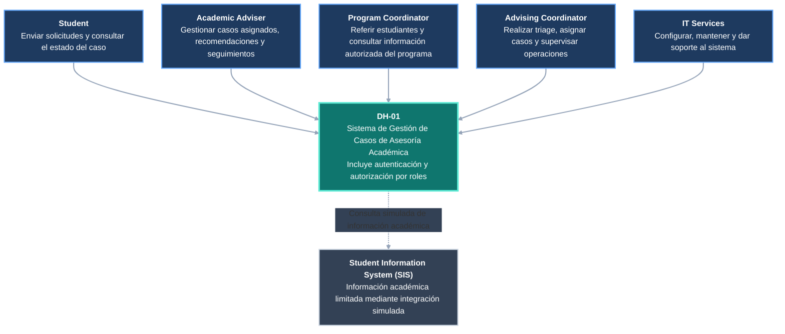

# DH-01 — Vista de Contexto del Sistema

**Proyecto:** Academic Advising Case Management System  
**ID de la vista:** V-CTX  
**Decisión arquitectónica relacionada:** ADR-001 — Arquitectura de Monolito Modular  
**Decisión de seguridad relacionada:** ADR-004 — Autenticación y Autorización Basada en Recursos

## 1. Propósito

La vista de contexto describe las relaciones entre el Academic Advising Case Management System (DH-01), sus usuarios y los sistemas institucionales externos con los que puede interactuar.

Su objetivo es establecer los límites del sistema y mostrar las principales interacciones sin introducir detalles internos de implementación, como módulos, bases de datos o frameworks.

Esta vista permite comprender qué responsabilidades corresponden a DH-01 y cuáles permanecen bajo el control de otros sistemas o actores institucionales.

Para la solución propuesta, DH-01 administrará internamente la autenticación mediante identidades de prueba y aplicará reglas de autorización según los roles y permisos definidos. Por lo tanto, no se considera necesaria una conexión con un proveedor institucional de identidad durante la implementación del prototipo.

## 2. Diagrama de contexto

**Figura V-CTX.** Contexto del Academic Advising Case Management System.

Las relaciones continuas representan las interacciones previstas entre los usuarios y DH-01. La relación punteada identifica la integración simulada con el Student Information System (SIS), cuya conexión con un servicio institucional real no forma parte del alcance actual.

La autenticación se encuentra dentro de los límites del sistema DH-01. Por esta razón, no se representa un proveedor de identidad externo.

## 3. Usuarios y responsabilidades

### 3.1. Student

El Student inicia solicitudes de asesoría académica y consulta el progreso de sus casos.

Sus principales interacciones incluyen:

- Registrar nuevas solicitudes.
- Consultar el estado general de sus casos.
- Proporcionar información adicional cuando sea solicitada.
- Consultar recomendaciones dirigidas al estudiante.
- Revisar la información de seguimiento que esté autorizado a conocer.

No tiene acceso a las notas internas de los asesores.

### 3.2. Academic Adviser

El Academic Adviser es responsable de atender los casos que le han sido asignados.

Sus principales interacciones incluyen:

- Consultar casos asignados.
- Revisar información académica autorizada.
- Registrar notas internas.
- Registrar orientación y recomendaciones.
- Crear y completar actividades de seguimiento.
- Solicitar reasignación cuando corresponda.
- Resolver casos cuando se cumplan las condiciones establecidas.

El acceso a información sensible depende de su relación con cada caso.

### 3.3. Program Coordinator

El Program Coordinator proporciona información relacionada con un programa académico y puede originar referencias autorizadas en nombre de estudiantes.

Sus principales interacciones incluyen:

- Crear referencias autorizadas.
- Proporcionar contexto académico relevante.
- Consultar información de casos vinculados a su programa dentro del alcance permitido.
- Identificar situaciones que requieran intervención del servicio de asesoría.

No dispone automáticamente de acceso a todas las notas internas de los asesores.

### 3.4. Advising Coordinator

El Advising Coordinator supervisa el funcionamiento del servicio de asesoría.

Sus principales interacciones propuestas incluyen:

- Supervisar el triage.
- Clasificar solicitudes o delegar esa actividad a personal autorizado.
- Asignar y reasignar casos.
- Supervisar casos abiertos y retrasados.
- Consultar la distribución de carga de trabajo.
- Revisar información operacional.
- Gestionar situaciones que requieran escalamiento.

Las facultades exactas de delegación, escalamiento y consulta de información sensible permanecerán sujetas a las políticas institucionales aplicables.

### 3.5. IT Services

IT Services participa en los aspectos técnicos y operacionales del sistema.

Sus principales responsabilidades incluyen:

- Administración y soporte de infraestructura.
- Configuración técnica del entorno.
- Mantenimiento del sistema.
- Administración técnica del mecanismo interno de autenticación.
- Gestión de usuarios de prueba y configuración de acceso, según los permisos administrativos definidos.
- Apoyo técnico a la integración simulada con el SIS.
- Revisión de condiciones de seguridad, disponibilidad y recuperación.

La responsabilidad de soporte técnico no implica acceso automático al contenido confidencial de los casos.

## 4. Sistemas externos y autenticación

### 4.1. Autenticación interna de DH-01

La solución propuesta utilizará un mecanismo de autenticación interno, integrado en el backend de DH-01.

Este mecanismo permitirá identificar a los usuarios mediante cuentas de prueba y asignarles los roles correspondientes.

Los usuarios de prueba representarán los distintos perfiles institucionales, sin requerir acceso al sistema real de autenticación de Horizon University.

**Responsabilidades de DH-01:**

- Validar las credenciales de los usuarios de prueba.
- Gestionar las sesiones de usuario mediante un mecanismo seguro.
- Identificar el rol asociado a cada usuario.
- Aplicar controles de autorización sobre las operaciones protegidas.
- Verificar la relación del usuario con los casos a los que solicita acceso.
- Impedir el acceso no autorizado a notas internas e información sensible.

La autenticación y la autorización serán responsabilidades diferentes.

**Autenticación:** verifica la identidad utilizada para ingresar al sistema.

**Autorización:** determina las operaciones y los recursos a los que puede acceder el usuario autenticado.

La utilización de identidades ficticias no elimina la necesidad de implementar controles de seguridad adecuados. Las contraseñas deberán almacenarse mediante algoritmos de hash seguros, y las verificaciones de permisos deberán ejecutarse en el backend.

**Alcance de la decisión:** la conexión con un proveedor institucional real de identidad queda fuera de la implementación propuesta.

Una futura integración institucional podrá considerarse mediante la adaptación del mecanismo de autenticación, procurando conservar las reglas de autorización definidas para los casos.

Esta decisión se encuentra relacionada con ADR-004.

### 4.2. Student Information System (SIS)

El Student Information System (SIS) es el sistema institucional responsable de administrar información académica oficial.

DH-01 no tiene como objetivo reemplazarlo ni modificar registros académicos oficiales.

Cuando se necesite representar información académica durante el desarrollo y las pruebas, podrá utilizarse una integración simulada con datos sintéticos.

Por ejemplo, el simulador podría proporcionar:

- Identificador ficticio de estudiante.
- Programa académico.
- Estado académico general.
- Información contextual mínima necesaria para una solicitud de asesoría.

Los datos proporcionados por esta integración deberán limitarse a la información requerida por los casos de uso.

**Responsabilidad del SIS institucional:** administrar la información académica oficial.

**Responsabilidad de DH-01:** gestionar solicitudes de asesoría, clasificación, asignaciones, seguimiento, historial y resolución de casos.

**Responsabilidad del simulador:** suministrar respuestas de prueba con información académica ficticia, de acuerdo con el contrato de integración definido.

La integración simulada no constituye una conexión real confirmada con la infraestructura académica de Horizon University.

En caso de que el prototipo no requiera consultar datos académicos externos, DH-01 podrá operar con los datos sintéticos mínimos necesarios para demostrar sus funcionalidades principales.

## 5. Límites y propiedad de la información

| Información | Sistema o componente responsable |
|---|---|
| Solicitudes de asesoría | DH-01 |
| Clasificación y estado de casos | DH-01 |
| Asignaciones y reasignaciones | DH-01 |
| Follow-ups y recomendaciones | DH-01 |
| Notas internas de asesoría | DH-01 |
| Historial de acciones relevantes | DH-01 |
| Información operacional de casos | DH-01 |
| Autenticación de usuarios de prueba | Módulo interno de autenticación de DH-01 |
| Roles y permisos de acceso | DH-01 |
| Registros académicos oficiales | SIS institucional |
| Respuestas académicas sintéticas de integración | Simulador del SIS |
| Datos de prueba propios del sistema | Entorno de prueba de DH-01 |

Esta separación permite identificar los límites de responsabilidad de la solución y evita atribuir a DH-01 funciones propias del sistema académico institucional.

El sistema gestionará únicamente la información necesaria para los procesos de asesoría definidos en su alcance.

Los datos académicos empleados en pruebas no serán considerados registros oficiales de la universidad.

## 6. Dependencias y comportamiento ante fallos

### 6.1. Autenticación interna

La autenticación es una función necesaria para proteger el acceso a DH-01.

Si el mecanismo interno de autenticación presenta un fallo, los nuevos inicios de sesión podrán verse afectados.

En ese escenario, el sistema deberá:

- Rechazar las solicitudes que no puedan autenticarse correctamente.
- Evitar conceder permisos cuando no pueda verificarse la identidad.
- No permitir el acceso a recursos protegidos mediante rutas alternativas.
- Registrar los eventos técnicos o de seguridad pertinentes sin exponer credenciales.

Las sesiones existentes deberán validarse de acuerdo con la política de seguridad implementada.

La indisponibilidad de la autenticación no deberá provocar que el sistema permita operaciones sin autorización.

### 6.2. Student Information System (SIS)

La integración simulada con el SIS representa una dependencia secundaria para los escenarios que requieran información académica contextual.

Si el simulador no está disponible, DH-01 deberá manejar la situación sin comprometer la integridad de los casos.

El comportamiento esperado incluye:

- Informar cuando la información académica solicitada no esté disponible.
- Evitar presentar datos ficticios improvisados como si fueran información institucional válida.
- Permitir la continuidad de las operaciones que no dependan de esa consulta.
- Registrar los errores de integración que resulten relevantes.
- No modificar ni sustituir registros académicos oficiales.

El diseño detallado determinará qué operaciones pueden continuar utilizando información local y cuáles requieren una respuesta válida del simulador.

### 6.3. Sistema DH-01

La indisponibilidad del backend o de su base de datos puede impedir temporalmente la consulta y gestión de casos.

La solución deberá considerar mecanismos de manejo de errores, persistencia y recuperación adecuados para el alcance del prototipo.

Los fallos no deberán producir transiciones inválidas de estado, asignaciones inconsistentes ni pérdidas silenciosas de información confirmada.

Los mecanismos de recuperación se documentarán en la vista de despliegue y en los escenarios de validación.

## 7. Relación con los requisitos y decisiones arquitectónicas

| Elemento | Relación |
|---|---|
| FR-01 y FR-02 | Creación de solicitudes por estudiantes y referencias autorizadas. |
| FR-04 y FR-09 | Gestión de asignaciones y reasignaciones. |
| FR-06 y FR-08 | Administración de casos y actividades de seguimiento. |
| FR-12 | Información visible para estudiantes. |
| FR-13 | Supervisión operacional. |
| FR-14 | Acceso controlado. |
| QR-01 y QR-02 | Protección de información sensible. |
| ADR-001 | Definición de la estrategia arquitectónica general mediante un monolito modular. |
| ADR-004 | Autenticación interna y autorización según roles, recursos y relación con los casos. |

La vista de contexto identifica los actores y las dependencias externas relevantes. Las decisiones sobre tecnologías, módulos internos y mecanismos específicos de seguridad se desarrollarán en las vistas y documentos correspondientes.

## 8. Conclusión

La vista de contexto establece a DH-01 como el sistema responsable de administrar el ciclo de vida de las solicitudes de asesoría académica.

Los usuarios interactúan con la solución de acuerdo con responsabilidades diferenciadas y permisos asociados a sus roles.

La autenticación se incorpora dentro de los límites de DH-01 mediante identidades de prueba, evitando depender de un proveedor institucional de identidad al que no se tiene acceso confirmado.

Por su parte, el Student Information System (SIS) permanece como sistema institucional externo. Su interacción con DH-01 se representará, cuando sea necesaria, mediante una integración simulada con datos sintéticos.

Esta delimitación permite desarrollar y validar la solución sin utilizar registros académicos oficiales y proporciona una base coherente para definir los contenedores, componentes internos, interfaces y mecanismos de seguridad en las siguientes vistas arquitectónicas.