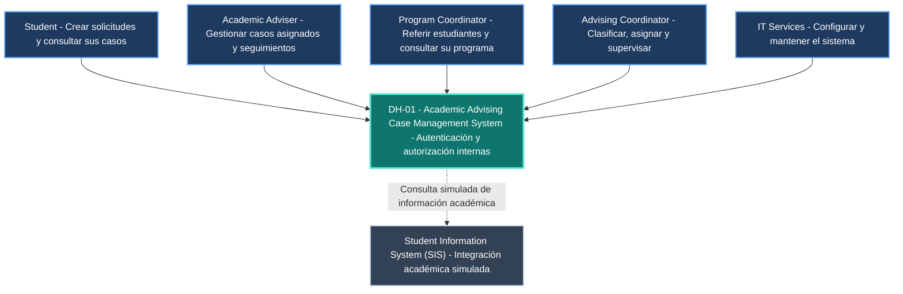

# DH-01 — Vista de Contexto del Sistema

**ID de la vista:** V-CTX     
**Decisiones arquitectónicas relacionadas:** ADR-001 — Modular Monolith Architecture; ADR-004 — Authentication and Resource-Based Authorization

## 1. Propósito

La vista de contexto describe las relaciones entre el Academic Advising Case Management System (DH-01), sus usuarios y los sistemas institucionales externos con los que interactúa.

Su objetivo es establecer los límites del sistema y mostrar las principales interacciones sin introducir detalles internos de implementación, como módulos, bases de datos o frameworks.

Esta vista permite comprender qué responsabilidades corresponden a DH-01 y cuáles permanecen bajo el control de otros sistemas o actores institucionales.

DH-01 será responsable de administrar el ciclo de vida de las solicitudes de asesoría académica, incluyendo creación, clasificación, asignación, seguimiento, reasignación y resolución.

La autenticación de los usuarios de prueba se encontrará dentro de los límites de DH-01. La autorización tendrá en cuenta los roles institucionales, la relación de cada usuario con los recursos solicitados y la sensibilidad de la información.

El Student Information System (SIS) permanecerá fuera de los límites de DH-01. Su integración se representará mediante un servicio simulado con datos sintéticos.

## 2. Diagrama de contexto

**Figura V-CTX.** Contexto del Academic Advising Case Management System.

Las relaciones continuas representan las interacciones previstas entre los usuarios y DH-01. La relación punteada representa la integración simulada con el Student Information System (SIS), cuya conexión con un servicio institucional real no forma parte del alcance actual.

La autenticación forma parte de los límites del sistema. Por esta razón, no se representa un proveedor externo de identidad.

El diagrama mantiene una perspectiva de contexto: los detalles de C-WEB, C-API, C-DB y X-SIS se desarrollan en las vistas de contenedores y componentes.

## 3. Usuarios y responsabilidades

### 3.1. Student

El Student inicia solicitudes de asesoría académica y consulta el progreso de sus propios casos.

Sus principales interacciones incluyen:

- Registrar nuevas solicitudes.
- Consultar el estado general de sus casos.
- Proporcionar información adicional cuando sea solicitada.
- Consultar recomendaciones dirigidas al estudiante.
- Revisar la información de seguimiento que esté autorizado a conocer.

El Student no tendrá acceso a las notas internas de los asesores ni a la información de otros estudiantes.

### 3.2. Academic Adviser

El Academic Adviser es responsable de atender los casos que le han sido asignados.

Sus principales interacciones incluyen:

- Consultar casos asignados.
- Revisar información académica autorizada.
- Registrar notas internas.
- Registrar orientación y recomendaciones.
- Crear y completar actividades de seguimiento.
- Solicitar reasignaciones cuando corresponda.
- Resolver casos cuando se cumplan las condiciones establecidas.

El acceso a información sensible dependerá de sus permisos y de su relación vigente con el caso.

### 3.3. Program Coordinator

El Program Coordinator proporciona información relacionada con un programa académico y puede originar referencias autorizadas en nombre de estudiantes.

Sus principales interacciones incluyen:

- Crear referencias autorizadas.
- Proporcionar contexto académico relevante.
- Consultar información de casos vinculados a su programa dentro del alcance permitido.
- Identificar situaciones que requieran intervención del servicio de asesoría.

Este rol no concede acceso automático a todas las notas internas ni a la información confidencial de los asesores.

### 3.4. Advising Coordinator

El Advising Coordinator supervisa el funcionamiento del servicio de asesoría.

Sus principales interacciones propuestas incluyen:

- Supervisar el proceso de triage.
- Clasificar solicitudes o coordinar su clasificación.
- Asignar y reasignar casos.
- Supervisar casos abiertos y retrasados.
- Consultar la distribución de carga de trabajo.
- Revisar información operacional.
- Gestionar situaciones que requieran escalamiento.

Las facultades específicas de delegación, escalamiento y acceso a información sensible estarán sujetas a las políticas institucionales aplicables.

### 3.5. IT Services

IT Services participa en los aspectos técnicos y operacionales del sistema.

Sus principales responsabilidades incluyen:

- Administración y soporte de infraestructura.
- Configuración técnica de los entornos.
- Mantenimiento del sistema.
- Administración técnica del mecanismo interno de autenticación.
- Gestión autorizada de usuarios de prueba y configuraciones de acceso.
- Apoyo técnico a la integración simulada con el SIS.
- Revisión de condiciones de seguridad, disponibilidad y recuperación.

Las funciones técnicas no implican acceso automático al contenido confidencial de los casos.

## 4. Sistemas externos y autenticación

### 4.1. Autenticación interna de DH-01

La solución utilizará un mecanismo de autenticación interno integrado en el backend.

Conforme a ADR-004, se propone utilizar sesiones opacas administradas por el servidor, vinculadas a usuarios ficticios que representan los roles institucionales.

Las sesiones se administrarán mediante una tabla técnica `SESSION` en PostgreSQL, almacenando un resumen del identificador de sesión en lugar del token original.

Las responsabilidades de DH-01 incluyen:

- Verificar credenciales mediante mecanismos seguros.
- Gestionar sesiones, expiración y revocación.
- Identificar de manera confiable al usuario autenticado.
- Asociar al usuario con sus roles y ámbitos autorizados.
- Aplicar controles de autorización sobre las operaciones protegidas.
- Verificar la relación del usuario con los casos.
- Proteger notas internas y otros recursos sensibles.
- Aplicar protección CSRF cuando corresponda.

La autenticación y la autorización se consideran responsabilidades diferentes.

**Autenticación:** verifica la identidad del usuario que intenta ingresar al sistema.

**Autorización:** determina las operaciones y los recursos a los que puede acceder el usuario autenticado.

Las cuentas utilizadas en el entorno de desarrollo y validación serán ficticias y no representarán credenciales institucionales reales.

La conexión con un proveedor institucional real de identidad queda fuera del alcance actual.

Una futura integración institucional podrá evaluarse mediante la adaptación del mecanismo de autenticación, procurando conservar las reglas de autorización basadas en recursos.

### 4.2. Student Information System (SIS)

El Student Information System (SIS) es el sistema institucional responsable de administrar información académica oficial.

DH-01 no tiene como objetivo reemplazarlo ni modificar sus registros.

La integración propuesta se representará mediante un servicio HTTP simulado con datos sintéticos.

El simulador podrá proporcionar información como:

- Identificador ficticio de estudiante.
- Programa académico.
- Estado académico general.
- Información contextual mínima necesaria para una solicitud de asesoría.

Los datos proporcionados deberán limitarse a la información necesaria para los escenarios de negocio.

**Responsabilidad del SIS institucional:** administrar la información académica oficial.

**Responsabilidad de DH-01:** gestionar solicitudes de asesoría, clasificación, asignaciones, seguimiento, historial y resolución de casos.

**Responsabilidad del simulador:** proporcionar respuestas de prueba con información académica ficticia conforme al contrato de integración.

La integración simulada no constituye una conexión real con la infraestructura académica de Horizon University.

## 5. Límites y propiedad de la información

| Información | Sistema responsable |
|---|---|
| Solicitudes de asesoría | DH-01 |
| Clasificación y estados de casos | DH-01 |
| Asignaciones y reasignaciones | DH-01 |
| Actividades de seguimiento y recomendaciones | DH-01 |
| Notas internas de asesoría | DH-01 |
| Historial de eventos de negocio | DH-01 |
| Información operacional de casos | DH-01 |
| Autenticación y sesiones de usuarios de prueba | DH-01 |
| Roles y permisos de acceso | DH-01 |
| Registros académicos oficiales | SIS institucional |
| Respuestas académicas sintéticas de integración | Simulador SIS |
| Datos de prueba propios del sistema | Entorno de prueba de DH-01 |

Esta separación permite identificar los límites de responsabilidad de cada sistema y evita atribuir a DH-01 funciones propias del sistema académico institucional.

DH-01 gestionará únicamente la información necesaria para los procesos de asesoría definidos en su alcance.

Los datos académicos empleados durante las pruebas no se considerarán registros oficiales de Horizon University.

## 6. Dependencias y comportamiento ante fallos

### 6.1. Autenticación interna

La autenticación es necesaria para proteger el acceso al sistema.

Si el mecanismo interno de autenticación o validación de sesiones presenta un fallo, DH-01 deberá:

- Rechazar las solicitudes que no puedan autenticarse correctamente.
- Evitar conceder permisos cuando no pueda verificarse la identidad.
- Impedir el acceso a recursos protegidos mediante rutas alternativas.
- Registrar los eventos técnicos o de seguridad pertinentes sin exponer credenciales.
- Mantener las verificaciones de autorización para toda operación protegida.

La indisponibilidad de la autenticación no deberá provocar que el sistema permita operaciones sin autorización.

### 6.2. Student Information System (SIS)

La integración simulada con el SIS representa una dependencia secundaria para los escenarios que requieren información académica contextual.

Si el simulador no está disponible, DH-01 deberá:

- Informar cuando la información académica solicitada no esté disponible.
- Evitar presentar datos inexistentes como si fueran información institucional válida.
- Permitir las operaciones que no dependan de esa consulta.
- Registrar los errores de integración relevantes.
- Mantener la integridad de los casos existentes.
- No modificar ni sustituir registros académicos oficiales.

El comportamiento de las operaciones dependientes del SIS estará determinado por los contratos de integración y las reglas de negocio correspondientes.

### 6.3. Sistema DH-01

La indisponibilidad de C-API o PostgreSQL puede impedir temporalmente la consulta y gestión de casos.

La arquitectura contempla mecanismos de persistencia y coordinación transaccional para evitar modificaciones parciales o inconsistentes.

Las operaciones confirmadas deberán conservar sus datos y eventos obligatorios de auditoría.

Los mecanismos de recuperación y sus supuestos se describen en la vista de despliegue y el plan de validación.

## 7. Relación con los requisitos y decisiones arquitectónicas

| Elemento | Relación |
|---|---|
| FR-01 y FR-02 | Creación de solicitudes y referencias autorizadas. |
| FR-04 y FR-09 | Asignación y reasignación de casos. |
| FR-06 y FR-08 | Gestión de casos y actividades de seguimiento. |
| FR-12 | Información visible para estudiantes. |
| FR-13 | Supervisión operacional. |
| FR-14 | Acceso controlado a recursos. |
| QR-01 y QR-02 | Protección de información sensible y seguridad. |
| ADR-001 | Arquitectura general mediante monolito modular. |
| ADR-004 | Autenticación interna y autorización basada en roles, recursos y contexto. |

**Vistas complementarias:**

- [Container View](container-view.md)
- [Component View](component-view.md)
- [Deployment View](deployment-view.md)

**Documentos relacionados:**

- [ADR-001 — Modular Monolith Architecture](../adr/ADR-001.md)
- [ADR-004 — Authentication and Resource-Based Authorization](../adr/ADR-004.md)
- [Security Design](../design/security.md)
- [API Contracts](../design/interfaces.md)
- [Matriz de Trazabilidad](../traceability.md)

La vista de contexto identifica los actores, las principales relaciones y las dependencias externas relevantes. Las tecnologías, los componentes internos y los mecanismos detallados se desarrollan en los documentos arquitectónicos correspondientes.

## 8. Conclusión

La vista de contexto establece a DH-01 como el sistema responsable de administrar el ciclo de vida de las solicitudes de asesoría académica.

Los cinco actores institucionales interactúan con la solución mediante funciones y permisos diferenciados.

La autenticación se incorpora dentro de los límites de DH-01 mediante identidades ficticias y sesiones administradas por el servidor, mientras que la autorización protege los recursos según el rol, la relación con el caso y la sensibilidad de la información.

El Student Information System (SIS) permanece como sistema institucional externo, representado mediante una integración simulada con datos sintéticos.

Esta delimitación establece una base coherente para definir los contenedores, componentes internos, interfaces y mecanismos de seguridad en las demás vistas arquitectónicas.